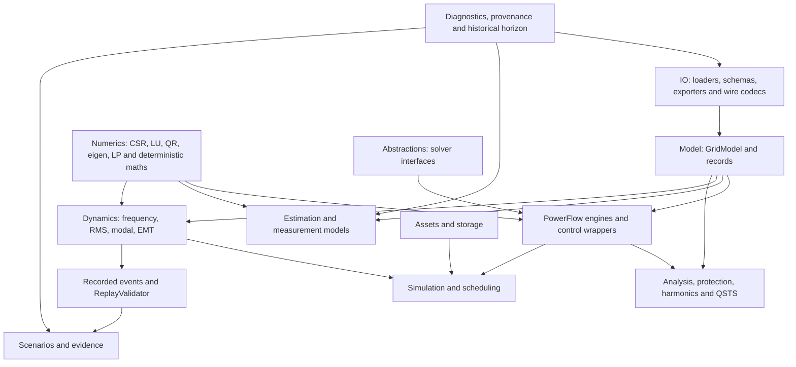
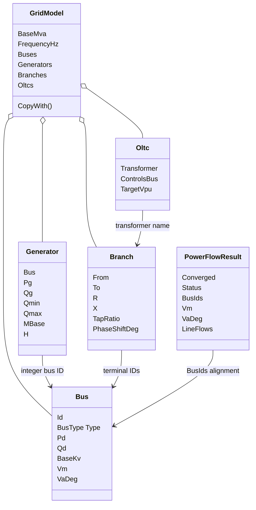
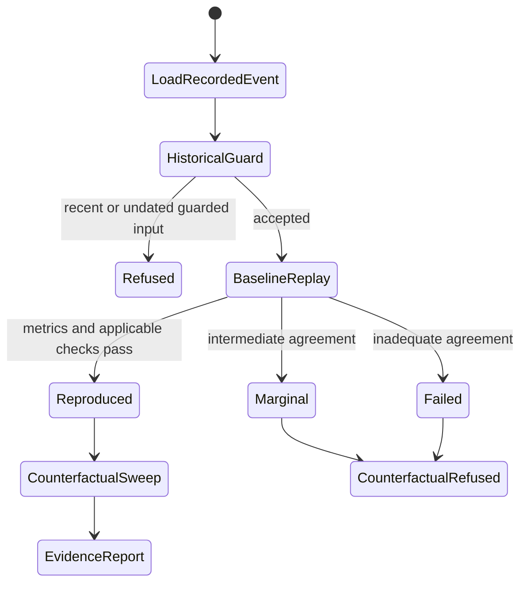
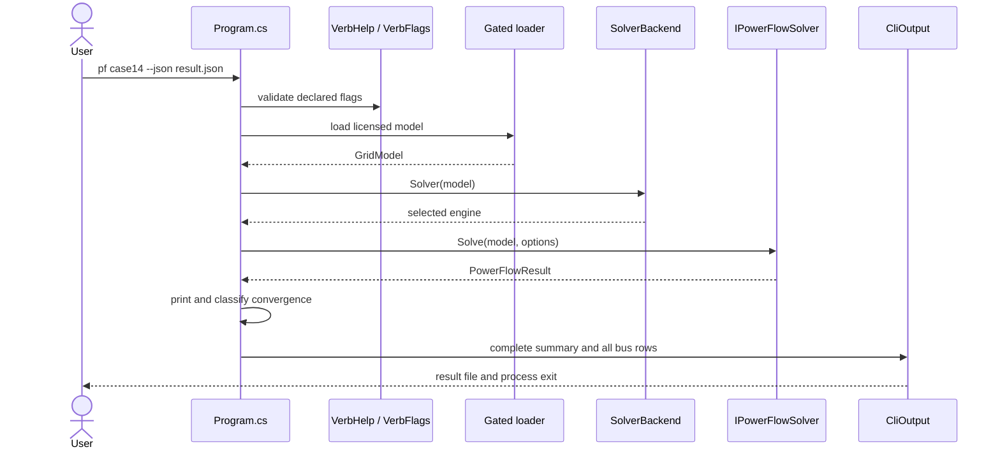
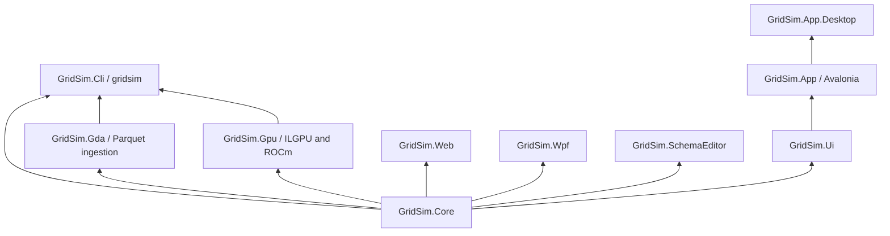
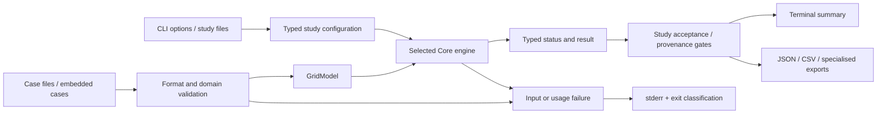
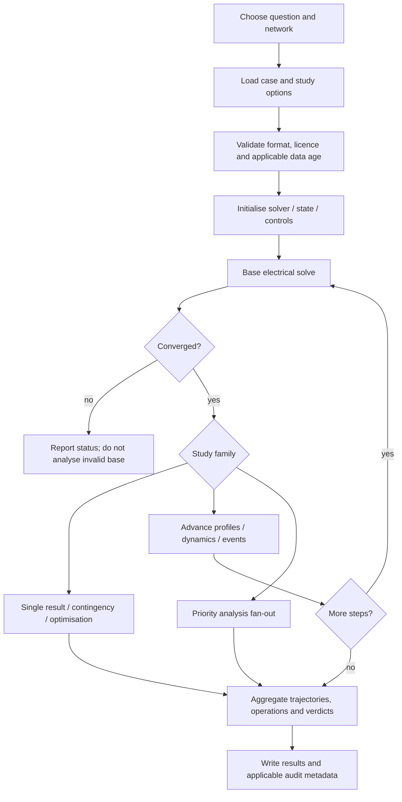

# GridSim: Comprehensive Technical, Architectural and Commercial Report

> **Archived assessment, not maintained.** This report describes GridSim 2.1.030 as inspected on 7 November 2026 and is
> kept as a record. Where it differs from the [project README](../../README.md), the README is current. Nothing in GridSim
> is validated, at any scale, and no buyer-facing framing here is current. For licensing, [LICENSE.md](../../LICENSE.md)
> governs, not this report.

**Primary subjects:** `GridSim.Core` and `GridSim.Cli`  
**Investigation date:** 7 November 2026  
**Repository:** [MarkS0485/GridSim](https://github.com/MarkS0485/GridSim)  
**Branch:** `main`  
**Reference commit:** `b0ff2fc47f46df9cc5724f5b336c858651fa9527`  
**Source version:** `2.1.030`, from `Directory.Build.props`.

Companion documents: [Technical reference](GRIDSIM_TECHNICAL_REFERENCE.md)  |  [Executive overview](GRIDSIM_EXECUTIVE_OVERVIEW.md).

## Contents

1. [Scope, evidence and verification](#1-scope-evidence-and-verification)
2. [Part I - Executive and product overview](#2-part-i---executive-and-product-overview)
3. [Part II - Core technical deep dive](#3-part-ii---core-technical-deep-dive)
4. [Part III - CLI architecture and user guide](#4-part-iii---cli-architecture-and-user-guide)
5. [Part IV - Complete system architecture](#5-part-iv---complete-system-architecture)
6. [Part V - Capabilities and applications](#6-part-v---capabilities-and-applications)
7. [Part VI - Commercial and product positioning](#7-part-vi---commercial-and-product-positioning)
8. [Part VII - Engineering assessment](#8-part-vii---engineering-assessment)
9. [Part VIII - Testing, validation and reliability](#9-part-viii---testing-validation-and-reliability)
10. [Part IX - Installation, development and deployment](#10-part-ix---installation-development-and-deployment)
11. [Part X - Supporting projects and ecosystem](#11-part-x---supporting-projects-and-ecosystem)
12. [Part XI - Limitations and prioritised opportunities](#12-part-xi---limitations-and-prioritised-opportunities)
13. [Part XII - Final assessment](#13-part-xii---final-assessment)
14. [Source guide](#14-source-guide)

## 1. Scope, evidence and verification

### 1.1 Identity and scope

This report concerns Mark Shirley's C#/.NET electrical power-system simulator. It does not concern the unrelated GridSim Java grid-computing toolkit. The solution uses the case-sensitive project names `GridSim.Core` and `GridSim.Cli`; the executable assembly is named `gridsim`. The primary source corpus comprises **563 C# files and 152,958 lines** across those two projects, excluding `bin` and `obj`, at the time of inventory. The technical reference provides a file-by-file declaration catalogue, command documentation and handler links. These inventory counts describe the inspected working tree, not a published release manifest.

The investigation combined project and dependency inspection, a complete primary-source file inventory and declaration scan, implementation tracing through representative execution paths, searches for unsupported paths and explicit refusals, examination of tests and workflows, and practical build/CLI/test attempts. This is a documentation and engineering assessment, not a formal proof, certification, penetration test or independently replicated field-validation programme. The catalogue is deliberately broader than the manually traced execution paths; inclusion in the catalogue does not imply execution of that API.

### 1.2 Working-tree qualification

The checkout was **not pristine before this task**. `git status --short --ignore-submodules` showed existing modifications to:

- `src/GridSim.Core/Protection/FaultAnalysis.cs`;
- `src/GridSim.Core/Protection/ShortCircuit/Iec60909.cs`;
- untracked `tests/GridSim.Tests/Gr144EarthFaultUnrepresentableZeroSequenceTests.cs`.

Those changes were preserved. Fault and short-circuit observations consequently describe the local implementation where it differs from the reference commit; a commit-pinned link cannot contain those uncommitted changes. No application source, tests, dependencies or configuration were intentionally edited for this report. Normal builds may update ignored build outputs.

Ordinary `git status` and the CLI's `git describe --dirty` build stamp encountered denied access to the `docs/Public/GB` submodule metadata. The branch and HEAD were obtainable independently. This is a verification-environment limitation, not evidence that the numerical code fails.

### 1.3 Evidence vocabulary

| Label | Meaning in this report |
|---|---|
| **Executed** | A command or test was run in this investigation; the verification ledger identifies its artefact and outcome. |
| **Implemented; not executed** | Source contains a concrete implementation, but this investigation did not establish its runtime outcome. This is the default for feature tables unless an execution is specifically recorded. |
| **Partial / bounded** | A working capability has explicit restrictions or a related mode is refused. |
| **Documented** | An existing manual or capture makes a claim; it is attributed and is not promoted to new measurement. |
| **Interpretation** | An architectural, performance or commercial assessment derived from implementation. |
| **Proposed** | A recommendation or possible application, not a shipped feature. |

A test's presence is evidence of intended coverage. Passing a synthetic regression is different from validating a national network or a measured disturbance. Similarly, deterministic numerical results can be reproducibly wrong if the model or data is wrong. The report maintains those distinctions throughout.

### 1.4 Verification ledger

The execution ledger is recorded in [technical reference ?2](GRIDSIM_TECHNICAL_REFERENCE.md#2-verification-ledger). Build failures, skipped or stale artefacts and successful checks must be read together. In particular, the initially available CLI reported `2.1.002+a14368fb6b55259c017a67e8130777174ad182bb`, whereas the source declares `2.1.030`; its initial `--help` output establishes only that the older binary ran. The rebuilt CLI subsequently reported the current revision, converged on case14, passed its physical-law audit, ran a case9 frequency trip, rendered current per-verb help, rejected a wrong-verb flag and wrote a 14-bus JSON result. No headline speed, national-scale capacity, GPU equivalence or coverage percentage was measured for this report.

## 2. Part I - Executive and product overview

### 2.1 Executive summary

GridSim brings network modelling, numerical power-system studies and evidence handling into a reusable .NET library and a scriptable console application. Its most immediately useful product is a coherent path from a network case to solved voltages, branch flows, losses, contingency assessments and structured study results. Around that foundation it implements frequency response, multiple state-estimation methods, dynamic-machine studies, harmonics, short-circuit duties, optimisation, battery models and quasi-static time-series studies.

`GridSim.Core` contains domain models, algorithms, import/export and study orchestration. `GridSim.Cli` supplies user-facing commands, argument validation, licence-aware model loading, compute-backend selection, result paths, console presentation and process exit behaviour. A developer can embed Core; an analyst can invoke the CLI without writing a .NET host. The CLI also references the GDA ingestion and GPU projects, keeping those external dependencies away from Core's primary numerical model. [Core project](https://github.com/MarkS0485/GridSim/blob/b0ff2fc47f46df9cc5724f5b336c858651fa9527/src/GridSim.Core/GridSim.Core.csproj), [CLI project](https://github.com/MarkS0485/GridSim/blob/b0ff2fc47f46df9cc5724f5b336c858651fa9527/src/GridSim.Cli/GridSim.Cli.csproj), [entry point](https://github.com/MarkS0485/GridSim/blob/b0ff2fc47f46df9cc5724f5b336c858651fa9527/src/GridSim.Cli/Program.cs).

The strongest product narrative is **inspectable, repeatable electrical-network experimentation with explicit evidence boundaries**. The implementation offers convergence statuses, provenance tags, a historical-data guard, baseline reproduction gates and audit records. These are meaningful engineering controls. They do not establish regulatory approval or universal physical fidelity, and the current product must be evaluated by study family rather than assigned one blanket readiness label. [Convergence contract](https://github.com/MarkS0485/GridSim/blob/b0ff2fc47f46df9cc5724f5b336c858651fa9527/src/GridSim.Core/PowerFlow/ConvergenceContract.cs), [provenance](https://github.com/MarkS0485/GridSim/blob/b0ff2fc47f46df9cc5724f5b336c858651fa9527/src/GridSim.Core/Diagnostics/Provenance.cs), [replay validation](https://github.com/MarkS0485/GridSim/blob/b0ff2fc47f46df9cc5724f5b336c858651fa9527/src/GridSim.Core/Replay/ReplayValidator.cs).

### 2.2 Vision, intended users and engineering objectives

The code addresses several recurring problems in power-system work: turning heterogeneous case files into one model; running related studies consistently; separating a failed solve from a valid result; comparing experimental scenarios; exposing results to scripts and displays; and retaining the provenance of an engineering claim. The common `GridModel`, solver interfaces, shared Newton kernel, versioned file formats and result writer all support that interpretation.

The repository also makes a deliberate scope choice: dated external inputs are generally treated as historical evidence, with a **169-hour minimum lag** at guarded ingestion boundaries. Synthetic simulations and hypothetical parameter studies still exist, but they must not be marketed as forecasts or current operational estimates of the real grid. The name `serve`, a live transport or a low-latency scheduler does not remove this restriction. [ForwardInferenceGuard](https://github.com/MarkS0485/GridSim/blob/b0ff2fc47f46df9cc5724f5b336c858651fa9527/src/GridSim.Core/Diagnostics/ForwardInferenceGuard.cs), [real-time estimator](https://github.com/MarkS0485/GridSim/blob/b0ff2fc47f46df9cc5724f5b336c858651fa9527/src/GridSim.Core/Simulation/RealtimeEstimatorEngine.cs).

Plausible audiences are power-system developers, research and teaching teams, engineering analysts, software integrators and organisations assessing historical grid studies. Commercial users and network operators must also assess the proprietary licence and data rights. Intended benefits follow from code; actual adoption, customer numbers and revenue are not established by this investigation.

### 2.3 Capabilities at a glance

All entries below are **implemented; not executed comprehensively**. Specific successful runtime checks are listed separately in the verification ledger.

| Capability | Project / implementation | Access | Practical value and status boundary |
|---|---|---|---|
| AC power flow | Core [Newton engines](https://github.com/MarkS0485/GridSim/blob/b0ff2fc47f46df9cc5724f5b336c858651fa9527/src/GridSim.Core/PowerFlow/SparseNewtonRaphsonPowerFlow.cs) | `pf`, case run, API | Bus voltage, angle, injection and branch-flow calculations; convergence must be checked. |
| Radial feeder solve | Core [BackwardForwardSweep](https://github.com/MarkS0485/GridSim/blob/b0ff2fc47f46df9cc5724f5b336c858651fa9527/src/GridSim.Core/PowerFlow/BackwardForwardSweep.cs) | Auto routing, `--bfs` where accepted | A network-appropriate alternative; convergence uses voltage updates rather than the Newton mismatch alone. |
| Reactive limits and taps | Core [NewtonShell](https://github.com/MarkS0485/GridSim/blob/b0ff2fc47f46df9cc5724f5b336c858651fa9527/src/GridSim.Core/PowerFlow/NewtonShell.cs), [SteadyStateSolver](https://github.com/MarkS0485/GridSim/blob/b0ff2fc47f46df9cc5724f5b336c858651fa9527/src/GridSim.Core/PowerFlow/SteadyStateSolver.cs) | Steady-state wrapper and case workflow | PV/PQ switching and bounded tap regulation; tap settlement is a separate outcome. |
| DC links and controlled devices | Core [HvdcCoupling](https://github.com/MarkS0485/GridSim/blob/b0ff2fc47f46df9cc5724f5b336c858651fa9527/src/GridSim.Core/PowerFlow/HvdcCoupling.cs) | Models carrying supported devices | AC/DC alternation for supported LCC/VSC/MTDC, FACTS/SVC and induction representations; unsupported control sharing is refused. |
| Contingency analysis | Core [ContingencyAnalysis](https://github.com/MarkS0485/GridSim/blob/b0ff2fc47f46df9cc5724f5b336c858651fa9527/src/GridSim.Core/Analysis/ContingencyAnalysis.cs) | `nminus1`, `nminus2`, `n-1-1`, sweep | Screening and ranking outages; selected candidate sets are not exhaustive security proofs. |
| DC sensitivities | Core [DistributionFactors](https://github.com/MarkS0485/GridSim/blob/b0ff2fc47f46df9cc5724f5b336c858651fa9527/src/GridSim.Core/Analysis/DistributionFactors.cs) | `ptdf`, `lodf`, `dcpf` | Explain redistribution under a DC approximation. |
| Economic dispatch | Core [DC OPF](https://github.com/MarkS0485/GridSim/blob/b0ff2fc47f46df9cc5724f5b336c858651fa9527/src/GridSim.Core/Analysis/DcOptimalPowerFlow.cs), [costed OPF](https://github.com/MarkS0485/GridSim/blob/b0ff2fc47f46df9cc5724f5b336c858651fa9527/src/GridSim.Core/Analysis/DcOpfCosted.cs) | `dcopf`, `--costs`, `--prices` | Optimisation against the model's costs and constraints; does not supply market bids or forecasts. |
| AC optimisation | Core [loss-loop OPF](https://github.com/MarkS0485/GridSim/blob/b0ff2fc47f46df9cc5724f5b336c858651fa9527/src/GridSim.Core/Analysis/AcOptimalPowerFlow.cs), [interior point](https://github.com/MarkS0485/GridSim/blob/b0ff2fc47f46df9cc5724f5b336c858651fa9527/src/GridSim.Core/Analysis/AcOpfInteriorPoint.cs) | `acopf`, `acopf-full` | Two materially different algorithms; only the latter is full AC OPF. |
| Commitment and security dispatch | Core [UnitCommitment](https://github.com/MarkS0485/GridSim/blob/b0ff2fc47f46df9cc5724f5b336c858651fa9527/src/GridSim.Core/Analysis/UnitCommitment.cs), [DcScopf](https://github.com/MarkS0485/GridSim/blob/b0ff2fc47f46df9cc5724f5b336c858651fa9527/src/GridSim.Core/Analysis/DcScopf.cs) | `scuc`, `scopf` | Period schedules and contingency-constrained dispatch within stated mathematical approximations and search caps. |
| Time series and hosting | Core [QstsEngine](https://github.com/MarkS0485/GridSim/blob/b0ff2fc47f46df9cc5724f5b336c858651fa9527/src/GridSim.Core/Qsts/QstsEngine.cs), [HostingCapacity](https://github.com/MarkS0485/GridSim/blob/b0ff2fc47f46df9cc5724f5b336c858651fa9527/src/GridSim.Core/Qsts/HostingCapacity.cs) | `qsts`, `hosting` | Profile-driven voltage/loading exposure and resource-capacity searches. |
| Frequency response | Core [FrequencyDynamics](https://github.com/MarkS0485/GridSim/blob/b0ff2fc47f46df9cc5724f5b336c858651fa9527/src/GridSim.Core/Dynamics/FrequencyDynamics.cs) | `trip`, `screen`, `transient`, API | RoCoF, nadir and finite-window response; default response constants are not case-specific measurements. |
| Spatial and machine dynamics | Core [distributed swing](https://github.com/MarkS0485/GridSim/blob/b0ff2fc47f46df9cc5724f5b336c858651fa9527/src/GridSim.Core/Dynamics/Distributed/MultiDomainSwing.cs), [RMS studies](https://github.com/MarkS0485/GridSim/blob/b0ff2fc47f46df9cc5724f5b336c858651fa9527/src/GridSim.Core/Dynamics/Models/RmsTransientStability.cs) | `domains`, `stability`, `inertia-placement` | Distinct reduced-domain and machine-level models; spatial-scale validation remains bounded. |
| Standard renewable models | Core [WECC model sources](https://github.com/MarkS0485/GridSim/blob/b0ff2fc47f46df9cc5724f5b336c858651fa9527/src/GridSim.Core/Dynamics/Models/Wecc/WeccConverterState.cs) | Authored dynamics and RMS workflows | Explicit renewable-control families; presence of a named model does not certify vendor equivalence. |
| Modal and impedance analysis | Core [ModalAnalysis](https://github.com/MarkS0485/GridSim/blob/b0ff2fc47f46df9cc5724f5b336c858651fa9527/src/GridSim.Core/Dynamics/SmallSignal/ModalAnalysis.cs), [scan](https://github.com/MarkS0485/GridSim/blob/b0ff2fc47f46df9cc5724f5b336c858651fa9527/src/GridSim.Core/Dynamics/Impedance/ImpedanceStabilityScan.cs) | `modal`, `impedance-stability` | Linear and frequency-domain stability indicators for configured operating points. |
| EMT | Core [EmtEngine](https://github.com/MarkS0485/GridSim/blob/b0ff2fc47f46df9cc5724f5b336c858651fa9527/src/GridSim.Core/Dynamics/Emt/EmtEngine.cs) | `emt`, API | Companion-model time stepping, switches and line delays; model conversion limits matter. |
| State estimation | Core [WlsStateEstimator](https://github.com/MarkS0485/GridSim/blob/b0ff2fc47f46df9cc5724f5b336c858651fa9527/src/GridSim.Core/Estimation/WlsStateEstimator.cs) | `estimate` | WLS, robust, QR and constrained methods, observability and residual diagnostics; some backends have dense size limits. |
| PMU and dynamic estimation | Core [linear PMU estimator](https://github.com/MarkS0485/GridSim/blob/b0ff2fc47f46df9cc5724f5b336c858651fa9527/src/GridSim.Core/Estimation/LinearPmuStateEstimator.cs), [DSE engine](https://github.com/MarkS0485/GridSim/blob/b0ff2fc47f46df9cc5724f5b336c858651fa9527/src/GridSim.Core/Simulation/RealtimeDseEngine.cs) | `pmu-estimate`, `serve`, APIs | Phasor and recursive estimation; guarded data age and supported measurement combinations still apply. |
| Unbalanced distribution | Core [ThreePhaseSweep](https://github.com/MarkS0485/GridSim/blob/b0ff2fc47f46df9cc5724f5b336c858651fa9527/src/GridSim.Core/Distribution/ThreePhaseSweep.cs) | `dist3ph` modes | Per-phase feeder studies, faults, estimation and harmonics; explicitly experimental CLI family. |
| Harmonics | Core [penetration](https://github.com/MarkS0485/GridSim/blob/b0ff2fc47f46df9cc5724f5b336c858651fa9527/src/GridSim.Core/Harmonics/HarmonicPenetration.cs), [frequency-dependent Y](https://github.com/MarkS0485/GridSim/blob/b0ff2fc47f46df9cc5724f5b336c858651fa9527/src/GridSim.Core/Harmonics/FrequencyDependentYBus.cs) | `harmonics`, API | Harmonic propagation, indices and impedance scans; source spectra are inputs, not discovered emissions. |
| Fault duty and protection | Core [FaultAnalysis](../../src/GridSim.Core/Protection/FaultAnalysis.cs), [IEC60909](../../src/GridSim.Core/Protection/ShortCircuit/Iec60909.cs), [relay assessment](https://github.com/MarkS0485/GridSim/blob/b0ff2fc47f46df9cc5724f5b336c858651fa9527/src/GridSim.Core/Protection/ProtectionAssessment.cs) | `fault`, `iec60909`, `protection-check`, `grade` | Sequence faults, equipment-duty estimates and passive relay overlays; input grounding/sequence data controls credibility. |
| Battery and asset response | Core [Storage](https://github.com/MarkS0485/GridSim/blob/b0ff2fc47f46df9cc5724f5b336c858651fa9527/src/GridSim.Core/Storage/PackModel.cs), [asset fleet](https://github.com/MarkS0485/GridSim/blob/b0ff2fc47f46df9cc5724f5b336c858651fa9527/src/GridSim.Core/Assets/AssetDynamicsFleet.cs) | `chain --bess`, live/API and authored classes | Stateful chemistry, power limits, response and thermal behaviour; parameter quality remains material. |
| Recorded-event evidence | Core [ReplayValidator](https://github.com/MarkS0485/GridSim/blob/b0ff2fc47f46df9cc5724f5b336c858651fa9527/src/GridSim.Core/Replay/ReplayValidator.cs), [ScenarioEngine](https://github.com/MarkS0485/GridSim/blob/b0ff2fc47f46df9cc5724f5b336c858651fa9527/src/GridSim.Core/Scenarios/ScenarioEngine.cs), [EvidenceReport](https://github.com/MarkS0485/GridSim/blob/b0ff2fc47f46df9cc5724f5b336c858651fa9527/src/GridSim.Core/Evidence/EvidenceReport.cs) | `replay-event`, `scenario`, `h0-study`, `fleet`, `evidence` | Counterfactuals gated on a reproduced baseline; a failed baseline is an informative refusal. |
| Physical-law checks | Core [PhysicsLaws](https://github.com/MarkS0485/GridSim/blob/b0ff2fc47f46df9cc5724f5b336c858651fa9527/src/GridSim.Core/Physics/PhysicsLaws.cs) | `physics-check`, `conformance` | Additional consistency evidence; not external calibration. |
| File interchange and editing | Core [IO](https://github.com/MarkS0485/GridSim/blob/b0ff2fc47f46df9cc5724f5b336c858651fa9527/src/GridSim.Core/IO/Json/V2CaseLoader.cs) | `convert`, `validate`, API, editor | Versioned JSON, MATPOWER, supported PSS/E/UCTE/CIM paths; unsupported equipment and export loss are bounded. |
| Protocol and telemetry | Core [interposer](https://github.com/MarkS0485/GridSim/blob/b0ff2fc47f46df9cc5724f5b336c858651fa9527/src/GridSim.Core/Interpose/InterposePipeline.cs), CLI [transport](https://github.com/MarkS0485/GridSim/blob/b0ff2fc47f46df9cc5724f5b336c858651fa9527/src/GridSim.Cli/InterposeTransport.cs) | `interpose`, `pmu-ingest` | Decode/map/quarantine/correct supported data; a frame codec is not a complete protocol stack. |
| Automation and audit | CLI [result writer](https://github.com/MarkS0485/GridSim/blob/b0ff2fc47f46df9cc5724f5b336c858651fa9527/src/GridSim.Cli/CliResultWriter.cs), Core [audit recorder](https://github.com/MarkS0485/GridSim/blob/b0ff2fc47f46df9cc5724f5b336c858651fa9527/src/GridSim.Core/Diagnostics/AuditRunRecorder.cs) | Result flags, supported audit verbs | Structured output, exit codes, chained records and optional signatures. |
| Compute selection | CLI [SolverBackend](https://github.com/MarkS0485/GridSim/blob/b0ff2fc47f46df9cc5724f5b336c858651fa9527/src/GridSim.Cli/SolverBackend.cs), Gpu | `--cpu`, `--gpu[=vendor]`, probes | CPU by default; unavailable GPU requests fall back visibly; GPU rounding is outside CPU bit identity. |

### 2.4 Value proposition and audience fit

For developers, Core turns numerical studies into callable services with typed models and results. For analysts, the CLI offers repeatable command lines, files and explicit failure statuses. For researchers, built-in reference networks, synthetic measurements and independent-comparison tooling provide a starting point for controlled experiments. For technical buyers, the source exposes both the algorithms and their boundaries.

Supported workflows include solving a supplied case, running a study, exporting its outcome and comparing configurations. Proposed applications include internal planning-study pipelines, teaching laboratories, product integration and historical-event assessment services under suitable terms. None of these interpretations establishes that GridSim is approved for operational control, settlement, protection-setting sign-off or procurement decisions without further validation.

## 3. Part II - Core technical deep dive

### 3.1 Architectural style and module boundaries

Core is a platform-neutral `net10.0` class library with nullable analysis, implicit usings and AOT compatibility enabled. It has no explicit `PackageReference` or `ProjectReference`; the SDK still brings build-time tooling such as ILLink, so "no direct runtime package dependencies" is more precise than "no dependencies". It embeds standard MATPOWER cases, schemas, kind specifications and a bundled-data manifest. [Project definition](https://github.com/MarkS0485/GridSim/blob/b0ff2fc47f46df9cc5724f5b336c858651fa9527/src/GridSim.Core/GridSim.Core.csproj).

The design is an in-process numerical library organised by electrical domain and supporting concern. It is neither a collection of independently deployed microservices nor one generic simulation engine for every study. Power flow, reduced frequency, RMS dynamics, EMT, estimation and QSTS have different state vectors, clocks and convergence criteria. They share models, numerics and explicit integration points.



Namespaces and every primary source file are indexed in the technical reference. Important secondary namespaces include `Security` for roles/secrets, `Identity` for electrical references, `Layout` and `Viz` for presentation data, and `Presentation` for shared thresholds and formatting. These are part of the library, but not additional physical solvers.

### 3.2 Domain model and ownership

`Model/Model.cs` defines immutable-style records for buses, generators and branches, plus control and device records and the aggregate `GridModel`. Buses carry ID, type, MW/MVAr demand, shunt values, base kV, initial voltage, optional ZIP composition and voltage limits. Generators carry schedules, reactive/active limits, MVA base, inertia, technology, fault-source properties, service state and costs. Branches carry connectivity, impedance, charging, tap/phase-shift information, ratings and sequence-related data. Further records represent OLTC controls, boundaries, LCC/VSC/MTDC links, FACTS, SVCs, induction machines and tap-impedance corrections. [Domain source](https://github.com/MarkS0485/GridSim/blob/b0ff2fc47f46df9cc5724f5b336c858651fa9527/src/GridSim.Core/Model/Model.cs).



Integer IDs need not equal array indices. Solvers build ID-to-index maps and result arrays are aligned with `BusIds`. Consumers must use that ordering explicitly. `AllGenerators` preserves out-of-service units while the active generator view filters them. Copy operations must preserve attached asset/device metadata; `GridModel.CopyWith` and `Dispatcher.Clone` provide central paths. Immutable records do not make mutable result arrays or stateful solver instances thread-safe. [Model](https://github.com/MarkS0485/GridSim/blob/b0ff2fc47f46df9cc5724f5b336c858651fa9527/src/GridSim.Core/Model/Model.cs), [Dispatcher](https://github.com/MarkS0485/GridSim/blob/b0ff2fc47f46df9cc5724f5b336c858651fa9527/src/GridSim.Core/Dispatch/Dispatcher.cs), [result](https://github.com/MarkS0485/GridSim/blob/b0ff2fc47f46df9cc5724f5b336c858651fa9527/src/GridSim.Core/PowerFlow/PowerFlowResult.cs).

### 3.3 Electrical conventions and admittance construction

The principal steady-state model is positive-sequence, balanced AC in per unit. Power inputs and results use MW/MVAr, voltages use per-unit magnitudes and degree angles at public boundaries, while the Newton inner loop uses radians. `BaseMva` provides the conversion between engineering power and per-unit equations. A 60 Hz case is not interchangeable with a 50 Hz case for frequency studies; the built-in WSCC case9 explicitly carries 60 Hz. [Model](https://github.com/MarkS0485/GridSim/blob/b0ff2fc47f46df9cc5724f5b336c858651fa9527/src/GridSim.Core/Model/Model.cs), [IeeeCases](https://github.com/MarkS0485/GridSim/blob/b0ff2fc47f46df9cc5724f5b336c858651fa9527/src/GridSim.Core/IO/IeeeCases.cs), [Newton engine](https://github.com/MarkS0485/GridSim/blob/b0ff2fc47f46df9cc5724f5b336c858651fa9527/src/GridSim.Core/PowerFlow/NewtonRaphsonPowerFlow.cs).

For series impedance `r + jx`, total charging susceptance `b`, and complex tap `t = a exp(jphi)`, `AdmittanceStamp` implements:

\[
y_s=(r+jx)^{-1},\quad
Y_{ff}=(y_s+jb/2)/a^2,\quad Y_{tt}=y_s+jb/2,
\]
\[
Y_{ft}=-y_s/\overline t,\qquad Y_{tf}=-y_s/t.
\]

A zero stored tap ratio means unity. Dense `YBus` and sparse admittance assembly use this common stamp, reducing disagreement between solvers and diagnostics. Frequency-domain variants scale reactance and charging by harmonic order and can apply resistance factors. The resulting matrix includes branch-end effects and bus shunts; it is not simply a graph adjacency matrix. [AdmittanceStamp](https://github.com/MarkS0485/GridSim/blob/b0ff2fc47f46df9cc5724f5b336c858651fa9527/src/GridSim.Core/PowerFlow/AdmittanceStamp.cs), [YBus](https://github.com/MarkS0485/GridSim/blob/b0ff2fc47f46df9cc5724f5b336c858651fa9527/src/GridSim.Core/PowerFlow/YBus.cs), [harmonic Y](https://github.com/MarkS0485/GridSim/blob/b0ff2fc47f46df9cc5724f5b336c858651fa9527/src/GridSim.Core/Harmonics/FrequencyDependentYBus.cs).

### 3.4 AC Newton execution lifecycle

`IPowerFlowSolver.Solve(GridModel, PowerFlowOptions?)` is the main solver contract. The dense and sparse Newton engines implement the same polar equations:

\[
P_i=V_i\sum_j V_j(G_{ij}\cos\theta_{ij}+B_{ij}\sin\theta_{ij}),
\]
\[
Q_i=V_i\sum_j V_j(G_{ij}\sin\theta_{ij}-B_{ij}\cos\theta_{ij}).
\]

The unknowns are non-slack bus angles and PQ voltage magnitudes. Each pass builds bus specifications, evaluates P/Q mismatches, forms the Jacobian, solves `J deltax = mismatch`, applies bounded corrections and repeats. Newton convergence tests the largest absolute power mismatch against the configured tolerance. Cancellation is checked at inner-iteration boundaries. The final permitted step is evaluated before reporting the iteration cap. [Interface](https://github.com/MarkS0485/GridSim/blob/b0ff2fc47f46df9cc5724f5b336c858651fa9527/src/GridSim.Core/Abstractions/IPowerFlowSolver.cs), [dense implementation](https://github.com/MarkS0485/GridSim/blob/b0ff2fc47f46df9cc5724f5b336c858651fa9527/src/GridSim.Core/PowerFlow/NewtonRaphsonPowerFlow.cs), [sparse implementation](https://github.com/MarkS0485/GridSim/blob/b0ff2fc47f46df9cc5724f5b336c858651fa9527/src/GridSim.Core/PowerFlow/SparseNewtonRaphsonPowerFlow.cs).

Defaults are tolerance `1e-8` pu, 30 Newton steps per pass, reactive-limit enforcement enabled, up to 12 Q-limit passes, non-flat initialisation and opt-in limit reversion disabled. Tolerance must be finite, positive and at most `1e-2`; a negative step cap is refused, while zero evaluates the initial point only. An outer Q-limit pass can cause the total reported iterations to exceed the per-pass cap. [PowerFlowOptions](https://github.com/MarkS0485/GridSim/blob/b0ff2fc47f46df9cc5724f5b336c858651fa9527/src/GridSim.Core/PowerFlow/PowerFlowOptions.cs).

Reactive limits are assessed only after a converged inner solve. A PV bus exceeding aggregated generator capability is pinned to a limit and becomes PQ, releasing its voltage magnitude. Reversion and broken-pin correction have anti-oscillation bookkeeping. If the outer cap is reached immediately after a switch, the engine solves the final bus types again but still reports non-convergence. Slack reactive capability is diagnosed without automatically electing a different slack. [NewtonShell](https://github.com/MarkS0485/GridSim/blob/b0ff2fc47f46df9cc5724f5b336c858651fa9527/src/GridSim.Core/PowerFlow/NewtonShell.cs), [dense solver](https://github.com/MarkS0485/GridSim/blob/b0ff2fc47f46df9cc5724f5b336c858651fa9527/src/GridSim.Core/PowerFlow/NewtonRaphsonPowerFlow.cs).

ZIP loads modify the specified injections and Jacobian derivatives according to `P(V)=Pd(Ap V^2+Bp V+Cp)` and the corresponding reactive expression. A missing ZIP model is constant power. The JSON loader checks coefficient sums rather than silently treating an arbitrary polynomial as a nominally normalised load. [ZipLoad](https://github.com/MarkS0485/GridSim/blob/b0ff2fc47f46df9cc5724f5b336c858651fa9527/src/GridSim.Core/Model/Model.cs), [loader](https://github.com/MarkS0485/GridSim/blob/b0ff2fc47f46df9cc5724f5b336c858651fa9527/src/GridSim.Core/IO/Json/JsonGridLoader.cs).

### 3.5 Sparse numerics, determinism and solver selection

Sparse Newton stores complex admittance and Jacobian patterns in CSR form. Within a Q-limit pass it builds the Jacobian structure and slot map once, then refills values. The CPU step uses direct sparse LU, with reverse Cuthill-McKee ordering and partial pivoting; the fallback chain includes direct CPU retry for non-CPU backends and ILU(0)/BiCGSTAB for a failed direct solve. CPU dense Newton converts its Jacobian into the canonical sparse pattern and shares step/update routines, supporting exact parity with sparse Newton. GPU factorisation follows a different floating-point path and is explicitly outside that bit-identity scope. [Sparse engine](https://github.com/MarkS0485/GridSim/blob/b0ff2fc47f46df9cc5724f5b336c858651fa9527/src/GridSim.Core/PowerFlow/SparseNewtonRaphsonPowerFlow.cs), [CPU solver](https://github.com/MarkS0485/GridSim/blob/b0ff2fc47f46df9cc5724f5b336c858651fa9527/src/GridSim.Core/PowerFlow/CpuSparseLuSolver.cs), [shared shell](https://github.com/MarkS0485/GridSim/blob/b0ff2fc47f46df9cc5724f5b336c858651fa9527/src/GridSim.Core/PowerFlow/NewtonShell.cs).

`SolverSelector` distinguishes automatic topology-aware selection from Newton-only selection. Strictly radial networks can route to backward/forward sweep. General CPU Newton routing uses threshold zero, so every non-empty meshed case selects sparse Newton. CLI GPU routing retains the 200-bus dense/sparse crossover. Live loops use their own 1,500-bus threshold and study policy. Therefore "GridSim automatically uses sparse above N buses" is incomplete without naming the caller. [Selector](https://github.com/MarkS0485/GridSim/blob/b0ff2fc47f46df9cc5724f5b336c858651fa9527/src/GridSim.Core/PowerFlow/SolverSelector.cs), [backend](https://github.com/MarkS0485/GridSim/blob/b0ff2fc47f46df9cc5724f5b336c858651fa9527/src/GridSim.Cli/SolverBackend.cs), [live settings](https://github.com/MarkS0485/GridSim/blob/b0ff2fc47f46df9cc5724f5b336c858651fa9527/src/GridSim.Core/Simulation/LiveSolveSettings.cs).

`DetMath`, its FDLIBM implementation, ordered reductions and SIMD dispatch are substantive reproducibility measures. They constrain platform maths and accumulation choices rather than relying solely on a fixed random seed. CI expresses cross-platform/SIMD expectations, but a workflow definition is not proof that every leg passed on the analysed commit. [DetMath](https://github.com/MarkS0485/GridSim/blob/b0ff2fc47f46df9cc5724f5b336c858651fa9527/src/GridSim.Core/Numerics/DetMath.cs), [deterministic parallelism](https://github.com/MarkS0485/GridSim/blob/b0ff2fc47f46df9cc5724f5b336c858651fa9527/src/GridSim.Core/Numerics/DeterministicParallel.cs), [SIMD kernels](https://github.com/MarkS0485/GridSim/blob/b0ff2fc47f46df9cc5724f5b336c858651fa9527/src/GridSim.Core/Numerics/SimdKernels.cs), [CI](https://github.com/MarkS0485/GridSim/blob/b0ff2fc47f46df9cc5724f5b336c858651fa9527/.github/workflows/ci.yml).

### 3.6 Regulation, coupled devices and result semantics

`SteadyStateSolver` wraps an engine with tap and transformer-flow control. It solves, inspects controlled quantities, steps bounded control positions, clones the current model and re-solves. Default maximum OLTC passes is 25. Controls already held by a generator are handled explicitly. `RegulatedModel` is the model corresponding to final taps; callers should retain it alongside the result. A tap at its range limit can leave `TapsSettled=false` even when the electrical solve converges. Ramp-start support progressively restores loading when enabled. The wrapper rejects overlapping solves on one instance with an interlocked guard. [SteadyStateSolver](https://github.com/MarkS0485/GridSim/blob/b0ff2fc47f46df9cc5724f5b336c858651fa9527/src/GridSim.Core/PowerFlow/SteadyStateSolver.cs).

Models carrying coupled devices enter `HvdcCoupling` before the AC-only solve. It validates device bus IDs, coordinates DC-device state and AC voltage/injection updates, and carries device-specific results and failure notes. Supported model records do not imply arbitrary PSS/E control-mode coverage: examples of explicit refusals include incompatible AC-voltage control sharing. FACTS, SVC and induction behaviour has its own bounds and settlement checks. [Coupling](https://github.com/MarkS0485/GridSim/blob/b0ff2fc47f46df9cc5724f5b336c858651fa9527/src/GridSim.Core/PowerFlow/HvdcCoupling.cs), [LCC](https://github.com/MarkS0485/GridSim/blob/b0ff2fc47f46df9cc5724f5b336c858651fa9527/src/GridSim.Core/PowerFlow/LccDcLinks.cs), [VSC](https://github.com/MarkS0485/GridSim/blob/b0ff2fc47f46df9cc5724f5b336c858651fa9527/src/GridSim.Core/PowerFlow/VscDcLinks.cs), [MTDC](https://github.com/MarkS0485/GridSim/blob/b0ff2fc47f46df9cc5724f5b336c858651fa9527/src/GridSim.Core/PowerFlow/MtdcLinks.cs), [FACTS](https://github.com/MarkS0485/GridSim/blob/b0ff2fc47f46df9cc5724f5b336c858651fa9527/src/GridSim.Core/PowerFlow/FactsDevices.cs), [induction](https://github.com/MarkS0485/GridSim/blob/b0ff2fc47f46df9cc5724f5b336c858651fa9527/src/GridSim.Core/PowerFlow/InductionMachines.cs).

`PowerFlowResult` contains convergence, status, iterations, mismatch, bus ordering, voltage/angle arrays, injections, losses and terminal line flows. `NonFinite` distinguishes invalid numerical state from an iteration cap. Sweep results carry `SweepVoltageStepPu`; projected state estimates carry estimator status/update information, because the reused `MaxMismatch` slot does not then mean a power-flow residual. Consumers must read the producer-specific fields. `ConvergenceContract` prevents selected downstream paths from quietly accepting an invalid solved state. [Result](https://github.com/MarkS0485/GridSim/blob/b0ff2fc47f46df9cc5724f5b336c858651fa9527/src/GridSim.Core/PowerFlow/PowerFlowResult.cs), [contract](https://github.com/MarkS0485/GridSim/blob/b0ff2fc47f46df9cc5724f5b336c858651fa9527/src/GridSim.Core/PowerFlow/ConvergenceContract.cs).

### 3.7 Simulation clocks, state and events

There is no single universal time engine. The important lifecycles are:

| Engine | Time / termination | Persistent state | Output |
|---|---|---|---|
| `LiveSim` | Caller-driven ticks and simulated minute increments | Last solve, frequency integrator, trip deficit, assets, storage and passive plant | `SimFrame` |
| `GdaReplayLoop` | Dated series entries | Warm solve and replay progress | Per-timestamp reconstructed states |
| `FrequencyDynamics` | Fixed steps over configured duration | Local frequency, responder and event states | `FrequencyResponse` |
| RMS machine engines | Integration steps and scheduled faults/trips/clears | Rotor, electrical and control states | Machine trajectories and stability/CCT outcomes |
| `EmtEngine` | Fixed electrical timestep and scheduled switches | Companion histories, line buffers, factorisation | Probe points and numerical statistics |
| `QstsEngine` | Profile steps plus inner control settlement | Tap/capacitor timers, inverter controls, storage energy | Steps, operations, energy and violation integrals |
| `CycleRunner` | A base tick followed by budgeted jobs | Cost estimates and low-priority rotation | `CycleResult` |

Sources: [LiveSim](https://github.com/MarkS0485/GridSim/blob/b0ff2fc47f46df9cc5724f5b336c858651fa9527/src/GridSim.Core/Simulation/LiveSim.cs), [replay](https://github.com/MarkS0485/GridSim/blob/b0ff2fc47f46df9cc5724f5b336c858651fa9527/src/GridSim.Core/Simulation/GdaReplayLoop.cs), [frequency](https://github.com/MarkS0485/GridSim/blob/b0ff2fc47f46df9cc5724f5b336c858651fa9527/src/GridSim.Core/Dynamics/FrequencyDynamics.cs), [RMS events](https://github.com/MarkS0485/GridSim/blob/b0ff2fc47f46df9cc5724f5b336c858651fa9527/src/GridSim.Core/Dynamics/Models/RmsEvents.cs), [EMT](https://github.com/MarkS0485/GridSim/blob/b0ff2fc47f46df9cc5724f5b336c858651fa9527/src/GridSim.Core/Dynamics/Emt/EmtEngine.cs), [QSTS](https://github.com/MarkS0485/GridSim/blob/b0ff2fc47f46df9cc5724f5b336c858651fa9527/src/GridSim.Core/Qsts/QstsEngine.cs), [cycle](https://github.com/MarkS0485/GridSim/blob/b0ff2fc47f46df9cc5724f5b336c858651fa9527/src/GridSim.Core/Scheduling/CycleRunner.cs).

`LiveSim` redispatches to meet a day-profile load and solves each tick. Its ambient frequency variation is a seeded imbalance process, not a measured trace. A manually injected trip adds a deficit with secondary restoration over a 300-second time constant. The sparse live policy disables Q-limit switching and skips the OLTC loop; radial live runs also skip the OLTC loop. `SimFrame.TapsRegulated` separates "no regulation attempted" from "regulation attempted but unsettled". Low-inertia fallback assumptions in ordinary live mode must not be mistaken for measured stored energy. [LiveSim](https://github.com/MarkS0485/GridSim/blob/b0ff2fc47f46df9cc5724f5b336c858651fa9527/src/GridSim.Core/Simulation/LiveSim.cs).

### 3.8 Frequency, inertia and standard dynamics

For the reduced centre-of-inertia model, stored energy is based on `sum H_g MBase_g`, with MW.s converted to GVA.s for display. The frequency equation has the form

\[
\dot f=\frac{f_0}{2E}\left(\Delta P+P_{response}-D(f-f_0)\right).
\]

Default parameters include 5% droop, 1% demand damping per Hz, responsive fraction 0.20, governor lag 8 s, 20 ms step and 30 s duration. These are model defaults, not identified plant parameters. The ordinary batch loop uses explicit Euler; it checks the damping-based step-stability condition and refuses non-finite trajectories. Grid-forming paths use substeps and a semi-implicit kernel. `FrequencyResponse.InitialRocofHzPerS` retains a legacy name although the implementation records the largest signed magnitude over the run; `SettleHz` is a finite-window end value, not proof of equilibrium. [FrequencyDynamics](https://github.com/MarkS0485/GridSim/blob/b0ff2fc47f46df9cc5724f5b336c858651fa9527/src/GridSim.Core/Dynamics/FrequencyDynamics.cs), [responders](https://github.com/MarkS0485/GridSim/blob/b0ff2fc47f46df9cc5724f5b336c858651fa9527/src/GridSim.Core/Dynamics/SwingResponders.cs), [forming kernel](https://github.com/MarkS0485/GridSim/blob/b0ff2fc47f46df9cc5724f5b336c858651fa9527/src/GridSim.Core/Dynamics/Forming/FormingKernel.cs).

Distributed inertia groups units into speed domains, assigns energy/stiffness and integrates a coupled multi-domain swing. Kron-derived coupling, explicit fallback reports and optional propagation delays are part of the implementation. This reduced model is distinct from detailed per-machine RMS stability, and its spatial propagation should retain the repository's unvalidated-at-scale qualification. [DomainAssignment](https://github.com/MarkS0485/GridSim/blob/b0ff2fc47f46df9cc5724f5b336c858651fa9527/src/GridSim.Core/Dynamics/Distributed/DomainAssignment.cs), [coupling](https://github.com/MarkS0485/GridSim/blob/b0ff2fc47f46df9cc5724f5b336c858651fa9527/src/GridSim.Core/Dynamics/Distributed/DomainCoupling.cs), [distributed model](https://github.com/MarkS0485/GridSim/blob/b0ff2fc47f46df9cc5724f5b336c858651fa9527/src/GridSim.Core/Dynamics/Distributed/DistributedInertiaModel.cs).

The RMS library contains one-axis, two-axis and subtransient synchronous machines, governors, exciters, PSS, network interfaces and converter models. Named families include TGOV1, IEEEG1, GAST, hydro, SEXS, IEEET1, ESST4B, PSS1A and WECC renewable controls. `RmsEvents` supports bus faults and clearance, branch trip/reclose, load steps and generator trips. CCT search returns a bracket and window-qualified result; one bracket is not a proof of global monotonic stability under all clearing times. [RMS studies](https://github.com/MarkS0485/GridSim/blob/b0ff2fc47f46df9cc5724f5b336c858651fa9527/src/GridSim.Core/Dynamics/Models/RmsTransientStability.cs), [events](https://github.com/MarkS0485/GridSim/blob/b0ff2fc47f46df9cc5724f5b336c858651fa9527/src/GridSim.Core/Dynamics/Models/RmsEvents.cs), [CctSearch](https://github.com/MarkS0485/GridSim/blob/b0ff2fc47f46df9cc5724f5b336c858651fa9527/src/GridSim.Core/Dynamics/Models/CctSearch.cs), [renewable state](https://github.com/MarkS0485/GridSim/blob/b0ff2fc47f46df9cc5724f5b336c858651fa9527/src/GridSim.Core/Dynamics/Models/Wecc/WeccConverterState.cs).

Modal analysis linearises configured state blocks and computes eigenmodes; impedance analysis assembles converter/grid impedances and applies SISO or MIMO Nyquist-related criteria. These are complementary local models rather than interchangeable transient simulations. `EmtEngine` instead stamps Dommel companion conductances and history-current sources, reuses sparse factorisation between changes, supports trapezoidal/backward-Euler rules and discontinuity damping, and models Bergeron line delays. Passive-network checks and explicit element validation bound what it accepts. [Small signal](https://github.com/MarkS0485/GridSim/blob/b0ff2fc47f46df9cc5724f5b336c858651fa9527/src/GridSim.Core/Dynamics/SmallSignal/SmallSignalAssembler.cs), [impedance](https://github.com/MarkS0485/GridSim/blob/b0ff2fc47f46df9cc5724f5b336c858651fa9527/src/GridSim.Core/Dynamics/Impedance/MinorLoopNyquist.cs), [EMT](https://github.com/MarkS0485/GridSim/blob/b0ff2fc47f46df9cc5724f5b336c858651fa9527/src/GridSim.Core/Dynamics/Emt/EmtEngine.cs).

### 3.9 State estimation and telemetry

`WlsStateEstimator.Estimate` fits network state to `MeasurementSet` observations through `MeasurementModel`. Conventional WLS minimises `sum((z_i-h_i(x))/sigma_i)^2`; the Gauss-Newton step solves the weighted linearised problem. The implementation includes observability checks, chi-square diagnostics and bad-data handling. Huber and Schweppe-GM apply robust weighting; QR avoids forming normal equations; constrained modes introduce hard zero-injection equalities; feasible estimation adds physical bounds and an acceptance audit. Exact LAV uses successive linear programming, while `LavIrls` denotes the approximation. LAV's objective is not chi-square distributed; its chi-square fields must not be presented as the same statistical verdict as WLS. [Estimator](https://github.com/MarkS0485/GridSim/blob/b0ff2fc47f46df9cc5724f5b336c858651fa9527/src/GridSim.Core/Estimation/WlsStateEstimator.cs), [steps](https://github.com/MarkS0485/GridSim/blob/b0ff2fc47f46df9cc5724f5b336c858651fa9527/src/GridSim.Core/Estimation/WlsStep.cs), [measurement model](https://github.com/MarkS0485/GridSim/blob/b0ff2fc47f46df9cc5724f5b336c858651fa9527/src/GridSim.Core/Estimation/MeasurementModel.cs), [result](https://github.com/MarkS0485/GridSim/blob/b0ff2fc47f46df9cc5724f5b336c858651fa9527/src/GridSim.Core/Estimation/EstimationResult.cs).

The estimator validates positive finite sigmas/options and preserves explicit unobservable, infeasible and numerical outcomes. Dense-only methods and recursive filter paths enforce size or measurement restrictions rather than silently substituting another method. `DenseEstimationLimits` sets 3,000 buses for dense estimation methods, 2,500 states for rank proofs and recursive filters, 2,000 states for state covariance, and 2,500 measurements for the innovation-form filters. These are algorithm-specific limits, not a universal Core bus ceiling. [Limit definitions](https://github.com/MarkS0485/GridSim/blob/b0ff2fc47f46df9cc5724f5b336c858651fa9527/src/GridSim.Core/Estimation/DenseEstimationLimits.cs). Synthetic measurement generation samples a solved truth with controlled noise and coverage; success in that workflow establishes self-consistency under that experiment, not independent field accuracy. [SyntheticMeasurements](https://github.com/MarkS0485/GridSim/blob/b0ff2fc47f46df9cc5724f5b336c858651fa9527/src/GridSim.Core/Estimation/SyntheticMeasurements.cs), [dense limits](https://github.com/MarkS0485/GridSim/blob/b0ff2fc47f46df9cc5724f5b336c858651fa9527/src/GridSim.Core/Estimation/DenseEstimationLimits.cs), [DSE](https://github.com/MarkS0485/GridSim/blob/b0ff2fc47f46df9cc5724f5b336c858651fa9527/src/GridSim.Core/Simulation/RealtimeDseEngine.cs).

Separate modules implement linear phasor estimation, three-phase distribution estimation and EKF/UKF/EnKF trackers. The RTU interposer composes protocol decoding, point mapping, quality handling and correction/quarantine behaviour. Concrete registered protocol support must be distinguished from the broader set of telemetry frame codecs. C37.118 code covers configuration/data parsing, CRC and quality handling, concentration, channel mapping and bounded live capture. Receiving data over a socket does not authorise treating fresh measurements as historical estimator inputs. [Linear PMU](https://github.com/MarkS0485/GridSim/blob/b0ff2fc47f46df9cc5724f5b336c858651fa9527/src/GridSim.Core/Estimation/LinearPmuStateEstimator.cs), [interposer](https://github.com/MarkS0485/GridSim/blob/b0ff2fc47f46df9cc5724f5b336c858651fa9527/src/GridSim.Core/Interpose/InterposePipeline.cs), [registry](https://github.com/MarkS0485/GridSim/blob/b0ff2fc47f46df9cc5724f5b336c858651fa9527/src/GridSim.Core/Interpose/RtuProtocolRegistry.cs), [PMU receiver](https://github.com/MarkS0485/GridSim/blob/b0ff2fc47f46df9cc5724f5b336c858651fa9527/src/GridSim.Core/Synchrophasor/C37118LiveTransport.cs).

### 3.10 Analysis, optimisation and power quality

Contingency analysis removes selected branches, generators or buses, re-solves and reports loading, voltage, islanding and convergence outcomes. N-2 candidate screening and sequential N-1-1 studies have different scopes; corrective redispatch between outages changes the question. Per-bus voltage limits and post-fault A/B/C ratings are study settings, not Newton equation changes. Island handling and exclusion reports must accompany ranked results. [ContingencyAnalysis](https://github.com/MarkS0485/GridSim/blob/b0ff2fc47f46df9cc5724f5b336c858651fa9527/src/GridSim.Core/Analysis/ContingencyAnalysis.cs), [batched implementation](https://github.com/MarkS0485/GridSim/blob/b0ff2fc47f46df9cc5724f5b336c858651fa9527/src/GridSim.Core/Analysis/ContingencyAnalysis.Batched.cs), [IslandPartition](https://github.com/MarkS0485/GridSim/blob/b0ff2fc47f46df9cc5724f5b336c858651fa9527/src/GridSim.Core/PowerFlow/IslandPartition.cs).

DC flow uses a linear angle model. PTDF and LODF describe sensitivities within that approximation. `dcopf` optimises dispatch with line limits and supported generator cost curves; costed paths expose nodal and shadow prices. `acopf` iterates a DC dispatch with AC loss compensation and does **not** enforce the complete AC feasible region. `acopf-full` calls a separate primal-dual interior-point AC optimisation over angles, voltages, P and Q, with equality balance and equipment limits. Its feasibility, gradient, complementarity and cost stopping criteria are separately configurable. [DC flow](https://github.com/MarkS0485/GridSim/blob/b0ff2fc47f46df9cc5724f5b336c858651fa9527/src/GridSim.Core/Analysis/DcPowerFlow.cs), [factors](https://github.com/MarkS0485/GridSim/blob/b0ff2fc47f46df9cc5724f5b336c858651fa9527/src/GridSim.Core/Analysis/DistributionFactors.cs), [loss loop](https://github.com/MarkS0485/GridSim/blob/b0ff2fc47f46df9cc5724f5b336c858651fa9527/src/GridSim.Core/Analysis/AcOptimalPowerFlow.cs), [full AC OPF](https://github.com/MarkS0485/GridSim/blob/b0ff2fc47f46df9cc5724f5b336c858651fa9527/src/GridSim.Core/Analysis/AcOpfInteriorPoint.cs).

`scopf` implements preventive security-constrained DC dispatch; `scuc` formulates multi-period commitment with binary decisions, minimum up/down periods, ramping, reserve and optional network/contingency constraints. Search limits and optimality-gap/status fields qualify outcomes. Startup/no-load/energy costs are model inputs; the software does not obtain a customer's real commercial costs automatically. [DcScopf](https://github.com/MarkS0485/GridSim/blob/b0ff2fc47f46df9cc5724f5b336c858651fa9527/src/GridSim.Core/Analysis/DcScopf.cs), [UnitCommitment](https://github.com/MarkS0485/GridSim/blob/b0ff2fc47f46df9cc5724f5b336c858651fa9527/src/GridSim.Core/Analysis/UnitCommitment.cs), [MILP](https://github.com/MarkS0485/GridSim/blob/b0ff2fc47f46df9cc5724f5b336c858651fa9527/src/GridSim.Core/Numerics/MilpBranchAndBound.cs).

Continuation, stress walks, tap recommendations, restoration sequencing, loss allocation and watch lists wrap solved states with further study logic. Their results inherit the selected solver, control settings and case data. Harmonic penetration solves `Y(h)V(h)=I(h)`, then derives indices and compliance reports. Harmonic source spectra, converter-source assumptions, resistance scaling and singular-network handling are material inputs. Coupled harmonic power flow and three-phase harmonic functions are separate implementations; neither implies complete electromagnetic device modelling. [CPF](https://github.com/MarkS0485/GridSim/blob/b0ff2fc47f46df9cc5724f5b336c858651fa9527/src/GridSim.Core/Analysis/ContinuationPowerFlow.cs), [restoration](https://github.com/MarkS0485/GridSim/blob/b0ff2fc47f46df9cc5724f5b336c858651fa9527/src/GridSim.Core/Analysis/RestorationSequencer.cs), [harmonic solver](https://github.com/MarkS0485/GridSim/blob/b0ff2fc47f46df9cc5724f5b336c858651fa9527/src/GridSim.Core/Harmonics/HarmonicPenetration.cs), [coupling](https://github.com/MarkS0485/GridSim/blob/b0ff2fc47f46df9cc5724f5b336c858651fa9527/src/GridSim.Core/Harmonics/CoupledHarmonicPowerFlow.cs).

### 3.11 QSTS, hosting capacity, storage and asset controllers

`QstsEngine` advances profile-driven snapshots and settles controls within each time step. It retains OLTC timing, capacitor state, inverter P/Q control and storage energy. It accumulates energy and voltage/loading violation durations and severity integrals; these describe exposure over the study rather than only the worst snapshot. `RecordStates` adds per-step voltage/loading arrays at additional memory cost. A completed run can contain unsettled control steps; CLI `--allow-unsettled` changes acceptance, not the underlying physics. [Engine](https://github.com/MarkS0485/GridSim/blob/b0ff2fc47f46df9cc5724f5b336c858651fa9527/src/GridSim.Core/Qsts/QstsEngine.cs), [study](https://github.com/MarkS0485/GridSim/blob/b0ff2fc47f46df9cc5724f5b336c858651fa9527/src/GridSim.Core/Qsts/QstsStudy.cs), [results](https://github.com/MarkS0485/GridSim/blob/b0ff2fc47f46df9cc5724f5b336c858651fa9527/src/GridSim.Core/Qsts/QstsResult.cs), [CLI adapter](https://github.com/MarkS0485/GridSim/blob/b0ff2fc47f46df9cc5724f5b336c858651fa9527/src/GridSim.Cli/QstsCli.cs).

`HostingCapacity` evaluates candidate buses with snapshot or QSTS studies, checks configured voltage, thermal, reverse-power and tap-operation criteria, and searches capacity within a maximum and MW tolerance. It reports feasible and failing bounds, limiting constraints and pre-existing violations. No failure before the search ceiling means "no limit found within range", not infinite hosting capacity. Its bounded search relies on the selected study response; discrete control changes make interpretation more nuanced than a universal monotone capacity theorem. Separate solver instances are supplied per worker. [HostingCapacity](https://github.com/MarkS0485/GridSim/blob/b0ff2fc47f46df9cc5724f5b336c858651fa9527/src/GridSim.Core/Qsts/HostingCapacity.cs), [CLI presentation](https://github.com/MarkS0485/GridSim/blob/b0ff2fc47f46df9cc5724f5b336c858651fa9527/src/GridSim.Cli/HostingCli.cs).

The chemistry-first storage module implements OCV lookup, ohmic resistance, two RC polarisation states, temperature effects, state of charge, capacity fade and pack conversion. Cell stepping uses exponential RC updates and Coulomb counting, with Peukert/coulombic-efficiency and self-discharge adjustments. Pack power delivery is constrained by the model; requested MW need not equal delivered MW. Dispatch policies include idle, peak shaving, price thresholds, response holding and schedules, with an LP scheduler available. This detailed model should not be conflated with the simpler energy bucket in a QSTS study. [CellModel](https://github.com/MarkS0485/GridSim/blob/b0ff2fc47f46df9cc5724f5b336c858651fa9527/src/GridSim.Core/Storage/CellModel.cs), [PackModel](https://github.com/MarkS0485/GridSim/blob/b0ff2fc47f46df9cc5724f5b336c858651fa9527/src/GridSim.Core/Storage/PackModel.cs), [dispatch](https://github.com/MarkS0485/GridSim/blob/b0ff2fc47f46df9cc5724f5b336c858651fa9527/src/GridSim.Core/Storage/StorageDispatch.cs), [ageing](https://github.com/MarkS0485/GridSim/blob/b0ff2fc47f46df9cc5724f5b336c858651fa9527/src/GridSim.Core/Storage/AgeingModel.cs).

Authored asset classes and binding rules create controllers through `AssetControllerFactory`. Active inverter controllers sample, compute, actuate and protect; passive plant controllers update thermal/tap behaviour on the steady-state tick. Parameter provenance and envelope sweeps expose assumptions. The protective action `RestoreBranch` is reserved and explicitly unsupported; a declared enumeration member is not proof of working behaviour. [Asset seam](https://github.com/MarkS0485/GridSim/blob/b0ff2fc47f46df9cc5724f5b336c858651fa9527/src/GridSim.Core/Assets/IAssetDynamics.cs), [factory](https://github.com/MarkS0485/GridSim/blob/b0ff2fc47f46df9cc5724f5b336c858651fa9527/src/GridSim.Core/Assets/AssetBinding.cs), [protection controller](https://github.com/MarkS0485/GridSim/blob/b0ff2fc47f46df9cc5724f5b336c858651fa9527/src/GridSim.Core/Assets/Protection/ProtectionController.cs).

### 3.12 Faults, relay assessment and physical-law auditing

Fault studies construct source/network equivalents and sequence networks for balanced and unbalanced faults, including current-limited converter contributions. IEC60909 functions provide voltage factors, peak/breaking/thermal quantities, correction-factor options and breaker-adequacy comparisons. The local fault-related edits are expressly outside the pinned commit. Grounding, transformer winding connections, machine/source impedance and converter assumptions materially affect earth-fault duties; refusing an unrepresentable sequence network is preferable to fabricating a finite duty. [FaultAnalysis](../../src/GridSim.Core/Protection/FaultAnalysis.cs), [FaultNetworkSystem](https://github.com/MarkS0485/GridSim/blob/b0ff2fc47f46df9cc5724f5b336c858651fa9527/src/GridSim.Core/Protection/FaultNetworkSystem.cs), [IEC60909](../../src/GridSim.Core/Protection/ShortCircuit/Iec60909.cs).

`ProtectionAssessment` is a passive relay overlay, and `ProtectionCascade` applies sequential actions and re-solves. Relay registries include voltage, current, thermal, frequency, RoCoF, distance, differential and ground-fault behaviours. Some decisions require trajectory information unavailable in a single static point; confidence/context fields matter. IDMT grading evaluates authored curves, pickup, time dial and coordination intervals. These functions are engineering aids, not a claim that the repository is a certified relay-setting suite. [Assessment](https://github.com/MarkS0485/GridSim/blob/b0ff2fc47f46df9cc5724f5b336c858651fa9527/src/GridSim.Core/Protection/ProtectionAssessment.cs), [relays](https://github.com/MarkS0485/GridSim/blob/b0ff2fc47f46df9cc5724f5b336c858651fa9527/src/GridSim.Core/Protection/ProtectionRelays.cs), [coordination](https://github.com/MarkS0485/GridSim/blob/b0ff2fc47f46df9cc5724f5b336c858651fa9527/src/GridSim.Core/Protection/Coordination/OvercurrentCoordination.cs).

Physical-law auditing evaluates additional consistency conditions and uses a registry to identify hard gates and optional experimental checks. These checks can catch a state that is numerically finite but physically inconsistent with its own model. They do not establish that the model matches a real asset or that source data is complete. [PhysicsLaws](https://github.com/MarkS0485/GridSim/blob/b0ff2fc47f46df9cc5724f5b336c858651fa9527/src/GridSim.Core/Physics/PhysicsLaws.cs), [registry](https://github.com/MarkS0485/GridSim/blob/b0ff2fc47f46df9cc5724f5b336c858651fa9527/src/GridSim.Core/Physics/PhysicsCheckRegistry.cs), [feasibility](https://github.com/MarkS0485/GridSim/blob/b0ff2fc47f46df9cc5724f5b336c858651fa9527/src/GridSim.Core/Physics/PhysicsFeasibility.cs).

### 3.13 Evidence, credibility gates and provenance

`ReplayValidator` simulates the no-device recorded-event baseline, compares recorded and simulated RoCoF/nadir and can incorporate trace-shape/back-test checks. Outcomes are `Reproduced`, `Marginal` or `Failed`. `ScenarioEngine.Run` refuses counterfactual sweeps unless the baseline is `Reproduced`. It then sweeps inertia, device settings and corners using exogenous losses, rather than replaying every recorded protective response as if it were inevitable in the alternative world. `H0StudyEngine` separately explores synchronous inertia and grid-forming fractions. [ReplayValidator](https://github.com/MarkS0485/GridSim/blob/b0ff2fc47f46df9cc5724f5b336c858651fa9527/src/GridSim.Core/Replay/ReplayValidator.cs), [ScenarioEngine](https://github.com/MarkS0485/GridSim/blob/b0ff2fc47f46df9cc5724f5b336c858651fa9527/src/GridSim.Core/Scenarios/ScenarioEngine.cs), [H0StudyEngine](https://github.com/MarkS0485/GridSim/blob/b0ff2fc47f46df9cc5724f5b336c858651fa9527/src/GridSim.Core/Scenarios/H0StudyEngine.cs).

`EvidenceReport.Build` assembles recorded, simulated and, when unlocked, counterfactual columns, risk curves, fleet comparisons and avoided-cost inputs/results. An avoided-cost number is conditional on supplied loss/shed and value-of-lost-load assumptions; it is not measured revenue or guaranteed savings. Provenance trust uses downgrade-only rules so synthetic/default assumptions cannot silently acquire recorded status. [EvidenceReport](https://github.com/MarkS0485/GridSim/blob/b0ff2fc47f46df9cc5724f5b336c858651fa9527/src/GridSim.Core/Evidence/EvidenceReport.cs), [AvoidedCost](https://github.com/MarkS0485/GridSim/blob/b0ff2fc47f46df9cc5724f5b336c858651fa9527/src/GridSim.Core/Evidence/AvoidedCost.cs), [ProvenanceTrust](https://github.com/MarkS0485/GridSim/blob/b0ff2fc47f46df9cc5724f5b336c858651fa9527/src/GridSim.Core/Diagnostics/ProvenanceTrust.cs).



### 3.14 Configuration, formats and persistence

There is no single universal application configuration file. Core uses typed options, network case files, study specifications and versioned result formats. V1 JSON is a directory of files such as `system.json`, `buses.json`, `generation.json`, `demand.json`, `transmission.json`, `transformer.json`, optional taps/assets/protections and boundaries. `JsonGridLoader.LoadDirectory` performs construction and domain checks and can dispatch the resulting case. V2 uses a `gridsim-case/2` manifest with network/library and optional overlay/dynamics documents, schema/kind validation and template resolution. [V1 loader](https://github.com/MarkS0485/GridSim/blob/b0ff2fc47f46df9cc5724f5b336c858651fa9527/src/GridSim.Core/IO/Json/JsonGridLoader.cs), [V2 loader](https://github.com/MarkS0485/GridSim/blob/b0ff2fc47f46df9cc5724f5b336c858651fa9527/src/GridSim.Core/IO/Json/V2CaseLoader.cs), [schemas](https://github.com/MarkS0485/GridSim/blob/b0ff2fc47f46df9cc5724f5b336c858651fa9527/schemas/v2/case.schema.json).

MATPOWER parsing reads supported case data rather than executing arbitrary MATLAB. PSS/E RAW, sequence and DYR readers, UCTE import and CIM/CGMES bridges have format-specific support and refusal rules. Do not interpret `convert` as a lossless translator for every vendor feature. PyPSA-GB zonal representations are transfer models and explicitly cannot be solved as ordinary AC network cases. [MATPOWER parser](https://github.com/MarkS0485/GridSim/blob/b0ff2fc47f46df9cc5724f5b336c858651fa9527/src/GridSim.Core/IO/Matpower/MatpowerParser.cs), [RAW parser](https://github.com/MarkS0485/GridSim/blob/b0ff2fc47f46df9cc5724f5b336c858651fa9527/src/GridSim.Core/IO/Psse/PsseRawParser.cs), [DYR](https://github.com/MarkS0485/GridSim/blob/b0ff2fc47f46df9cc5724f5b336c858651fa9527/src/GridSim.Core/IO/Psse/PsseDyrReader.cs), [UCTE](https://github.com/MarkS0485/GridSim/blob/b0ff2fc47f46df9cc5724f5b336c858651fa9527/src/GridSim.Core/IO/Ucte/UcteParser.cs), [CIM](https://github.com/MarkS0485/GridSim/blob/b0ff2fc47f46df9cc5724f5b336c858651fa9527/src/GridSim.Core/IO/Cim/CimImporter.cs), [zonal](https://github.com/MarkS0485/GridSim/blob/b0ff2fc47f46df9cc5724f5b336c858651fa9527/src/GridSim.Core/IO/PyPsa/PypsaGbZonal.cs).

Persistence is principally file based: versioned JSON, CSV, case directories, exports and JSON-lines audit records. Solve export can capture the numerical trail; solve import reconstructs a snapshot, not a running dynamic integrator. JSON uses source-generated serializer contexts for AOT/trim compatibility. Lossless case editing is a separate internal subsystem: syntax-aware text edits, reference indexes, transactional history, validation/save gates and a committer. Those internals are exposed to named friend assemblies rather than treated as a universal public editor SDK. [SolveExport](https://github.com/MarkS0485/GridSim/blob/b0ff2fc47f46df9cc5724f5b336c858651fa9527/src/GridSim.Core/IO/SolveExport.cs), [SolveImport](https://github.com/MarkS0485/GridSim/blob/b0ff2fc47f46df9cc5724f5b336c858651fa9527/src/GridSim.Core/IO/SolveImport.cs), [case session](https://github.com/MarkS0485/GridSim/blob/b0ff2fc47f46df9cc5724f5b336c858651fa9527/src/GridSim.Core/IO/Json/CaseEditing/CaseSession.cs), [committer](https://github.com/MarkS0485/GridSim/blob/b0ff2fc47f46df9cc5724f5b336c858651fa9527/src/GridSim.Core/IO/Json/CaseEditing/CaseCommitter.cs).

### 3.15 API integration and extension points

The following is a **source-checked integration example**, not a transcript. It uses existing public signatures and intentionally checks convergence before accessing results:

```csharp
using GridSim.Core.Abstractions;
using GridSim.Core.IO;
using GridSim.Core.Model;
using GridSim.Core.PowerFlow;

GridModel model = IeeeCases.Case14();
IPowerFlowSolver engine = new SparseNewtonRaphsonPowerFlow();
PowerFlowResult result = engine.Solve(model,
    new PowerFlowOptions { Tolerance = 1e-8, MaxIterations = 50 });

if (!result.Converged)
    throw new InvalidOperationException($"Solve failed: {result.Status}");

for (int i = 0; i < result.BusIds.Count; i++)
    Console.WriteLine($"Bus {result.BusIds[i]}: {result.Vm[i]:F6} pu");
```

For tap regulation use `new SteadyStateSolver(engine).Solve(model)` and retain the wrapper's `RegulatedModel`, `TapsSettled` and `TapsAtLimit`. The two `SteadyStateSolver` constructor overloads accept either a linear solver or a power-flow engine; avoid an ambiguous explicit `null` argument. Licence enforcement is normally a front-end loading responsibility; an external host should deliberately reproduce the appropriate `LicenceGate` checks rather than assume that instantiating a solver resolves licensing. [SteadyStateSolver](https://github.com/MarkS0485/GridSim/blob/b0ff2fc47f46df9cc5724f5b336c858651fa9527/src/GridSim.Core/PowerFlow/SteadyStateSolver.cs), [LicenceGate](https://github.com/MarkS0485/GridSim/blob/b0ff2fc47f46df9cc5724f5b336c858651fa9527/src/GridSim.Core/Licensing/LicenceGate.cs).

Real extension seams include `IPowerFlowSolver`, dense/sparse/batched linear solver contracts, complex solver/factorisation contracts, `IInertiaModel`, asset dynamics interfaces, storage dispatch policies, `IProcessModel`, relay/physics registries, RTU protocol registration and audit/incident sinks. These are compile-time composition points; no general hot-loaded plugin marketplace is implemented by their existence. A custom linear backend must honour mutation/failure contracts: `ILinearSolver.SolveInPlace` overwrites buffers, while sparse solve returns a vector or `null` for failure. A custom controller must honour units, timestep semantics, provenance and validation restrictions. [Abstractions](https://github.com/MarkS0485/GridSim/blob/b0ff2fc47f46df9cc5724f5b336c858651fa9527/src/GridSim.Core/Abstractions/ILinearSolver.cs), [complex seam](https://github.com/MarkS0485/GridSim/blob/b0ff2fc47f46df9cc5724f5b336c858651fa9527/src/GridSim.Core/Abstractions/IComplexLinearSolver.cs), [process model](https://github.com/MarkS0485/GridSim/blob/b0ff2fc47f46df9cc5724f5b336c858651fa9527/src/GridSim.Core/Estimation/Dse/IProcessModel.cs), [storage seam](https://github.com/MarkS0485/GridSim/blob/b0ff2fc47f46df9cc5724f5b336c858651fa9527/src/GridSim.Core/Storage/StorageDispatch.cs).

### 3.16 Diagnostics, error handling and cleanup

Core combines exceptions for invalid arguments/domain refusals with explicit numerical statuses. Domain errors should not be confused with programmer defects. Validation occurs at loader, model, option and algorithm boundaries; no claim is made that every possible inconsistent direct `GridModel` construction is rejected before all calculations. Solve traces capture optional intermediate state, while estimation traces and export residuals support diagnosis. Trace/Jacobian recording can materially increase memory and output size. [DomainRefusal](https://github.com/MarkS0485/GridSim/blob/b0ff2fc47f46df9cc5724f5b336c858651fa9527/src/GridSim.Core/Diagnostics/DomainRefusal.cs), [SolveTrace](https://github.com/MarkS0485/GridSim/blob/b0ff2fc47f46df9cc5724f5b336c858651fa9527/src/GridSim.Core/Diagnostics/SolveTrace.cs), [EstimationTrace](https://github.com/MarkS0485/GridSim/blob/b0ff2fc47f46df9cc5724f5b336c858651fa9527/src/GridSim.Core/Estimation/EstimationTrace.cs).

Audit records chain SHA-256 hashes and can retain input hashes, run identity and outcomes. Separate anchors detect truncation relative to a retained head/count; detached ECDSA signatures and secondary sinks add controls. An attacker able to rewrite both an unsigned log and its only local anchor is a different threat from accidental file damage, so deployment must protect keys/anchors independently. An implementation labelled for a compliance framework is not evidence of externally certified compliance. [AuditLogFile](https://github.com/MarkS0485/GridSim/blob/b0ff2fc47f46df9cc5724f5b336c858651fa9527/src/GridSim.Core/Diagnostics/AuditLogFile.cs), [SignedAuditAnchor](https://github.com/MarkS0485/GridSim/blob/b0ff2fc47f46df9cc5724f5b336c858651fa9527/src/GridSim.Core/Diagnostics/SignedAuditAnchor.cs), [supply-chain attestation](https://github.com/MarkS0485/GridSim/blob/b0ff2fc47f46df9cc5724f5b336c858651fa9527/src/GridSim.Core/Diagnostics/SupplyChain/ComplianceAttestation.cs).

### 3.17 Performance and scalability assessment

Theoretical characteristics, not new measurements:

| Path | Expected cost driver | Practical implication |
|---|---|---|
| Dense Newton assembly | Quadratic matrix storage and all-pair calculations | Useful as a reference/explicit choice; large networks favour sparse assembly. |
| Sparse Newton | Admittance/Jacobian nonzeros plus LU fill-in | Sparse input storage is linear in nonzeros; factorisation memory/time depends on topology, ordering and pivoting and is not guaranteed O(nnz). |
| N-1 / N-2 | Approximately one solve per selected outage / pair | Candidate selection, parallel workers and reusable structure matter; exhaustive pairs grow quadratically. |
| QSTS | Profile steps  x  control iterations  x  solve cost | Fine cadence, slow control settlement and stored state arrays increase cost. |
| Hosting | Candidates  x  trial capacities  x  study cost | QSTS hosting can multiply already expensive time-series runs. |
| Residual covariance | Additional gain-system solves per measurement | Lean residual diagnostics can save work but leave less diagnostic detail. |
| Dense recursive estimation / modal work | State dimension and matrix factorisation/eigendecomposition | Explicit dense limits prevent uncontrolled allocation; limits must guide case selection. |
| EMT | Number of steps, matrix factorisation events and probes | Microsecond steps over long durations are intrinsically expensive; factor reuse helps unchanged networks. |
| SCUC | Binary search tree and LP solves | Node/gap caps bound work; capped results are not automatically optimal. |

Sources: [sparse Newton](https://github.com/MarkS0485/GridSim/blob/b0ff2fc47f46df9cc5724f5b336c858651fa9527/src/GridSim.Core/PowerFlow/SparseNewtonRaphsonPowerFlow.cs), [sparse LU](https://github.com/MarkS0485/GridSim/blob/b0ff2fc47f46df9cc5724f5b336c858651fa9527/src/GridSim.Core/Numerics/SparseLu.cs), [estimator](https://github.com/MarkS0485/GridSim/blob/b0ff2fc47f46df9cc5724f5b336c858651fa9527/src/GridSim.Core/Estimation/WlsStateEstimator.cs), [hosting](https://github.com/MarkS0485/GridSim/blob/b0ff2fc47f46df9cc5724f5b336c858651fa9527/src/GridSim.Core/Qsts/HostingCapacity.cs), [EMT](https://github.com/MarkS0485/GridSim/blob/b0ff2fc47f46df9cc5724f5b336c858651fa9527/src/GridSim.Core/Dynamics/Emt/EmtEngine.cs), [MILP](https://github.com/MarkS0485/GridSim/blob/b0ff2fc47f46df9cc5724f5b336c858651fa9527/src/GridSim.Core/Numerics/MilpBranchAndBound.cs).

Buffer reuse, Jacobian slot maps, ordering/factorisation plans, warm starts, deterministic SIMD kernels and batching show deliberate performance engineering. Server/concurrent GC and tiered PGO are enabled by the CLI, with low-latency GC scopes in selected loops. These choices are not a substitute for profiling representative workloads. Cache-owning solver instances and stateful controllers should generally be owned per worker; the explicit `SteadyStateSolver` guard confirms that shared-instance parallel calls are unsupported. [CPU sparse solver](https://github.com/MarkS0485/GridSim/blob/b0ff2fc47f46df9cc5724f5b336c858651fa9527/src/GridSim.Core/PowerFlow/CpuSparseLuSolver.cs), [GcScope](https://github.com/MarkS0485/GridSim/blob/b0ff2fc47f46df9cc5724f5b336c858651fa9527/src/GridSim.Core/Simulation/GcScope.cs), [CLI project](https://github.com/MarkS0485/GridSim/blob/b0ff2fc47f46df9cc5724f5b336c858651fa9527/src/GridSim.Cli/GridSim.Cli.csproj).

## 4. Part III - CLI architecture and user guide

### 4.1 Entry point and command model

`Program.cs` is a top-level executable containing global processing, dispatch branches and many local handlers. It manually parses a mutable argument list; there is no general dependency-injection container or third-party command framework in the CLI project. Helpers split out licensing, paths, result writing, QSTS/hosting presentation, storage parsing and backend selection. The large entry point provides a direct trace from arguments to calculations, but increases maintenance coupling. [Program](https://github.com/MarkS0485/GridSim/blob/b0ff2fc47f46df9cc5724f5b336c858651fa9527/src/GridSim.Cli/Program.cs), [CLI project](https://github.com/MarkS0485/GridSim/blob/b0ff2fc47f46df9cc5724f5b336c858651fa9527/src/GridSim.Cli/GridSim.Cli.csproj).

The process pins invariant numeric culture, initialises protected input paths, answers version/help early, installs exception handling, resolves licensing, normalises/validates flags, consumes global settings and output flags, checks per-verb applicability, then dispatches. A command handler validates its own values, loads a model through `Gated` or another appropriate loader, invokes Core and formats the result. Some handlers use `Environment.Exit`; others assign `Environment.ExitCode` and return. Hosts should invoke the executable as a process, not treat local handlers as a stable library API. [Program](https://github.com/MarkS0485/GridSim/blob/b0ff2fc47f46df9cc5724f5b336c858651fa9527/src/GridSim.Cli/Program.cs), [Gated](https://github.com/MarkS0485/GridSim/blob/b0ff2fc47f46df9cc5724f5b336c858651fa9527/src/GridSim.Cli/Gated.cs), [CliExit](https://github.com/MarkS0485/GridSim/blob/b0ff2fc47f46df9cc5724f5b336c858651fa9527/src/GridSim.Cli/CliExit.cs).

### 4.2 Complete command reference

The [technical reference](GRIDSIM_TECHNICAL_REFERENCE.md#5-complete-cli-reference) includes the **full embedded CLI reference**, including syntax, all option tables/defaults, validation notes, outputs, error/exit behaviour and nested modes. This avoids reducing several hundred flags to an inaccurate abbreviated table. It also provides a source-linked handler index. The following navigation groups explain the complete command surface:

| Group | Commands / modes |
|---|---|
| Discovery and licensing | `help`, `licence` (`status`, `path`, `import`), `--version`; no-verb case/live run |
| Contingency and workload loops | `trip`, `screen`, `nminus1`/`n-1`, `nminus2`/`n-2`, `n-1-1`/`nminus1minus1`, `nminus1-sweep`, `stress`, `chain`, `cycle` |
| Network analysis | `pf`, `ptdf`, `lodf`, `dcpf`, `dcopf`, `acopf`, `acopf-full`, `scuc`, `scopf`, `qsts`, `hosting`, `cpf`, `taps`, `restore`, `losses` |
| Three-phase | `dist3ph`: default/`sweep`, `fault`, `estimate`, `harmonics`, `to-v2` |
| Physics and protection | `physics-check`, `conformance`, `protection-check`, `grade`, `fault`, `iec60909`, `experimental` (`reciprocity`, `wave`, `modal-consistency`, `harmonic-kcl`, `passivity`, `trace`, `carbon`, `boundaries`) |
| Frequency and dynamics | `freq`, `replay`, `transient`, `domains`, `stability`, `modal`, `fit-frequency`, `inertia-placement` |
| Power quality / EMT | `harmonics`, `impedance-stability`, `emt` |
| Evidence | `replay-event`, `scenario`, `h0-study`, `fleet`, `evidence` |
| Case/data operations | `gda`, `gda-replay`, `synth`, `export`, `convert`, `validate`, `zonal`, `pmu-ingest`, `pmu-estimate`, `estimate`, `estimate-noise-floor`, `crossval` |
| Resident / protocol | `serve`, `interpose` including `--list-protocols` |
| Preflight / benchmark | `bench`, `bench --estimate`, `bench --perf`, `gpucheck`, `simdcheck`, `batchsolve` |
| Assurance / identity | `audit` (`verify`, `show`, `sign`, `keygen`), `compliance verify`, `ref` (`encode`, `decode`, `scatter`, `from-id`) |

The source of the public help and flag declarations is [manual chapter 19](<../manual/0019 CLI reference.md>), embedded by the project. `VerbHelp` extracts and renders sections and aliases. `VerbFlags` derives accepted flags from usage lines, first table cells, shared group notes and globals; a flag mentioned merely in prose is not accepted. Thus the manual is partly executable configuration, not simply secondary documentation. [VerbHelp](https://github.com/MarkS0485/GridSim/blob/b0ff2fc47f46df9cc5724f5b336c858651fa9527/src/GridSim.Cli/VerbHelp.cs), [VerbFlags](https://github.com/MarkS0485/GridSim/blob/b0ff2fc47f46df9cc5724f5b336c858651fa9527/src/GridSim.Cli/VerbFlags.cs).

### 4.3 Parsing, defaults and error behaviour

Unknown flags, a flag belonging to another command, repeated value flags, missing values, invalid enums and non-finite numeric values are rejected rather than silently ignored. Two-dash options and `--name=value` forms are supported; `-h` and `-d` are specific short forms. Positionals exclude known option values. Many commands accept built-in cases, JSON folders/manifests or supported imported files, but their own reference section is authoritative: do not assume every verb accepts every input form or global switch. `GlobalSwitchUse` warns about known switches that cannot affect a selected study. [Parsing helpers](https://github.com/MarkS0485/GridSim/blob/b0ff2fc47f46df9cc5724f5b336c858651fa9527/src/GridSim.Cli/Program.cs), [switch applicability](https://github.com/MarkS0485/GridSim/blob/b0ff2fc47f46df9cc5724f5b336c858651fa9527/src/GridSim.Cli/GlobalSwitchUse.cs).

| Exit | Meaning and caution |
|---|---|
| `0` | Requested operation completed under that verb's acceptance rules. It does not universally mean "no engineering limit violation": QSTS reports violations as study results, for example. |
| `1` | Input/output error or designated failed check. |
| `2` | Usage error, unknown case/flag, licence refusal or historical-horizon refusal. |
| `3` | Numerical non-convergence, infeasibility or a designated study/verdict failure. |
| `77` | `crossval` environment skip, such as unavailable Python/pandapower. |

Command-specific exceptions matter: a physical-law hard-gate failure uses 1, while a non-converged solve uses 3. Unhandled genuine defects remain crashes and are logged; not every exception is converted into a friendly domain error. [CliExit](https://github.com/MarkS0485/GridSim/blob/b0ff2fc47f46df9cc5724f5b336c858651fa9527/src/GridSim.Cli/CliExit.cs), [exception handler](https://github.com/MarkS0485/GridSim/blob/b0ff2fc47f46df9cc5724f5b336c858651fa9527/src/GridSim.Cli/Program.cs), [CrashReport](https://github.com/MarkS0485/GridSim/blob/b0ff2fc47f46df9cc5724f5b336c858651fa9527/src/GridSim.Cli/CrashReport.cs).

### 4.4 Representative end-to-end traces

**Power flow:** `gridsim pf case14`  ->  entry point/global checks  ->  `RunPf`  ->  `LoadAnalysisCase`/`Gated`  ->  `SolverBackend.Solver`  ->  sparse Newton for this meshed CPU case  ->  shared bus specification, Jacobian and LU  ->  `PowerFlowResult`  ->  voltage/loss summary and optional `CliResult` bus table. `RunPf` specifically uses 100 maximum iterations with Q limits on. Distributed slack and switched shunts are optional wrappers. It is not identical to the no-verb regulated case report. [RunPf](https://github.com/MarkS0485/GridSim/blob/b0ff2fc47f46df9cc5724f5b336c858651fa9527/src/GridSim.Cli/Program.cs#L8570), [backend](https://github.com/MarkS0485/GridSim/blob/b0ff2fc47f46df9cc5724f5b336c858651fa9527/src/GridSim.Cli/SolverBackend.cs).

**Estimation:** `gridsim estimate case14 --synth`  ->  `RunEstimate`  ->  reject conflicting synthetic/measurement inputs  ->  load case  ->  generate measurements from solved synthetic truth or read the supplied set  ->  construct estimation options  ->  `WlsStateEstimator.Estimate`  ->  observability, iterations, residual/bad-data stages  ->  console diagnostics and estimate exports. Optional audit records hash the inputs and record the outcome. This command has its own `--out` directory semantics, not the generic result-file contract. [RunEstimate](https://github.com/MarkS0485/GridSim/blob/b0ff2fc47f46df9cc5724f5b336c858651fa9527/src/GridSim.Cli/Program.cs#L5442), [estimator](https://github.com/MarkS0485/GridSim/blob/b0ff2fc47f46df9cc5724f5b336c858651fa9527/src/GridSim.Core/Estimation/WlsStateEstimator.cs).

**QSTS:** `gridsim qsts <case> --study <file>`  ->  `RunQsts`  ->  strict verb flags and required study  ->  model loading and radial/selected engine  ->  `QstsCli.Run`  ->  `QstsFile`/`QstsEngine.Run`  ->  profile/control steps, energy and violations  ->  summary, operation tables and optional result files. Unsettled control steps can produce exit 3 unless explicitly accepted. [RunQsts](https://github.com/MarkS0485/GridSim/blob/b0ff2fc47f46df9cc5724f5b336c858651fa9527/src/GridSim.Cli/Program.cs#L10146), [QstsCli](https://github.com/MarkS0485/GridSim/blob/b0ff2fc47f46df9cc5724f5b336c858651fa9527/src/GridSim.Cli/QstsCli.cs).

**Evidence sweep:** `gridsim scenario --event <id>`  ->  `RunScenario`  ->  event catalogue/dated-input checks  ->  `ScenarioEngine.Run`  ->  `ReplayValidator.Validate`  ->  either baseline refusal or inertia/device/corner sweep  ->  risk curve and exports. A refusal at the baseline is the designed credibility boundary, not a missing sweep implementation. [RunScenario](https://github.com/MarkS0485/GridSim/blob/b0ff2fc47f46df9cc5724f5b336c858651fa9527/src/GridSim.Cli/Program.cs#L3116), [ScenarioEngine](https://github.com/MarkS0485/GridSim/blob/b0ff2fc47f46df9cc5724f5b336c858651fa9527/src/GridSim.Core/Scenarios/ScenarioEngine.cs).



### 4.5 Practical workflows

The examples below are **source-checked commands**, unless the verification ledger explicitly marks a run as executed. From the repository root after a successful Release build, the stable invocation is `dotnet src/GridSim.Cli/bin/Release/net10.0/gridsim.dll ...`. A published installation can use `gridsim ...`.

**First solve and inspection:**

```powershell
dotnet src/GridSim.Cli/bin/Release/net10.0/gridsim.dll --version
dotnet src/GridSim.Cli/bin/Release/net10.0/gridsim.dll pf --help
dotnet src/GridSim.Cli/bin/Release/net10.0/gridsim.dll pf case14
dotnet src/GridSim.Cli/bin/Release/net10.0/gridsim.dll physics-check case14
```

This sequence establishes binary identity, discovers the actual command contract, solves an embedded case and performs model-consistency checks. A consistency pass is not independent confirmation against a different solver.

**Structured results and scripting:**

```powershell
dotnet src/GridSim.Cli/bin/Release/net10.0/gridsim.dll pf case14 --json results/report-pf.json
if ($LASTEXITCODE -ne 0) { throw "Power flow failed with exit $LASTEXITCODE" }
$studyResult = Get-Content -LiteralPath results/report-pf.json -Raw | ConvertFrom-Json
$studyResult.summary
```

**Contingency study:**

```powershell
dotnet src/GridSim.Cli/bin/Release/net10.0/gridsim.dll nminus1 case14 --json results/report-nminus1.json
$studyExit = $LASTEXITCODE
if ($studyExit -eq 3) { Write-Output 'Study completed with an insecure or failed contingency verdict.' }
if ($studyExit -ne 0 -and $studyExit -ne 3) { throw "Study error: $studyExit" }
```

An insecure result is useful engineering output. The file may be written with a failing verdict; a usage failure before a result normally writes none. Scripts must not consume an older file left by a failed new run.

**Synthetic estimation experiment:**

```powershell
dotnet src/GridSim.Cli/bin/Release/net10.0/gridsim.dll estimate case14 --synth --seed 42 --out results/report-estimate
dotnet src/GridSim.Cli/bin/Release/net10.0/gridsim.dll estimate case14 --synth --seed 42 --method huber --out results/report-estimate-huber
```

The two runs allow a method comparison with the same experiment seed. They do not establish measurement availability or observability on a customer's actual case. [Estimate command](<../manual/0019 CLI reference.md#estimate>).

**Custom-case validation and QSTS:** validate the intended file/folder first, then use a study file conforming to `QstsFile` and a supplied case. Because arbitrary filenames would not be runnable, the following is a **template** requiring real paths:

```text
gridsim validate <case-file-or-folder>
gridsim qsts <case> --study <existing-study.json> --json <new-result.json>
gridsim hosting <case> --method qsts --study <existing-study.json> --max-mw 10 --tolerance-mw 0.01
```

**Recorded-event work:** use a real catalogue ID and establish `replay-event` success before attempting `scenario` or `h0-study`. Do not edit tolerances merely to obtain an attractive counterfactual. **GPU evaluation:** run `gpucheck`, inspect the reported backend, then compare a representative study; a successful command after a GPU request may have used CPU fallback. [Evidence reference](<../manual/0019 CLI reference.md#replay-event>), [backend](https://github.com/MarkS0485/GridSim/blob/b0ff2fc47f46df9cc5724f5b336c858651fa9527/src/GridSim.Cli/SolverBackend.cs).

### 4.6 Automation, output and user experience

Generic result-writing verbs support `--json`, `--csv` or extension-selected `--out`. JSON schema `gridsim-cli-result/1` contains tool version, verb, args, exit code, summary and tables. CSV writes the main table plus supplementary table/summary files. Files retain full rows when the terminal uses `--top`, and use round-trip numeric formatting; non-finite JSON values are strings. Console text remains human-oriented, and file-status messages go to stderr. `modal --json` and `screen --csv` have their own contracts; `serve` is a stream rather than one generic document. [CliResultWriter](https://github.com/MarkS0485/GridSim/blob/b0ff2fc47f46df9cc5724f5b336c858651fa9527/src/GridSim.Cli/CliResultWriter.cs), [full reference](<../manual/0019 CLI reference.md#result-files>).

`CliFiles` protects known input files, case folders and bundled data from output replacement. Existing ordinary output paths may still be replaced, so unique result locations are advisable in automation. Repeatability requires preserving version, case bytes, options, seeds, backend and environment; it does not follow from command text alone. Long-running interactive modes need headless bounds such as ticks, cycles, frames or windows when supported. [CliFiles](https://github.com/MarkS0485/GridSim/blob/b0ff2fc47f46df9cc5724f5b336c858651fa9527/src/GridSim.Cli/CliFiles.cs), [RunInfo](https://github.com/MarkS0485/GridSim/blob/b0ff2fc47f46df9cc5724f5b336c858651fa9527/src/GridSim.Cli/RunInfo.cs).

The strongest UX features are specific help, explicit defaults, unknown/applicability flag checks, meaningful exits and complete structured tables. Limitations are the very broad verb surface, mixed output-flag semantics, distinct solver policies and the size of `Program.cs`. Single-sourcing help prevents help/manual text drift but still requires tests to establish manual/handler agreement. A useful future improvement is generated, executable command metadata, provided existing parsing and result contracts remain stable.

## 5. Part IV - Complete system architecture

### 5.1 Project dependencies and deployment boundaries



Arrows here mean dependency flows from a referenced library towards its consumer. Consult the project-reference inventory in the technical reference for exact current edges; supporting heads evolve faster than old architecture prose. The solution currently lists ten source projects, two test projects and two smoke tools, exceeding the project count stated in an older architecture chapter. The solution and `.csproj` files take precedence. [Solution](../../GridSim.slnx), [project inventory](GRIDSIM_TECHNICAL_REFERENCE.md#3-repository-and-project-inventory).

### 5.2 Data and error propagation



Numerical status propagates through typed results; argument and domain failures propagate through validation exceptions or explicit refusal outcomes. CLI handlers then map them to exit codes. Exporters do not turn an unconverged physical state into a valid one simply by serialising it. Audit and crash handling are cross-cutting, with different purposes and coverage. [CliExit](https://github.com/MarkS0485/GridSim/blob/b0ff2fc47f46df9cc5724f5b336c858651fa9527/src/GridSim.Cli/CliExit.cs), [contract](https://github.com/MarkS0485/GridSim/blob/b0ff2fc47f46df9cc5724f5b336c858651fa9527/src/GridSim.Core/PowerFlow/ConvergenceContract.cs), [exports](https://github.com/MarkS0485/GridSim/blob/b0ff2fc47f46df9cc5724f5b336c858651fa9527/src/GridSim.Core/IO/SolveExport.cs).

### 5.3 End-to-end study lifecycle and scheduler



The diagram is conceptual: RMS and EMT advance their own network states rather than invoking the ordinary AC base solve on every inner timestep. This distinction prevents the common error of portraying all dynamics as repeated steady-state load flow.

`CycleRunner.RunOnce` performs a `LiveSim` step then invokes `CycleScheduler.RunCycle` with a solver factory and measured base-solve cost. The scheduler rejects an unconverged base, reserves high-priority work and admits/rotates low-priority jobs within estimated core-time and cancellation budgets. Deadline-aware cancellation is cooperative, not a hard real-time execution guarantee. `PipelineBacklog=true` throws `NotSupportedException`: pipelined stale-frame drain is not implemented. [CycleRunner](https://github.com/MarkS0485/GridSim/blob/b0ff2fc47f46df9cc5724f5b336c858651fa9527/src/GridSim.Core/Scheduling/CycleRunner.cs), [scheduler](https://github.com/MarkS0485/GridSim/blob/b0ff2fc47f46df9cc5724f5b336c858651fa9527/src/GridSim.Core/Scheduling/CycleScheduler.cs), [options](https://github.com/MarkS0485/GridSim/blob/b0ff2fc47f46df9cc5724f5b336c858651fa9527/src/GridSim.Core/Scheduling/CycleOptions.cs).

## 6. Part V - Capabilities and applications

### 6.1 Network-study pipeline

An engineering team can import or author a supported network, validate it, solve the base state, investigate losses/voltage, then run selected outages and export full tables. Compared with manually transcribing terminal summaries into spreadsheets, structured results preserve row completeness and numeric precision. The resulting benefit is reduced transcription and more consistent reruns; no measured productivity percentage is asserted. Case conversion still requires checking omitted equipment and provenance. [Convert/validation handlers](https://github.com/MarkS0485/GridSim/blob/b0ff2fc47f46df9cc5724f5b336c858651fa9527/src/GridSim.Cli/Program.cs#L8869), [result writer](https://github.com/MarkS0485/GridSim/blob/b0ff2fc47f46df9cc5724f5b336c858651fa9527/src/GridSim.Cli/CliResultWriter.cs).

### 6.2 Distribution resource assessment

A researcher can define load/PV profiles, capacitor and tap behaviour, then evaluate voltage exposure and resource hosting under snapshot and QSTS methods. The useful distinction is between a capacity limited by instantaneous voltage and one limited by durations or control operations across the profile. This is a supported numerical workflow; using its output for an actual connection agreement requires validated feeder impedances, controls, load data and acceptance criteria. [QSTS models](https://github.com/MarkS0485/GridSim/blob/b0ff2fc47f46df9cc5724f5b336c858651fa9527/src/GridSim.Core/Qsts/QstsStudy.cs), [hosting](https://github.com/MarkS0485/GridSim/blob/b0ff2fc47f46df9cc5724f5b336c858651fa9527/src/GridSim.Core/Qsts/HostingCapacity.cs).

### 6.3 Historical-event and inertia assessment

A historical loss-of-infeed study can compare the recorded baseline with a reduced frequency model, quantify agreement, then explore alternative inertia/device assumptions only where the gate permits. This creates a defensible separation between "reproduced observation" and "conditional counterfactual". The repository's evidence machinery is commercially useful precisely because it can refuse a persuasive-looking alternative when the baseline is not credible. [Replay](https://github.com/MarkS0485/GridSim/blob/b0ff2fc47f46df9cc5724f5b336c858651fa9527/src/GridSim.Core/Replay/ReplayValidator.cs), [scenarios](https://github.com/MarkS0485/GridSim/blob/b0ff2fc47f46df9cc5724f5b336c858651fa9527/src/GridSim.Core/Scenarios/ScenarioEngine.cs).

### 6.4 Estimation research and integration

Developers can vary measurement coverage, noise and method against a known synthetic truth, test observability and bad-data strategies, then integrate recorded measurement sets. Robust estimators, constrained methods and dynamic filters offer different trade-offs. A synthetic truth produced by the same network equations is valuable for regression but cannot substitute for independent instruments and calibrated sigmas. [SyntheticMeasurements](https://github.com/MarkS0485/GridSim/blob/b0ff2fc47f46df9cc5724f5b336c858651fa9527/src/GridSim.Core/Estimation/SyntheticMeasurements.cs), [estimator](https://github.com/MarkS0485/GridSim/blob/b0ff2fc47f46df9cc5724f5b336c858651fa9527/src/GridSim.Core/Estimation/WlsStateEstimator.cs).

### 6.5 Component and product integration

A licensed integrator can use Core to embed a selected study behind its own user interface, preserve results/provenance and use the supplied tests/reference cases as an initial regression base. The existing desktop/web ecosystem demonstrates multiple consumers of shared functionality. A buyer should scope a supported capability set and acceptance suite rather than assume every experimental subsystem is equally mature. [Core APIs](GRIDSIM_TECHNICAL_REFERENCE.md#4-core-and-cli-source-catalogue), [licence](../../LICENSE.md).

## 7. Part VI - Commercial and product positioning

### 7.1 Product narrative and differentiation

GridSim can credibly be presented as a programmable power-system study platform that couples inspectable numerical methods with command-line automation and evidence controls. Its differentiating architectural choices include a .NET/AOT-oriented Core, shared deterministic CPU calculation paths, a broad set of electrical studies, source-linked help/validation and explicit reproduction/provenance gates. These distinguish its implementation; no market survey establishes that they are unique.

The most valuable selling points are concrete: a common model across studies, embeddable algorithms, scriptable results, explicit convergence/failure outcomes, model-consistency checks and transparent assumptions. GPU options offer an evaluation path for appropriate workloads, not a general speed guarantee. [Core project](https://github.com/MarkS0485/GridSim/blob/b0ff2fc47f46df9cc5724f5b336c858651fa9527/src/GridSim.Core/GridSim.Core.csproj), [numerical kernel](https://github.com/MarkS0485/GridSim/blob/b0ff2fc47f46df9cc5724f5b336c858651fa9527/src/GridSim.Core/Numerics/DetMath.cs), [result writer](https://github.com/MarkS0485/GridSim/blob/b0ff2fc47f46df9cc5724f5b336c858651fa9527/src/GridSim.Cli/CliResultWriter.cs), [replay gate](https://github.com/MarkS0485/GridSim/blob/b0ff2fc47f46df9cc5724f5b336c858651fa9527/src/GridSim.Core/Replay/ReplayValidator.cs).

### 7.2 Business value and adoption

Practical business value can arise from reusing the same study implementation in batch scripts, internal tools and product interfaces; reducing manual result handling; and making engineering assumptions reviewable. Adoption can begin with a bounded benchmark/reference-case pilot, move to a validated internal case, then expand to an integrated workflow. Historical reconstruction and hypothetical design studies are more faithful positioning than current operational forecasting.

The inspected licence is source-available proprietary software, not an open-source grant. It describes personal non-commercial and academic use up to 1,500 buses per non-bundled network, bundled-network exemptions, and commercial code/deployment and operator arrangements by application. Signed offline entitlements and major-version checks implement part of that commercial model. This paragraph reports repository terms; buyers should read the actual licence and obtain agreed terms. No price, SLA, support staffing or regulatory approval was established. [Licence](../../LICENSE.md), [gate](https://github.com/MarkS0485/GridSim/blob/b0ff2fc47f46df9cc5724f5b336c858651fa9527/src/GridSim.Core/Licensing/LicenceGate.cs), [entitlement](https://github.com/MarkS0485/GridSim/blob/b0ff2fc47f46df9cc5724f5b336c858651fa9527/src/GridSim.Core/Licensing/Entitlement.cs), [bundled checks](https://github.com/MarkS0485/GridSim/blob/b0ff2fc47f46df9cc5724f5b336c858651fa9527/src/GridSim.Core/Licensing/BundledNetworks.cs).

### 7.3 Product maturity and commercial limits

The project is substantially more developed than a minimal load-flow prototype: it has multiple consumers, extensive tests, release/publish workflows, package locks, deployment controls and detailed manuals. Conversely, breadth creates a large validation surface. Experimental distribution/spatial models, default parameter assumptions, bounded protocol support and explicit unsupported branches require capability-specific qualification. Source availability is an advantage for auditability, but commercial readiness additionally depends on support commitments, acceptance testing, distribution rights, lifecycle policy and independent validation. Those are procurement questions, not facts inferable from class count.

## 8. Part VII - Engineering assessment

| Dimension | Demonstrated strength | Limitation / implication |
|---|---|---|
| Organisation | Clear domain folders and dependency seams | Core covers many concerns; contributors need a map and subsystem ownership. |
| Separation | Numerical engines distinct from argv and UI | CLI orchestration remains concentrated in a very large top-level file. |
| API design | Typed options/results and replaceable solvers | Mutable arrays, per-call diagnostic state and internal friend APIs require ownership discipline. |
| Numerical honesty | Finite checks, status fields, explicit refusals | Convergence and correctness depend on model assumptions; some result slots are producer-dependent. |
| Validation | Loader/schema and algorithm-specific checks | Validation is distributed; direct API construction does not automatically traverse every file-level gate. |
| Testability | Small interfaces, synthetic fixtures, parity/reference tests | Source-contract scans test structure, not necessarily runtime semantics. |
| Dependencies | Small direct numerical runtime surface, locks | GPU/native/Python/data capabilities still need external environments. |
| Security | Roles/secrets, guarded inputs, audit, output protection | Deployment key handling and access control remain operator responsibilities; certification is not established. |
| Concurrency | Solver factories and dedicated parallel paths | Stateful solvers/controllers are not generally shareable across concurrent calls. |
| Resources | Buffer/factorisation reuse and disposable paths | Trace capture, dense methods and long trajectories can become memory-heavy. |
| Portability | .NET 10 Core and multiple CLI publish targets | WPF is Windows-specific, GPU availability is driver-specific, full-solution workloads differ by host. |
| Documentation | Extensive manual, technical chapters and captures | Some project/version narratives lag current project files; embedded documentation requires code-level review. |

Evidence: [solution](../../GridSim.slnx), [CLI](https://github.com/MarkS0485/GridSim/blob/b0ff2fc47f46df9cc5724f5b336c858651fa9527/src/GridSim.Cli/Program.cs), [model/result](https://github.com/MarkS0485/GridSim/blob/b0ff2fc47f46df9cc5724f5b336c858651fa9527/src/GridSim.Core/PowerFlow/PowerFlowResult.cs), [SteadyStateSolver guard](https://github.com/MarkS0485/GridSim/blob/b0ff2fc47f46df9cc5724f5b336c858651fa9527/src/GridSim.Core/PowerFlow/SteadyStateSolver.cs), [security](https://github.com/MarkS0485/GridSim/blob/b0ff2fc47f46df9cc5724f5b336c858651fa9527/src/GridSim.Core/Security/RoleGuard.cs), [project locks/build policy](../../Directory.Build.props).

The constructive architectural priority is to preserve shared numerical kernels and explicit status semantics while reducing command-definition duplication and strengthening case-specific evidence. Refactoring is outside this task; these are recommendations only.

## 9. Part VIII - Testing, validation and reliability

### 9.1 Existing test organisation

The principal xUnit project references Core, GDA, GPU, Web, SchemaEditor and Ui, and builds CLI without using its executable assembly as an API. It links several pure CLI helper sources into tests, while separate process tests invoke the actual executable. A second project covers the Avalonia application. Test content includes numerical regressions, dense/sparse and SIMD parity, file/wire formats, schema/kind validation, CLI parsing/help/results, protection/dynamics, case editing, security and UI parity. [Main test project](https://github.com/MarkS0485/GridSim/blob/b0ff2fc47f46df9cc5724f5b336c858651fa9527/tests/GridSim.Tests/GridSim.Tests.csproj), [app tests](https://github.com/MarkS0485/GridSim/blob/b0ff2fc47f46df9cc5724f5b336c858651fa9527/tests/GridSim.App.Tests/GridSim.App.Tests.csproj).

Representative evidence families include `DenseSparseParityTests`, `Case9InertiaTests`, `WlsEstimatorTests`, `VerbHelpTests`, `VerbFlagsTests`, V2 schema/loader tests, WECC model comparisons, short-circuit tests and workflow-contract tests. Numerical pins establish regression behaviour on their fixtures; independent sidecar comparisons add a different kind of evidence. Tests that scan source strings or workflow text establish declared structural contracts, not the physics of a run. The technical reference inventories test files for further audit.

### 9.2 CI/CD and benchmarks

`ci.yml` defines Release build/test legs across Windows/Linux, reduced SIMD settings, explicit vector tiers, macOS and ARM64 hosts. AVX-512 legs explicitly report hardware absence instead of pretending to test a narrower tier. Actual triggers include workflow call/dispatch, pushes to `main` and a weekly schedule, with repository guards. Older comments describing a release-only trigger policy are historical; executable YAML takes precedence. [CI workflow](https://github.com/MarkS0485/GridSim/blob/b0ff2fc47f46df9cc5724f5b336c858651fa9527/.github/workflows/ci.yml).

Release/publish workflows implement packaging and dependency/security checks; separate cross-validation tooling supports independent solver comparison. CLI `bench`, estimation/performance modes and `batchsolve` provide measurement tools. No new benchmark campaign was run here and no timings copied from old manuals are presented as measurements from this machine. [Publish](https://github.com/MarkS0485/GridSim/blob/b0ff2fc47f46df9cc5724f5b336c858651fa9527/.github/workflows/publish.yml), [release](https://github.com/MarkS0485/GridSim/blob/b0ff2fc47f46df9cc5724f5b336c858651fa9527/.github/workflows/release.yml), [cross-validation workflow](https://github.com/MarkS0485/GridSim/blob/b0ff2fc47f46df9cc5724f5b336c858651fa9527/.github/workflows/crossval.yml), [benchmark handlers](https://github.com/MarkS0485/GridSim/blob/b0ff2fc47f46df9cc5724f5b336c858651fa9527/src/GridSim.Cli/Program.cs#L13490).

### 9.3 What reliability evidence does and does not establish

The breadth of assertions, deterministic paths and explicit refusal handling supports a serious engineering effort. Reliability remains specific to tested inputs, supported modes and environment. This investigation does not establish code-coverage percentages, mutation-test strength, independent review completeness, long-duration soak behaviour, field-calibrated accuracy across all studies or a passing remote CI run for HEAD. The verification ledger records local outcomes without conflating stale binaries with newly built source.

Recommended validation additions are independent case/model-family reference datasets; clear expected-failure cases for unsupported devices; end-to-end tests tied to current binary identity; long-run resource/cancellation tests; and published provenance for empirical dynamic parameters. These would complement, rather than replace, the existing regression suite.

## 10. Part IX - Installation, development and deployment

### 10.1 Prerequisites and reproducible build

Source build requires **.NET SDK 10.0.401 exactly** under `global.json` (`rollForward=disable`, prereleases disallowed). The projects target .NET 10; runtime-only installations are insufficient for compilation. A full-solution build also covers platform/UI projects and therefore has a broader dependency surface than the CLI. [global.json](../../global.json), [solution](../../GridSim.slnx).

```powershell
git clone https://github.com/MarkS0485/GridSim.git
Set-Location GridSim
git rev-parse HEAD
dotnet --version
dotnet restore GridSim.slnx --locked-mode
dotnet build GridSim.slnx -c Release --no-restore
dotnet test tests/GridSim.Tests/GridSim.Tests.csproj -c Release --no-build --no-restore
```

The initial clone is illustrative setup for a new machine; it was not performed in this existing checkout. If only Core/CLI are needed, narrow the build:

```powershell
dotnet restore src/GridSim.Cli/GridSim.Cli.csproj --locked-mode
dotnet build src/GridSim.Cli/GridSim.Cli.csproj -c Release --no-restore
dotnet src/GridSim.Cli/bin/Release/net10.0/gridsim.dll --version
dotnet src/GridSim.Cli/bin/Release/net10.0/gridsim.dll pf case14
```

Locked restore refuses graph drift; do not treat failure as a reason to silently update package locks during an evaluation. A populated cache and `--no-restore` do not prove a clean-machine restore. Source version is centralised in `Directory.Build.props`, and builds stamp provenance where Git/build inputs permit. [Build policy](../../Directory.Build.props), [CLI stamp target](https://github.com/MarkS0485/GridSim/blob/b0ff2fc47f46df9cc5724f5b336c858651fa9527/src/GridSim.Cli/GridSim.Cli.csproj).

### 10.2 Packaging and runtime assets

The CLI project defines publish support for `win-x64`, `linux-x64` and `osx-arm64`, with self-contained single-file release profiles and external data/schema/notices/sidecar content. Single executable packaging does not mean the entire installation consists of one file. Keep the accompanying `data`, `schemas`, licences and tool files intact. The executable is not configured as a `dotnet tool` package, so no `dotnet tool install` command is asserted. Core has package metadata; GDA is marked non-packable. [CLI project](https://github.com/MarkS0485/GridSim/blob/b0ff2fc47f46df9cc5724f5b336c858651fa9527/src/GridSim.Cli/GridSim.Cli.csproj), [GDA project](https://github.com/MarkS0485/GridSim/blob/b0ff2fc47f46df9cc5724f5b336c858651fa9527/src/GridSim.Gda/GridSim.Gda.csproj), [publish workflow](https://github.com/MarkS0485/GridSim/blob/b0ff2fc47f46df9cc5724f5b336c858651fa9527/.github/workflows/publish.yml).

After inspecting the available profile names in `src/GridSim.Cli/Properties/PublishProfiles`, a developer may use the matching profile. A profile-independent equivalent for a Windows evaluation is:

```powershell
dotnet publish src/GridSim.Cli/GridSim.Cli.csproj -c Release -r win-x64 --self-contained true -p:PublishSingleFile=true
```

This command was not executed for the report. Publish has a stray-data guard: untracked/ignored JSON or CSV in shipped data locations can refuse the publish rather than leak local datasets. It is preferable to publish from a controlled clean checkout. GPU drivers, Python/pandapower and external GDA data are separate capability-specific requirements; ordinary CPU reference-case solving does not require all of them. [Publish guard/content](https://github.com/MarkS0485/GridSim/blob/b0ff2fc47f46df9cc5724f5b336c858651fa9527/src/GridSim.Cli/GridSim.Cli.csproj), [Python locator](https://github.com/MarkS0485/GridSim/blob/b0ff2fc47f46df9cc5724f5b336c858651fa9527/src/GridSim.Cli/PythonLocator.cs), [GDA project](https://github.com/MarkS0485/GridSim/blob/b0ff2fc47f46df9cc5724f5b336c858651fa9527/src/GridSim.Gda/GridSim.Gda.csproj).

### 10.3 Troubleshooting

| Symptom | Likely interpretation / next check |
|---|---|
| SDK not found | Check exact `global.json` version and `dotnet --version`; roll-forward is disabled. |
| Restore graph refuses | Use the pinned SDK and committed locks; inspect missing sources/cache or genuine dependency drift. |
| Build stamp reports unknown / Git error | Inspect checkout/submodule access and stamped revision separately; do not assume the current executable matches HEAD. |
| Command succeeds after GPU request | Inspect stderr/backend metadata for CPU fallback. |
| Exit 2 on a large custom case | Check licence entitlement and bundled-content classification, then usage errors. |
| Historical-data rejection | Inspect actual UTC timestamps and 169-hour horizon; changing a supplied clock cannot legitimately move the horizon forward. |
| Non-convergence | Inspect status, mismatch, limits, initial point and supported equipment; increasing iterations alone is not a diagnosis. |
| Taps not settled | Check deadband, range, held buses and wrapper controls separately from electrical convergence. |
| No result file after an error | Early input/usage failures can stop before a result exists; avoid reusing stale files. |
| `crossval` exit 77 | Python or pandapower unavailable; this is a skip, not agreement. |
| Zonal case rejected by AC solve | Use its transfer-model workflow; zonal data is not a complete impedance network. |

Sources: [CLI reference](<../manual/0019 CLI reference.md>), [backend](https://github.com/MarkS0485/GridSim/blob/b0ff2fc47f46df9cc5724f5b336c858651fa9527/src/GridSim.Cli/SolverBackend.cs), [Gated](https://github.com/MarkS0485/GridSim/blob/b0ff2fc47f46df9cc5724f5b336c858651fa9527/src/GridSim.Cli/Gated.cs), [historical guard](https://github.com/MarkS0485/GridSim/blob/b0ff2fc47f46df9cc5724f5b336c858651fa9527/src/GridSim.Core/Diagnostics/ForwardInferenceGuard.cs).

## 11. Part X - Supporting projects and ecosystem

| Component | Role and relationship |
|---|---|
| `GridSim.Gda` | Maps external GB data-lake sources to Core models, using Parquet.Net; no actual authorised lake is implied by the source. |
| `GridSim.Gpu` | ILGPU CUDA/OpenCL and native ROCm implementations behind Core solver seams; CLI owns selection/fallback. |
| `GridSim.Ui` | Shared platform-neutral UI, editing and presentation integration consumed by application heads. |
| `GridSim.App` / `.Desktop` | Avalonia application and desktop entry point. |
| `GridSim.Web` | Web host, sessions, REST/WebSocket and dashboard integration; web deployment/security is broader than CLI execution. |
| `GridSim.Wpf` | Windows-specific dashboard. |
| `GridSim.SchemaEditor` | Terminal case editor driving Core's internal lossless editing engine. |
| Tests / smoke tools | Numerical and UI contract/regression tests plus asset/UI smoke harnesses. |
| `python/` | Python-facing wrapper around executable/result contracts, rather than a separate numerical reimplementation. |
| `unity/GridSimViz` | Visualisation consumer of exported data. |
| `schemas`, `data`, `tools` | Machine-readable schemas/kinds, reference/sample inputs and sidecars/build/documentation utilities. |
| `docs/manual`, `docs/technical`, validation and captures | Existing user/engineering documentation and historical evidence; dates and source revision must be checked. |

The exact project dependencies/packages are tabulated in the technical reference from project files. Older overview prose is useful context but not the authority for the current solution graph. [Solution](../../GridSim.slnx), [Python documentation](../../python/README.md), Unity documentation (`unity/GridSimViz/README.md`, removed from the repository in 2.1.073).

## 12. Part XI - Limitations and prioritised opportunities

### 12.1 Current implementation boundaries

1. Historical external-data processing is deliberately constrained; the product is not an unrestricted live-grid forecasting engine.
2. Some modelling families remain experimental or unvalidated at scale, especially spatial propagation and selected distribution workflows.
3. Reduced-model defaults and synthesised machine/control parameters require provenance and sensitivity assessment.
4. The cycle pipelined backlog mode and `ProtectionAction.RestoreBranch` are explicitly unsupported.
5. Dense estimation/dynamic analysis paths impose size and measurement-mode restrictions.
6. GPU numerical paths are outside the canonical CPU bit-identity claim; selected backends may fall back.
7. Case import/export supports defined subsets; zonal models, unsupported controls and insufficient sequence information have explicit boundaries.
8. A converged base state is not an exhaustive security, stability or economic-optimality guarantee.
9. The inspected checkout has local fault-study changes and a constrained build environment, limiting claims about a clean published artefact.

Sources: [guard](https://github.com/MarkS0485/GridSim/blob/b0ff2fc47f46df9cc5724f5b336c858651fa9527/src/GridSim.Core/Diagnostics/ForwardInferenceGuard.cs), [distributed config](https://github.com/MarkS0485/GridSim/blob/b0ff2fc47f46df9cc5724f5b336c858651fa9527/src/GridSim.Core/Dynamics/Distributed/DistributedConfig.cs), [cycle refusal](https://github.com/MarkS0485/GridSim/blob/b0ff2fc47f46df9cc5724f5b336c858651fa9527/src/GridSim.Core/Scheduling/CycleRunner.cs), [controller refusal](https://github.com/MarkS0485/GridSim/blob/b0ff2fc47f46df9cc5724f5b336c858651fa9527/src/GridSim.Core/Assets/Protection/ProtectionController.cs), [dense limits](https://github.com/MarkS0485/GridSim/blob/b0ff2fc47f46df9cc5724f5b336c858651fa9527/src/GridSim.Core/Estimation/DenseEstimationLimits.cs), [backend](https://github.com/MarkS0485/GridSim/blob/b0ff2fc47f46df9cc5724f5b336c858651fa9527/src/GridSim.Cli/SolverBackend.cs), [Gated](https://github.com/MarkS0485/GridSim/blob/b0ff2fc47f46df9cc5724f5b336c858651fa9527/src/GridSim.Cli/Gated.cs).

### 12.2 Proposed roadmap, not a commitment

| Priority | Opportunity | Impact | Indicative effort |
|---|---|---|---|
| 1 | Publish a versioned capability/validation matrix with independent reference datasets and expected failures | High: makes adoption and numerical trust assessable per subsystem | Medium-high |
| 1 | Make binary identity, source state and build/test artefact provenance unambiguous in evaluation workflows | High: prevents stale-binary evidence being attributed to current source | Low-medium |
| 1 | Calibrate and document dynamic parameters with independent recorded events, preserving failed baselines | High for event/inertia commercial claims | High; data dependent |
| 2 | Centralise command metadata and incrementally reduce entry-point orchestration size | High maintenance/UX benefit across a large surface | Medium-high |
| 2 | Expand end-to-end contract tests for results, cancellation and unsupported device combinations | High reliability value | Medium |
| 2 | Profile representative large-case QSTS, hosting, estimation and contingency workloads | Identifies actual bottlenecks without speculative optimisation | Medium |
| 2 | Document API instance ownership, mutation, units and dense limits as first-class contracts | Reduces integration errors | Low-medium |
| 3 | Add bounded long-duration memory/resource and deployment soak evidence | Strengthens operational packaging confidence | Medium |
| 3 | Productise installation/support and buyer acceptance packages for a defined supported subset | Commercial clarity and predictable onboarding | Medium-high |
| 3 | Implement currently refused modes only when backed by a validated requirement | Extends scope without diluting existing guarantees | Variable |

Effort ratings are engineering judgement, not estimates from an implementation plan. No recommended change was applied to application code during this task.

## 13. Part XII - Final assessment

GridSim currently delivers a broad, inspectable numerical study platform centred on a shared electrical model and accessible through both a .NET library and an extensive CLI. Its most valuable foundation is the power-flow and numerical infrastructure; its product reach comes from the surrounding estimation, analysis, dynamics, protection, QSTS, interchange and evidence workflows. These capabilities form a coherent engineering toolkit when users respect their separate models and acceptance criteria.

Architecturally, the strongest choices are the solver seams, shared CPU Newton path, explicit result/status types, versioned files, provenance controls and reusable domain logic. Developer experience benefits from embedded reference cases, extensive tests and detailed existing documentation. Maintenance is challenged by the breadth of the codebase, a large command entry point, evolving supporting applications and the need to keep documentation, validation evidence and runtime identity aligned.

Commercially, GridSim offers a credible basis for programmable historical studies, research tooling and licensed integration. Its source-available model and evidence-oriented controls make technical due diligence possible. Production readiness should be negotiated and demonstrated for a defined workflow, dataset, hardware environment and acceptance suite. No commercial claim should erase the historical horizon, baseline gate, experimental labels, field-validation gaps or licence conditions.

The next useful step is a bounded adoption pilot: select the study family, verify the exact binary, run published/reference cases, compare independent results, introduce a validated customer case, and retain inputs/options/provenance with every result. That creates evidence for adoption without requiring buyers to accept the entire platform on reputation alone.

> **Product summary:** GridSim combines a reusable .NET power-system engine with a comprehensive command-line study environment. From network cases and power flow to estimation, dynamics and structured evidence, it gives engineers a transparent way to calculate, compare and explain electrical-system behaviour - with explicit numerical outcomes and clear limits on what each result establishes.

## 14. Source guide

For exact declarations, namespaces, command options/defaults, source line links and test inventory, use the [technical reference](GRIDSIM_TECHNICAL_REFERENCE.md). For a standalone stakeholder presentation, use the [executive overview](GRIDSIM_EXECUTIVE_OVERVIEW.md).

Existing subsystem mathematics and format detail remain useful secondary references in [technical contents](<../technical/0000 Contents.md>) and [CLI manual](<../manual/0019 CLI reference.md>). They are cited as repository documentation, not as newly executed verification. Where an older chapter conflicts with current source, solution/project files and implementation take precedence.
