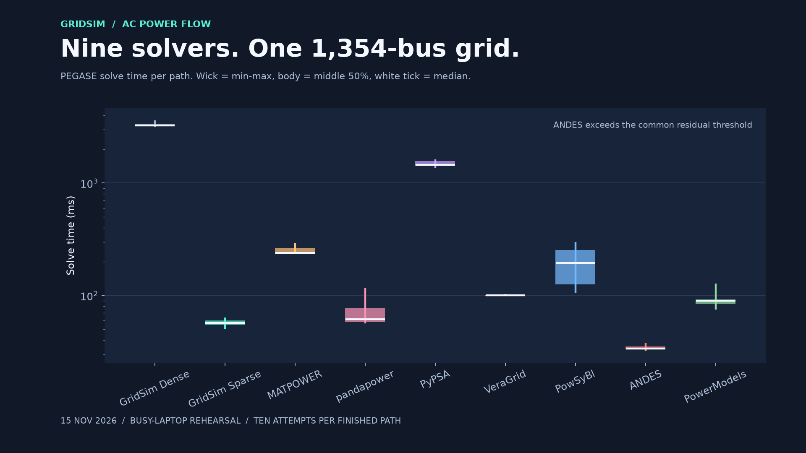

# AC power-flow suite rehearsal, 67 cases

*Status: historical. Measured on a busy laptop, 15 November 2026, before the cloud-server runs. Superseded by the [RC4 (2.1.073) results](../../rc4-2.1.073/index.md). Back to the [benchmarks landing page](../../index.md).*

This busy-laptop rehearsal scheduled 67 MATPOWER 8.1 cases. The comparison below includes 53 case rows, including the unsupported RTS-GMLC entry. Two large RTE cases were omitted from the comparison under the laptop resource limit. The run stopped during ACTIVSg2000 (2,000 buses), whose saved results are shown separately.

| Solver path | Cases with 10/10 convergence | Cases with 10/10 and residual at or below 1e-8 pu |
| --- | ---: | ---: |
| dense | 51 | 51 |
| sparse | 51 | 51 |
| matpower | 51 | 51 |
| pandapower | 50 | 34 |
| pypsa | 48 | 43 |
| veragrid | 51 | 51 |
| powsybl | 49 | 47 |
| andes | 52 | 2 |
| powermodels | 52 | 51 |

Sparse was fastest among paths meeting both checks on 51 cases.
On 51 of those cases an external path also met both checks. The median ratio of the fastest external path to Sparse was 2.48x.

## Win counts

Ties count as a win for each tied path. Cases without an eligible path award no wins.

| Solver path | Residual wins | Compute time wins |
| --- | ---: | ---: |
| GridSim Dense | 9 | 0 |
| GridSim Sparse | 9 | 51 |
| MATPOWER | 5 | 0 |
| pandapower | 2 | 0 |
| PyPSA | 13 | 0 |
| VeraGrid | 5 | 0 |
| PowSyBl | 14 | 0 |
| ANDES | 0 | 0 |
| PowerModels | 4 | 0 |

## Cases

Cells show mean solve ms, convergence count, then worst independent residual in pu.
An asterisk marks missing residual evidence or a worst residual above 1e-8 pu.

Winners require 10/10 convergence and a worst residual at or below 1e-8 pu. Ties use the unrounded values.

| Case | Buses | dense | sparse | matpower | pandapower | pypsa | veragrid | powsybl | andes | powermodels | Winner Residuals | Winner Compute Time |
| --- | ---: | ---: | ---: | ---: | ---: | ---: | ---: | ---: | ---: | ---: | --- | --- |
| case4_dist.m | 4 | 0.1124 (10/10) 2.68622041e-09 pu | 0.05907 (10/10) 2.68622041e-09 pu | 175.4 (10/10) 2.68636888e-09 pu | 35.64 (10/10) 2.68636882e-09 pu | 344.1 (10/10) 2.68630951e-09 pu | 10.07 (10/10) 2.68636888e-09 pu | 3.726 (10/10) 3.37768702e-12 pu | 6.549 (10/10) 3.96289632e-01 pu* | 0.2436 (10/10) 2.68619099e-09 pu | PowSyBl | GridSim Sparse |
| case4gs.m | 4 | 0.1455 (10/10) 1.06851019e-09 pu | 0.07755 (10/10) 1.06851019e-09 pu | 154.7 (10/10) 1.06851047e-09 pu | 20.36 (10/10) 1.06850877e-09 pu | 322.8 (10/10) 8.81072992e-15 pu | 14.69 (10/10) 1.06851047e-09 pu | 2.335 (10/10) 1.45108075e-09 pu | 5.86 (10/10) 6.09098157e-07 pu* | 0.352 (10/10) 1.06851218e-09 pu | PyPSA | GridSim Sparse |
| case5.m | 5 | 0.1001 (10/10) 6.41473719e-11 pu | 0.06491 (10/10) 6.41473719e-11 pu | 149.3 (10/10) 6.41402664e-11 pu | 23.16 (10/10) 6.41753672e-11 pu | 296.6 (10/10) 6.41193765e-11 pu | 14.64 (10/10) 6.41404085e-11 pu | 3.535 (10/10) 6.41387032e-11 pu | 5.966 (10/10) 5.07413079e-06 pu* | 0.2978 (10/10) 6.41686881e-11 pu | PyPSA | GridSim Sparse |
| case6ww.m | 6 | 0.1973 (10/10) 2.08637516e-10 pu | 0.09828 (10/10) 2.08637516e-10 pu | 158 (10/10) 2.08640358e-10 pu | 21.12 (10/10) 2.08640074e-10 pu | 305 (10/10) 6.96331881e-15 pu | 9.514 (10/10) 2.08638369e-10 pu | 2.397 (10/10) 2.84217094e-15 pu | 5.793 (10/10) 1.11581222e-07 pu* | 0.3183 (10/10) 2.08642206e-10 pu | PowSyBl | GridSim Sparse |
| case9.m | 9 | 0.3178 (10/10) 1.69109171e-14 pu | 0.1494 (10/10) 1.69109171e-14 pu | 166.5 (10/10) 1.63424829e-14 pu | 20.76 (10/10) 3.42132082e-07 pu* | 261.6 (10/10) 1.73372428e-14 pu | 12.41 (10/10) 1.77635684e-14 pu | 3.135 (10/10) 1.10844667e-14 pu | 6.036 (10/10) 2.50154144e-07 pu* | 0.4725 (10/10) 1.67688086e-14 pu | PowSyBl | GridSim Sparse |
| case9Q.m | 9 | 0.2892 (10/10) 5.51381163e-14 pu | 0.1469 (10/10) 5.51381163e-14 pu | 158.8 (10/10) 5.38591394e-14 pu | 21.01 (10/10) 5.71435644e-07 pu* | 315.8 (10/10) 5.40012479e-14 pu | 9.669 (10/10) 5.44275736e-14 pu | 2.517 (10/10) 7.26863334e-10 pu | 5.997 (10/10) 2.37663808e-07 pu* | 0.4001 (10/10) 5.48538992e-14 pu | MATPOWER | GridSim Sparse |
| case9target.m | 9 | 0.4182 (10/10) 4.14956958e-14 pu | 0.1834 (10/10) 4.14956958e-14 pu | 167.2 (10/10) 1.98951966e-14 pu | 20.66 (10/10) 1.39933468e-07 pu* | 273.4 (10/10) 2.10320650e-14 pu | 10.3 (10/10) 1.81898940e-14 pu | 2.596 (10/10) 1.93267624e-14 pu | 6.776 (10/10) 4.02170902e-07 pu* | 0.4421 (10/10) 2.16004992e-14 pu | VeraGrid | GridSim Sparse |
| case10ba.m | 10 | 0.3639 (10/10) 1.45246037e-12 pu | 0.238 (10/10) 1.45246037e-12 pu | 191.4 (10/10) 1.45243817e-12 pu | 22.55 (10/10) 1.45206069e-12 pu | 247.8 (10/10) 1.45117252e-12 pu | 12.09 (10/10) 1.45081724e-12 pu | 2.267 (10/10) 1.45137236e-12 pu | 7.816 (10/10) 1.65599824e-01 pu* | 0.3603 (10/10) 1.45026213e-12 pu | PowerModels | GridSim Sparse |
| case12da.m | 12 | 0.3697 (10/10) 2.07660514e-10 pu | 0.209 (10/10) 2.07660514e-10 pu | 187 (10/10) 2.07639086e-10 pu | 21.4 (10/10) 2.07649255e-10 pu | 278.1 (10/10) 2.07653499e-10 pu | 11.55 (10/10) 2.07654026e-10 pu | 3.116 (10/10) 2.07655886e-10 pu | 4.677 (10/10) 5.93999337e-02 pu* | 0.3956 (10/10) 2.07653866e-10 pu | MATPOWER | GridSim Sparse |
| case14.m | 14 | 0.5296 (10/10) 3.95683486e-15 pu | 0.399 (10/10) 3.95683486e-15 pu | 192.8 (10/10) 8.59756710e-15 pu | 0/10 | 310.4 (10/10) 8.59756710e-15 pu | 12.27 (10/10) 9.30810984e-15 pu | 3.291 (10/10) 1.23501209e-14 pu | 7.782 (10/10) 2.33742390e-07 pu* | 0.8757 (10/10) 1.06936682e-14 pu | GridSim Dense, GridSim Sparse | GridSim Sparse |
| case15da.m | 15 | 0.4804 (10/10) 3.20482502e-10 pu | 0.2305 (10/10) 3.20482502e-10 pu | 175.5 (10/10) 3.20475979e-10 pu | 21.84 (10/10) 3.20489024e-10 pu | 292.3 (10/10) 3.20475979e-10 pu | 9.647 (10/10) 3.20475785e-10 pu | 2.932 (10/10) 3.20489330e-10 pu | 5.119 (10/10) 1.41400369e-01 pu* | 0.5952 (10/10) 3.20489413e-10 pu | VeraGrid | GridSim Sparse |
| case15nbr.m | 15 | 0.5078 (10/10) 2.10011453e-13 pu | 0.2022 (10/10) 2.10011453e-13 pu | 152.3 (10/10) 2.10225171e-13 pu | 17.57 (10/10) 9.82096278e-08 pu* | 273.8 (10/10) 2.10123585e-13 pu | 10.44 (10/10) 2.10439721e-13 pu | 3.001 (10/10) 2.10226003e-13 pu | 5.106 (10/10) 5.40971834e-11 pu | 0.5523 (10/10) 2.10227669e-13 pu | GridSim Dense, GridSim Sparse | GridSim Sparse |
| case16am.m | 15 | 0/10 | 0/10 | 0/10 | 18.21 (10/10) 4.00675190e-08 pu* | 0/10 | 0/10 | 2.736 (10/10) 2.92114004e+00 pu* | 4.911 (10/10) 5.56239924e+01 pu* | 0.4249 (10/10) 1.98069344e-07 pu* | - | - |
| case16ci.m | 16 | 0.4475 (10/10) 9.60218571e-12 pu | 0.1702 (10/10) 9.60218571e-12 pu | 145.7 (10/10) 9.60262980e-12 pu | 18.35 (10/10) 9.58868540e-12 pu | 292 (10/10) 1.31261557e+00 pu* | 28.03 (10/10) 9.63096269e-12 pu | 0/10 | 6.387 (10/10) 4.49999199e-01 pu* | 0.4075 (10/10) 9.60183044e-12 pu | pandapower | GridSim Sparse |
| case17me.m | 17 | 1.167 (10/10) 4.06563672e-15 pu | 0.3586 (10/10) 4.06563672e-15 pu | 175.7 (10/10) 5.38458167e-15 pu | 17.98 (10/10) 3.19095110e-08 pu* | 266.7 (10/10) 5.72208947e-15 pu | 10.97 (10/10) 4.35707026e-15 pu | 2.684 (10/10) 4.75286477e-15 pu | 5.689 (10/10) 1.67644704e-08 pu* | 0.4857 (10/10) 5.83200155e-15 pu | GridSim Dense, GridSim Sparse | GridSim Sparse |
| case18.m | 18 | 0.6762 (10/10) 1.30961908e-13 pu | 0.2743 (10/10) 1.30961908e-13 pu | 178.9 (10/10) 5.44453371e-14 pu | 23.87 (10/10) 1.34514622e-13 pu | 282.8 (10/10) 8.42437231e-14 pu | 10.41 (10/10) 8.61533067e-14 pu | 2.811 (10/10) 4.51638726e-14 pu | 5.585 (10/10) 2.69999878e-01 pu* | 0.5828 (10/10) 1.19637633e-13 pu | PowSyBl | GridSim Sparse |
| case18nbr.m | 18 | 0.6274 (10/10) 1.53289548e-12 pu | 0.3318 (10/10) 1.53289548e-12 pu | 172 (10/10) 1.53278862e-12 pu | 19.39 (10/10) 2.45397949e-07 pu* | 253.6 (10/10) 1.53214608e-12 pu | 10.35 (10/10) 1.53151214e-12 pu | 3.419 (10/10) 1.53310725e-12 pu | 5.205 (10/10) 7.43842615e-11 pu | 0.6853 (10/10) 1.53204227e-12 pu | VeraGrid | GridSim Sparse |
| case22.m | 22 | 0.7958 (10/10) 1.60863683e-12 pu | 0.2747 (10/10) 1.60863683e-12 pu | 157.5 (10/10) 3.26980804e-12 pu | 18.91 (10/10) 2.43109005e-12 pu | 282.4 (10/10) 1.38958983e-12 pu | 9.897 (10/10) 4.66719025e-12 pu | 4.931 (10/10) 2.02097367e-12 pu | 4.851 (10/10) 8.13071327e-02 pu* | 0.6806 (10/10) 2.94912011e-12 pu | PyPSA | GridSim Sparse |
| case24_ieee_rts.m | 24 | 1.03 (10/10) 6.52477183e-12 pu | 0.3743 (10/10) 6.52477183e-12 pu | 205.4 (10/10) 2.30983233e-12 pu | 34.56 (10/10) 1.26752032e+00 pu* | 312.6 (10/10) 2.30926389e-12 pu | 13.67 (10/10) 2.31096919e-12 pu | 3.101 (10/10) 2.49144705e-12 pu | 6.471 (10/10) 1.15089423e-06 pu* | 1.352 (10/10) 2.30926389e-12 pu | PyPSA, PowerModels | GridSim Sparse |
| case28da.m | 28 | 1.171 (10/10) 9.08477762e-09 pu | 0.6029 (10/10) 9.08477762e-09 pu | 149.4 (10/10) 9.08478048e-09 pu | 17.33 (10/10) 9.08477320e-09 pu | 285.1 (10/10) 9.08480998e-09 pu | 12.37 (10/10) 9.08481645e-09 pu | 3.636 (10/10) 9.08480068e-09 pu | 4.588 (10/10) 5.65597244e-02 pu* | 0.8321 (10/10) 9.08478747e-09 pu | pandapower | GridSim Sparse |
| case30.m | 30 | 1.503 (10/10) 9.56998285e-10 pu | 0.6429 (10/10) 9.56998285e-10 pu | 188 (10/10) 9.56998711e-10 pu | 32.68 (10/10) 9.56998392e-10 pu | 337.7 (10/10) 1.05870868e-14 pu | 12.74 (10/10) 9.57000950e-10 pu | 4.78 (10/10) 9.56999386e-10 pu | 6.312 (10/10) 1.55511540e-07 pu* | 1.31 (10/10) 9.56999280e-10 pu | PyPSA | GridSim Sparse |
| case30Q.m | 30 | 1.2 (10/10) 9.56998285e-10 pu | 0.4939 (10/10) 9.56998285e-10 pu | 185.2 (10/10) 9.56998711e-10 pu | 26.58 (10/10) 9.56998392e-10 pu | 301.3 (10/10) 1.05870868e-14 pu | 13.12 (10/10) 9.57000950e-10 pu | 4.171 (10/10) 9.56999386e-10 pu | 6.431 (10/10) 1.55511540e-07 pu* | 1.48 (10/10) 9.56999280e-10 pu | PyPSA | GridSim Sparse |
| case30pwl.m | 30 | 1.29 (10/10) 9.56998285e-10 pu | 0.4927 (10/10) 9.56998285e-10 pu | 181.3 (10/10) 9.56998711e-10 pu | 26.07 (10/10) 9.56998392e-10 pu | 308.2 (10/10) 1.05870868e-14 pu | 12.22 (10/10) 9.57000950e-10 pu | 4.638 (10/10) 9.56999386e-10 pu | 6.674 (10/10) 1.55511540e-07 pu* | 2.013 (10/10) 9.56999280e-10 pu | PyPSA | GridSim Sparse |
| case_ieee30.m | 30 | 1.776 (10/10) 1.44595447e-14 pu | 0.7137 (10/10) 1.44595447e-14 pu | 236.7 (10/10) 1.33226763e-14 pu | 52.89 (10/10) 5.18401190e-08 pu* | 321.4 (10/10) 1.16173737e-14 pu | 12.53 (10/10) 2.13651319e-14 pu | 4.597 (10/10) 1.13953291e-14 pu | 8.007 (10/10) 2.75263413e-07 pu* | 1.599 (10/10) 1.62492242e-14 pu | PowSyBl | GridSim Sparse |
| case33bw.m | 33 | 1.702 (10/10) 7.46750737e-09 pu | 0.3683 (10/10) 7.46750737e-09 pu | 161.8 (10/10) 7.46750818e-09 pu | 18.06 (10/10) 7.46750808e-09 pu | 309.7 (10/10) 3.95041839e-02 pu* | 14.21 (10/10) 7.46750776e-09 pu | 3.713 (10/10) 7.46750620e-09 pu | 5.006 (10/10) 5.39999804e-02 pu* | 0.9394 (10/10) 7.46751071e-09 pu | PowSyBl | GridSim Sparse |
| case33mg.m | 33 | 2.565 (10/10) 2.91933144e-13 pu | 0.7819 (10/10) 2.91933144e-13 pu | 176.6 (10/10) 3.95725119e-13 pu | 18.26 (10/10) 6.81538159e-13 pu | 329 (10/10) 3.95040276e-01 pu* | 12.96 (10/10) 3.20021787e-13 pu | 5.279 (10/10) 2.66953126e-13 pu | 4.605 (10/10) 5.93998040e-01 pu* | 1.283 (10/10) 5.39818190e-13 pu | PowSyBl | GridSim Sparse |
| case34sa.m | 34 | 1.66 (10/10) 9.67105979e-10 pu | 0.4647 (10/10) 9.67105979e-10 pu | 159.5 (10/10) 9.67023184e-10 pu | 18.11 (10/10) 9.67166736e-10 pu | 237.8 (10/10) 9.67085495e-10 pu | 15.68 (10/10) 9.67063818e-10 pu | 5.342 (10/10) 9.67132346e-10 pu | 5.171 (10/10) 2.27701577e-01 pu* | 1.348 (10/10) 9.67099290e-10 pu | MATPOWER | GridSim Sparse |
| case38si.m | 38 | 2.452 (10/10) 3.04090086e-13 pu | 0.483 (10/10) 3.04090086e-13 pu | 175.6 (10/10) 1.77025061e-13 pu | 22.84 (10/10) 2.79980900e-13 pu | 300.6 (10/10) 1.37265199e-13 pu | 13.28 (10/10) 3.02952108e-13 pu | 4.981 (10/10) 1.84796622e-13 pu | 5.049 (10/10) 5.93998040e-01 pu* | 1.227 (10/10) 1.50685020e-13 pu | PyPSA | GridSim Sparse |
| case39.m | 39 | 2.459 (10/10) 3.31613137e-11 pu | 0.8572 (10/10) 3.31613137e-11 pu | 171.6 (10/10) 3.31874617e-11 pu | 30.11 (10/10) 3.31908723e-11 pu | 387 (10/10) 3.32534000e-11 pu | 12.12 (10/10) 3.31988304e-11 pu | 5.492 (10/10) 2.89423951e-11 pu | 6.677 (10/10) 1.95396840e-05 pu* | 2.125 (10/10) 3.32147465e-11 pu | PowSyBl | GridSim Sparse |
| case51ga.m | 51 | 4.422 (10/10) 1.54487534e-13 pu | 0.7649 (10/10) 1.54487534e-13 pu | 171.3 (10/10) 2.93959301e-13 pu | 18.43 (10/10) 1.66498759e-13 pu | 262 (10/10) 2.37782016e-13 pu | 11.27 (10/10) 2.94181346e-13 pu | 3.357 (10/10) 9.90596494e-14 pu | 4.9 (10/10) 1.18799817e-01 pu* | 1.519 (10/10) 2.37782016e-13 pu | PowSyBl | GridSim Sparse |
| case51he.m | 51 | 3.684 (10/10) 2.28642105e-11 pu | 0.5427 (10/10) 2.28642105e-11 pu | 154.2 (10/10) 2.28378427e-11 pu | 22.95 (10/10) 2.29200547e-11 pu | 306 (10/10) 2.25292840e-11 pu | 12.18 (10/10) 2.26695607e-11 pu | 4.568 (10/10) 2.28635166e-11 pu | 4.356 (10/10) 1.47261805e-01 pu* | 1.211 (10/10) 2.28646546e-11 pu | PyPSA | GridSim Sparse |
| case57.m | 57 | 5.785 (10/10) 1.54211754e-12 pu | 1.3 (10/10) 1.54211754e-12 pu | 196.9 (10/10) 1.54137147e-12 pu | 0/10 | 308.1 (10/10) 1.54199320e-12 pu | 12.2 (10/10) 1.54178892e-12 pu | 4.84 (10/10) 1.51918478e-12 pu | 6.559 (10/10) 5.06734265e-07 pu* | 2.249 (10/10) 1.54185997e-12 pu | PowSyBl | GridSim Sparse |
| case59.m | 59 | 11.58 (10/10) 2.69596967e-11 pu | 1.664 (10/10) 2.69596967e-11 pu | 163 (10/10) 8.56118731e-11 pu | 29.05 (10/10) 3.33328679e+01 pu* | 307.5 (10/10) 8.56141469e-11 pu | 14.52 (10/10) 8.56061888e-11 pu | 5.059 (10/10) 6.82450718e-11 pu | 7.943 (10/10) 1.12615408e-04 pu* | 2.873 (10/10) 8.56095994e-11 pu | GridSim Dense, GridSim Sparse | GridSim Sparse |
| case60nordic.m | 60 | 5.9 (10/10) 1.69706027e-12 pu | 1.52 (10/10) 1.69706027e-12 pu | 189.7 (10/10) 1.21644916e-13 pu | 30.33 (10/10) 5.14577689e-08 pu* | 341.9 (10/10) 1.04023457e-13 pu | 14.51 (10/10) 1.36424205e-13 pu | 4.358 (10/10) 1.00044417e-13 pu | 7.584 (10/10) 5.20869799e-05 pu* | 19.3 (10/10) 9.20863386e-14 pu | PowerModels | GridSim Sparse |
| case69.m | 69 | 7.7 (10/10) 3.63788999e-12 pu | 1.039 (10/10) 3.63788999e-12 pu | 158.9 (10/10) 5.45670176e-12 pu | 16.69 (10/10) 1.04243999e-08 pu* | 305.9 (10/10) 3.48535194e-12 pu | 12.01 (10/10) 2.72823431e-12 pu | 3.794 (10/10) 3.18307602e-12 pu | 5.392 (10/10) 1.11960004e-01 pu* | 1.757 (10/10) 4.20615209e-12 pu | VeraGrid | GridSim Sparse |
| case70da.m | 70 | 7.992 (10/10) 6.59056143e-14 pu | 1.343 (10/10) 6.59056143e-14 pu | 156 (10/10) 1.10994547e-13 pu | 18.57 (10/10) 1.71807013e-13 pu | 0/10 | 19.47 (10/10) 3.41358256e-09 pu | 0/10 | 4.718 (10/10) 2.85117660e-01 pu* | 18.74 (10/10) 1.65284453e-13 pu | GridSim Dense, GridSim Sparse | GridSim Sparse |
| case_RTS_GMLC.m | 73 | No evidence | No evidence | No evidence | No evidence | No evidence | No evidence | No evidence | No evidence | No evidence | - | - |
| case74ds.m | 74 | 7.317 (10/10) 4.05751266e-11 pu | 0.8924 (10/10) 4.05751266e-11 pu | 145.1 (10/10) 3.97026023e-11 pu | 18.37 (10/10) 4.07973932e-11 pu | 321.6 (10/10) 4.01307043e-11 pu | 11.81 (10/10) 4.03557465e-11 pu | 3.805 (10/10) 3.99170974e-11 pu | 4.494 (10/10) 4.13811438e-01 pu* | 6.581 (10/10) 3.96969402e-11 pu | PowerModels | GridSim Sparse |
| case85.m | 85 | 11.76 (10/10) 2.90725777e-13 pu | 1.244 (10/10) 2.90725777e-13 pu | 158.7 (10/10) 2.04058992e-13 pu | 19.54 (10/10) 5.00384456e-13 pu | 319.2 (10/10) 2.98469582e-13 pu | 13.03 (10/10) 2.36366482e-13 pu | 4.881 (10/10) 3.31533412e-13 pu | 4.744 (10/10) 1.13120053e-01 pu* | 18.78 (10/10) 3.11056736e-13 pu | MATPOWER | GridSim Sparse |
| case89pegase.m | 89 | 17.55 (10/10) 2.12708073e-12 pu | 4.615 (10/10) 2.12708073e-12 pu | 196.5 (10/10) 2.80722674e-09 pu | 37.16 (10/10) 2.80719263e-09 pu | 358 (10/10) 2.45954368e-12 pu | 17.12 (10/10) 2.80720911e-09 pu | 8.263 (10/10) 2.37721252e-09 pu | 8.69 (10/10) 3.79263034e-04 pu* | 21.5 (10/10) 2.80722048e-09 pu | GridSim Dense, GridSim Sparse | GridSim Sparse |
| case94pi.m | 94 | 14.5 (10/10) 1.46440846e-12 pu | 1.256 (10/10) 1.46440846e-12 pu | 159.6 (10/10) 1.43890108e-12 pu | 19.96 (10/10) 1.45499932e-12 pu | 300.9 (10/10) 1.34394926e-12 pu | 13.84 (10/10) 1.45733078e-12 pu | 4.316 (10/10) 1.44967024e-12 pu | 4.767 (10/10) 5.15877395e-01 pu* | 2.967 (10/10) 1.51600607e-12 pu | PyPSA | GridSim Sparse |
| case118.m | 118 | 15.92 (10/10) 3.96909172e-13 pu | 1.781 (10/10) 3.96909172e-13 pu | 171.9 (10/10) 4.05009359e-13 pu | 35.16 (10/10) 3.92716970e-13 pu | 336.3 (10/10) 3.94919653e-13 pu | 19.82 (10/10) 3.83977294e-13 pu | 7.414 (10/10) 2.94804181e-13 pu | 8.994 (10/10) 6.22888699e-06 pu* | 22.08 (10/10) 4.06359391e-13 pu | PowSyBl | GridSim Sparse |
| case118zh.m | 118 | 23.71 (10/10) 1.55536695e-13 pu | 1.792 (10/10) 1.55536695e-13 pu | 152.3 (10/10) 2.26689501e-13 pu | 22.34 (10/10) 3.95833366e-13 pu | 298.6 (10/10) 1.92715112e-01 pu* | 15.24 (10/10) 1.73250303e-13 pu | 6.948 (10/10) 2.06525075e-13 pu | 6.017 (10/10) 1.08458892e-01 pu* | 22.84 (10/10) 1.70452541e-13 pu | GridSim Dense, GridSim Sparse | GridSim Sparse |
| case136ma.m | 136 | 28.86 (10/10) 5.70121728e-13 pu | 1.751 (10/10) 5.70121728e-13 pu | 156 (10/10) 9.63717994e-13 pu | 19.77 (10/10) 1.17788239e-08 pu* | 331.3 (10/10) 1.32348084e-01 pu* | 15.51 (10/10) 1.21891386e-12 pu | 9.947 (10/10) 9.57448281e-13 pu | 6.815 (10/10) 1.35587020e-01 pu* | 19.87 (10/10) 1.20782578e-12 pu | GridSim Dense, GridSim Sparse | GridSim Sparse |
| case141.m | 141 | 28.47 (10/10) 2.11603941e-09 pu | 1.443 (10/10) 2.11603941e-09 pu | 160.3 (10/10) 2.11599999e-09 pu | 19.52 (10/10) 2.11597354e-09 pu | 305.3 (10/10) 1.10785463e-10 pu | 14.56 (10/10) 2.11606562e-09 pu | 10.36 (10/10) 2.11597330e-09 pu | 6.08 (10/10) 5.73748402e-02 pu* | 19.51 (10/10) 2.11602642e-09 pu | PyPSA | GridSim Sparse |
| case145.m | 145 | 55.36 (10/10) 1.15335297e-12 pu | 9.292 (10/10) 1.15335297e-12 pu | 191 (10/10) 6.24252152e-10 pu | 37.13 (10/10) 6.24254710e-10 pu | 434.8 (10/10) 1.01920250e-12 pu | 24.94 (10/10) 6.24251584e-10 pu | 16.82 (10/10) 4.63052601e-10 pu | 12.32 (10/10) 1.31744560e-04 pu* | 23.97 (10/10) 1.03387947e-10 pu | PyPSA | GridSim Sparse |
| case_ACTIVSg200.m | 200 | 57.86 (10/10) 2.69335665e-13 pu | 4.937 (10/10) 2.69335665e-13 pu | 174.3 (10/10) 2.40185649e-13 pu | 34.09 (10/10) 2.33288692e-07 pu* | 412 (10/10) 1.73838721e-13 pu | 20.89 (10/10) 5.12776488e-13 pu | 15.7 (10/10) 1.58846269e-13 pu | 8.792 (10/10) 3.34447459e-06 pu* | 10.62 (10/10) 2.56639154e-13 pu | PowSyBl | GridSim Sparse |
| case300.m | 300 | 143 (10/10) 4.08897392e-09 pu | 8.105 (10/10) 4.08897392e-09 pu | 207.7 (10/10) 1.23719701e-12 pu | 40.9 (10/10) 1.20466173e+01 pu* | 525.9 (10/10) 1.26096467e-12 pu | 30.7 (10/10) 1.24241950e-12 pu | 16.66 (10/10) 1.24318301e-03 pu* | 12.17 (10/10) 1.29008726e-04 pu* | 18.17 (10/10) 4.61916727e-12 pu | MATPOWER | GridSim Sparse |
| case_ACTIVSg500.m | 500 | 349.7 (10/10) 2.38344455e-12 pu | 13.7 (10/10) 2.38344455e-12 pu | 223.6 (10/10) 2.59547051e-12 pu | 33.19 (10/10) 2.38969733e-12 pu | 593.5 (10/10) 1.28721922e-12 pu | 36.47 (10/10) 2.60740762e-12 pu | 34.69 (10/10) 1.45234935e-12 pu | 13.91 (10/10) 1.78784203e-05 pu* | 18.43 (10/10) 2.37747599e-12 pu | PyPSA | GridSim Sparse |
| case533mt_hi.m | 533 | 334.5 (10/10) 1.25813657e-11 pu | 6.37 (10/10) 1.25813657e-11 pu | 160.7 (10/10) 1.25838662e-11 pu | 25.33 (10/10) 1.25818950e-11 pu | 0/10 | 31.9 (10/10) 1.25820031e-11 pu | 32.04 (10/10) 1.25872116e-11 pu | 10.07 (10/10) 6.90331730e-02 pu* | 28.3 (10/10) 1.25849739e-11 pu | GridSim Dense, GridSim Sparse | GridSim Sparse |
| case533mt_lo.m | 533 | 303.9 (10/10) 4.60708867e-13 pu | 6.531 (10/10) 4.60708867e-13 pu | 161.2 (10/10) 5.45206146e-13 pu | 24.47 (10/10) 5.77894325e-13 pu | 0/10 | 31.3 (10/10) 7.31384953e-13 pu | 19.46 (10/10) 3.48687745e-13 pu | 7.571 (10/10) 2.62332726e-02 pu* | 28.06 (10/10) 6.81873932e-13 pu | PowSyBl | GridSim Sparse |
| case1197.m | 1197 | 1521 (10/10) 4.64466257e-12 pu | 15.06 (10/10) 4.64466257e-12 pu | 180.5 (10/10) 4.64422820e-12 pu | 24.9 (10/10) 1.72398018e-07 pu* | 922.8 (10/10) 4.64523212e-12 pu | 61.73 (10/10) 7.70219999e-14 pu | 0/10 | 13.43 (10/10) 3.65971044e-08 pu* | 37.18 (10/10) 4.64474681e-12 pu | VeraGrid | GridSim Sparse |
| case1354pegase.m | 1354 | 3305 (10/10) 5.70725689e-12 pu | 57.11 (10/10) 5.70725689e-12 pu | 251.4 (10/10) 2.83051804e-12 pu | 70.28 (10/10) 6.28702423e-12 pu | 1483 (10/10) 1.08633458e-11 pu | 100.9 (10/10) 5.11946041e-12 pu | 195.9 (10/10) 2.16708429e-12 pu | 34.29 (10/10) 1.26031765e-03 pu* | 91.52 (10/10) 4.82572204e-12 pu | PowSyBl | GridSim Sparse |

## Evidence notes

| Case | Evidence notes |
| --- | --- |
| Interpreting missing GridSim results | GridSim is designed to withhold a converged result when its solve checks or applicable constraints are not satisfied. An empty result alone does not establish Newton non-convergence or physical infeasibility. Check the recorded attempts and logs for the cause. The harness also audits saved GridSim solutions independently. |
| case4_dist.m | harness files changed during this case; 0 Dense/Sparse bit differences on first converged results; andes worst residual 0.39628963175550802 pu at bus 400 (P). |
| case4gs.m | 0 Dense/Sparse bit differences on first converged results; andes worst residual 6.09098157013932e-07 pu at bus 2 (Q). |
| case5.m | 0 Dense/Sparse bit differences on first converged results; andes worst residual 5.0741307904900165e-06 pu at bus 5 (P). |
| case6ww.m | 0 Dense/Sparse bit differences on first converged results; andes worst residual 1.1158122248389191e-07 pu at bus 6 (Q). |
| case9.m | 0 Dense/Sparse bit differences on first converged results; pandapower worst residual 3.4213208238043081e-07 pu at bus 8 (P); andes worst residual 2.5015414422568939e-07 pu at bus 2 (P). |
| case9Q.m | 0 Dense/Sparse bit differences on first converged results; pandapower worst residual 5.7143564362149842e-07 pu at bus 9 (P); andes worst residual 2.3766380763845518e-07 pu at bus 2 (P). |
| case9target.m | 0 Dense/Sparse bit differences on first converged results; pandapower worst residual 1.3993346783536254e-07 pu at bus 5 (P); andes worst residual 4.0217090166549954e-07 pu at bus 4 (Q). |
| case10ba.m | 0 Dense/Sparse bit differences on first converged results; andes worst residual 0.1655998241576653 pu at bus 5 (Q). |
| case12da.m | 0 Dense/Sparse bit differences on first converged results; andes worst residual 0.059399933741244852 pu at bus 2 (Q). |
| case14.m | 0 Dense/Sparse bit differences on first converged results; andes worst residual 2.3374238960371941e-07 pu at bus 2 (P). |
| case15da.m | 0 Dense/Sparse bit differences on first converged results; andes worst residual 0.14140036888574894 pu at bus 6 (Q). |
| case15nbr.m | 0 Dense/Sparse bit differences on first converged results; pandapower worst residual 9.8209627818757188e-08 pu at bus 15 (Q). |
| case16am.m | GridSim Dense, GridSim Sparse and MATPOWER each hit 50 iterations on all ten attempts from the shared flat start. No path passed the common residual threshold under these settings; pandapower worst residual 4.0067519023467836e-08 pu at bus 2 (Q); powsybl worst residual 2.9211400422386049 pu at bus 2 (P); andes worst residual 55.623992362544371 pu at bus 2 (Q); powermodels worst residual 1.9806934391519705e-07 pu at bus 2 (Q). |
| case16ci.m | 0 Dense/Sparse bit differences on first converged results; pypsa worst residual 1.3126155671622766 pu at bus 5 (P); andes worst residual 0.44999919940990918 pu at bus 9 (P). |
| case17me.m | 0 Dense/Sparse bit differences on first converged results; pandapower worst residual 3.1909511026828596e-08 pu at bus 8 (Q); andes worst residual 1.6764470422980793e-08 pu at bus 2 (P). |
| case18.m | 0 Dense/Sparse bit differences on first converged results; andes worst residual 0.26999987770881795 pu at bus 5 (P). |
| case18nbr.m | 0 Dense/Sparse bit differences on first converged results; pandapower worst residual 2.4539794850148012e-07 pu at bus 4 (P). |
| case22.m | 0 Dense/Sparse bit differences on first converged results; andes worst residual 0.081307132655839207 pu at bus 13 (P). |
| case24_ieee_rts.m | 0 Dense/Sparse bit differences on first converged results; pandapower worst residual 1.2675203152276071 pu at bus 9 (Q); andes worst residual 1.1508942316140747e-06 pu at bus 23 (P). |
| case28da.m | 0 Dense/Sparse bit differences on first converged results; andes worst residual 0.056559724441516475 pu at bus 11 (Q). |
| case30.m | 0 Dense/Sparse bit differences on first converged results; andes worst residual 1.5551154007198419e-07 pu at bus 21 (Q). |
| case30Q.m | 0 Dense/Sparse bit differences on first converged results; andes worst residual 1.5551154007198419e-07 pu at bus 21 (Q). |
| case30pwl.m | 0 Dense/Sparse bit differences on first converged results; andes worst residual 1.5551154007198419e-07 pu at bus 21 (Q). |
| case_ieee30.m | 0 Dense/Sparse bit differences on first converged results; pandapower worst residual 5.1840118970858382e-08 pu at bus 6 (P); andes worst residual 2.7526341330741386e-07 pu at bus 2 (P). |
| case33bw.m | 0 Dense/Sparse bit differences on first converged results; pypsa worst residual 0.03950418387859049 pu at bus 25 (Q); andes worst residual 0.053999980403032034 pu at bus 30 (Q). |
| case33mg.m | 0 Dense/Sparse bit differences on first converged results; pypsa worst residual 0.39504027626424415 pu at bus 25 (Q); andes worst residual 0.59399804044275528 pu at bus 30 (Q). |
| case34sa.m | 0 Dense/Sparse bit differences on first converged results; andes worst residual 0.22770157712769579 pu at bus 2 (Q). |
| case38si.m | 0 Dense/Sparse bit differences on first converged results; andes worst residual 0.59399804044255711 pu at bus 30 (Q). |
| case39.m | 0 Dense/Sparse bit differences on first converged results; andes worst residual 1.9539683970748457e-05 pu at bus 6 (Q). |
| case51ga.m | 0 Dense/Sparse bit differences on first converged results; andes worst residual 0.1187998167720908 pu at bus 15 (P). |
| case51he.m | 0 Dense/Sparse bit differences on first converged results; andes worst residual 0.14726180546595627 pu at bus 44 (P). |
| case57.m | 0 Dense/Sparse bit differences on first converged results; andes worst residual 5.0673426528646818e-07 pu at bus 8 (P). |
| case59.m | 0 Dense/Sparse bit differences on first converged results; pandapower worst residual 33.332867861209131 pu at bus 22 (Q); andes worst residual 0.00011261540772807166 pu at bus 22 (Q). |
| case60nordic.m | 0 Dense/Sparse bit differences on first converged results; pandapower worst residual 5.1457768890372793e-08 pu at bus 18 (Q); andes worst residual 5.2086979895875632e-05 pu at bus 13 (Q). |
| case69.m | 0 Dense/Sparse bit differences on first converged results; pandapower worst residual 1.0424399932151828e-08 pu at bus 61 (Q); andes worst residual 0.11196000444768175 pu at bus 61 (P). |
| case70da.m | 0 Dense/Sparse bit differences on first converged results; andes worst residual 0.28511766007786082 pu at bus 58 (P). |
| case_RTS_GMLC.m | No manifest. The shared adapter model does not support its DC lines. |
| case74ds.m | 0 Dense/Sparse bit differences on first converged results; andes worst residual 0.41381143811954141 pu at bus 64 (P). |
| case85.m | 0 Dense/Sparse bit differences on first converged results; andes worst residual 0.11312005270638223 pu at bus 17 (Q). |
| case89pegase.m | 0 Dense/Sparse bit differences on first converged results; andes worst residual 0.00037926303436975673 pu at bus 659 (Q). |
| case94pi.m | 0 Dense/Sparse bit differences on first converged results; andes worst residual 0.51587739481462191 pu at bus 58 (P). |
| case118.m | 0 Dense/Sparse bit differences on first converged results; andes worst residual 6.228886989561033e-06 pu at bus 116 (P). |
| case118zh.m | 0 Dense/Sparse bit differences on first converged results; pypsa worst residual 0.19271511204799593 pu at bus 8 (P); andes worst residual 0.10845889221287124 pu at bus 50 (Q). |
| case136ma.m | 0 Dense/Sparse bit differences on first converged results; pandapower worst residual 1.1778823894026402e-08 pu at bus 106 (P); pypsa worst residual 0.13234808389998615 pu at bus 48 (P); andes worst residual 0.13558701972302262 pu at bus 106 (P). |
| case141.m | 0 Dense/Sparse bit differences on first converged results; andes worst residual 0.057374840224830734 pu at bus 80 (P). |
| case145.m | 0 Dense/Sparse bit differences on first converged results; andes worst residual 0.00013174455996647794 pu at bus 6 (Q). |
| case_ACTIVSg200.m | 0 Dense/Sparse bit differences on first converged results; pandapower worst residual 2.3328869161787224e-07 pu at bus 102 (P); andes worst residual 3.3444745875499393e-06 pu at bus 121 (P). |
| case300.m | 0 Dense/Sparse bit differences on first converged results; pandapower worst residual 12.04661732627005 pu at bus 3 (Q); powsybl worst residual 0.0012431830141010458 pu at bus 9038 (P); andes worst residual 0.00012900872562056519 pu at bus 231 (Q). |
| case_ACTIVSg500.m | 0 Dense/Sparse bit differences on first converged results; andes worst residual 1.7878420306942646e-05 pu at bus 386 (P). |
| case533mt_hi.m | 0 Dense/Sparse bit differences on first converged results; andes worst residual 0.069033172973236148 pu at bus 72 (P). |
| case533mt_lo.m | 0 Dense/Sparse bit differences on first converged results; andes worst residual 0.026233272579831431 pu at bus 72 (P). |
| case1197.m | 0 Dense/Sparse bit differences on first converged results; pandapower worst residual 1.7239801834809109e-07 pu at bus 15 (P); andes worst residual 3.6597104398350397e-08 pu at bus 2 (Q). |
| case1354pegase.m | 0 Dense/Sparse bit differences on first converged results; andes worst residual 0.0012603176506581803 pu at bus 960 (Q). |

## Data and charts

[Case comparison CSV](assets/comparison.csv) |
[Attempt-level CSV](assets/attempt-results.csv)

### Ten-chart benchmark pack

Candlesticks show the minimum, first quartile, median, third quartile and maximum of the saved timings. The interrupted case is marked where shown. All timings come from the busy-laptop rehearsal.

- [PEGASE solve time candlesticks](assets/chart-pack/01-pegase-candlesticks.png) ([SVG](assets/chart-pack/01-pegase-candlesticks.svg))
- [GridSim scaling candlesticks](assets/chart-pack/02-gridsim-scaling-candlesticks.png) ([SVG](assets/chart-pack/02-gridsim-scaling-candlesticks.svg))
- [Dense versus Sparse speedup](assets/chart-pack/03-sparse-speedup.png) ([SVG](assets/chart-pack/03-sparse-speedup.svg))
- [GridSim Sparse versus the fastest qualifying external path](assets/chart-pack/04-nearest-challenger.png) ([SVG](assets/chart-pack/04-nearest-challenger.svg))
- [Convergence versus independent residual check](assets/chart-pack/05-convergence-versus-check.png) ([SVG](assets/chart-pack/05-convergence-versus-check.svg))
- [Residual distributions by solver](assets/chart-pack/06-residual-distributions.png) ([SVG](assets/chart-pack/06-residual-distributions.svg))
- [PEGASE time versus residual](assets/chart-pack/07-pegase-speed-versus-residual.png) ([SVG](assets/chart-pack/07-pegase-speed-versus-residual.svg))
- [Interrupted 2,000-bus candlesticks](assets/chart-pack/08-interrupted-2000-bus-candles.png) ([SVG](assets/chart-pack/08-interrupted-2000-bus-candles.svg))
- [Headline: compute time wins](assets/chart-pack/09-headline-compute-wins.png) ([SVG](assets/chart-pack/09-headline-compute-wins.svg))
- [Headline: 1,197-bus speedup](assets/chart-pack/10-headline-1197-bus.png) ([SVG](assets/chart-pack/10-headline-1197-bus.svg))
