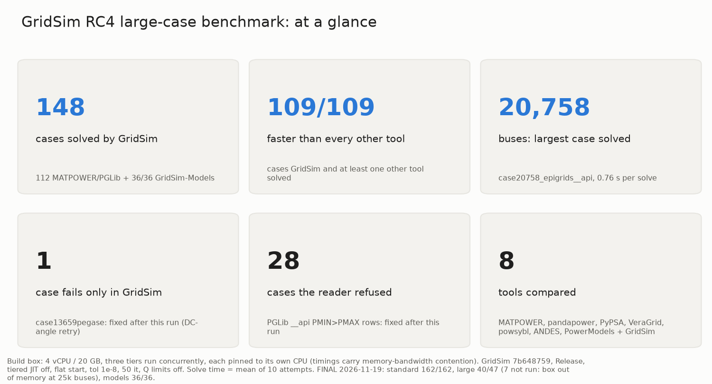

# Benchmarks

GridSim is benchmarked against MATPOWER, pandapower, PyPSA, VeraGrid, PowSyBl, ANDES and PowerModels on AC power flow.
Every tool solves the same cases from a flat start. A solve counts only if all 10 timed attempts converge and an
independent residual check on the original case is at or below 1e-8 pu. Times are the mean of 10 attempts after a warm-up,
for the solve call alone. The same harness drives every run. The pass rules are in the
[benchmark criteria](criteria.md), and the harness is in
[`benchmarks/free-ac-power-flow`](https://github.com/MarkS0485/GridSim/tree/main/benchmarks/free-ac-power-flow).

## Current results: RC4 (2.1.073)

GridSim solved 148 of 245 networks in the final RC4 run (112 MATPOWER and PGLib cases, all 36 GridSim-Models networks).
On the 109 cases where GridSim and at least one other tool passed the residual check, GridSim's sparse solver was the
fastest. The largest case solved was 20,758 buses at 0.76 s per solve.

| Tier | Cases | GridSim CPU sparse passed | No solver converged | Reader refused | Failed only in GridSim | Not run |
| --- | ---: | ---: | ---: | ---: | ---: | ---: |
| Standard, up to 5,000 buses | 162 | 104 | 36 | 21 | 0 | 0 |
| Large, above 5,000 buses | 47 | 8 | 24 | 7 | 1 | 7 |
| GridSim-Models | 36 | 36 | 0 | 0 | 0 | 0 |

One standard case (`dcline`) is not supported by the case loader. Two items from this run have since been fixed:
`case13659pegase` converges and the MATPOWER reader accepts the PGLib `__api` generator limits. The
[RC4 results page](rc4-2.1.073/index.md) has the setup, the charts and the details.

## History

Earlier runs, newest first. Each is a snapshot of the version named and is superseded by the RC4 run.

| Run | Date | GridSim version | What it measured |
| --- | --- | --- | --- |
| [Cloud servers, November 2026](history/hyperstack-2026-11/index.md) (boxes 1 to 3, chart packs) | 17-18 Nov 2026 | 2.1.071 RC-3, then the ordering and Vm-floor change | the 67-case suite on three rented KVM servers: two on RC-3, one A/B of the RC-3 fixes, with chart packs for each |
| [Suite rehearsal](history/suite-rehearsal/index.md) | 15 Nov 2026 | 2.1.031 RC-2 source | the 67-case MATPOWER suite on a busy laptop, with ten charts |
| [Free AC power-flow comparison](history/free-ac-pegase-1354/index.md) | 15 Nov 2026 | 2.1.031 RC-2 source, Debug build | 1,354-bus PEGASE case, GridSim dense and sparse against six other solvers, with evidence files |
| [Server results, July 2026](history/server-results-2026-07/index.md) | 1-2 Jul 2026 | v0.1 builds | the CPU sweep, and A100 and H100 GPU against CPU: [A100 and H100 results](history/server-results-2026-07/a100-results.md), [A100](history/server-results-2026-07/a100/bench.md), [A100 CUDA](history/server-results-2026-07/a100/cuda-p1/bench.md), [H100](history/server-results-2026-07/h100/h100-p1/bench.md), [CPU](history/server-results-2026-07/cpu/bench.md), [MI300 (no run yet)](history/server-results-2026-07/mi300/README.md) |
| [Bench matrix and yardsticks](history/bench-and-perf-yardsticks/index.md) | Jul-Aug 2026 | v0.1 to v1.3 builds | 25-case CPU matrix, state-estimation timing, and the single-thread `bench --perf` yardstick before and after performance tuning ([baseline](history/bench-and-perf-yardsticks/perf-baseline.md), [after](history/bench-and-perf-yardsticks/perf-after.md)) |

The user manual chapter [Benchmarking and GPU](<../../manual/0028 Benchmarking and GPU.md>) explains the `bench` commands
and quotes these results.
