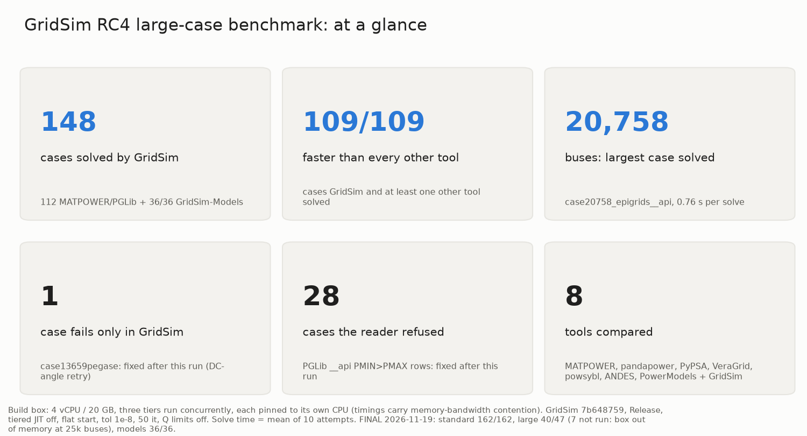

# RC4 (2.1.073) large-case benchmark

This run solved 209 MATPOWER-format cases and 36 GridSim-Models networks from a flat start with GridSim and seven other
solvers: MATPOWER, pandapower, PyPSA, VeraGrid, PowSyBl, ANDES and PowerModels. GridSim solved 148 of them (112
MATPOWER and PGLib cases plus all 36 GridSim-Models networks). On the 109 cases where GridSim and at least one other tool
passed the independent residual check, GridSim's sparse solver was the fastest. The largest case it solved was
`pglib_opf_case20758_epigrids__api` (20,758 buses) in 0.76 s per solve.

*The "case fails only in GridSim" tile records the state at the time of the run. See [Since this run](#since-this-run).*

## What was run

| Item | Value |
| --- | --- |
| GridSim build | commit `7b648759`, Release, tiered JIT off |
| Settings | flat start, tolerance 1e-8 pu, 50 iterations maximum, Q limits off |
| Timing | mean of 10 timed attempts after a warm-up; solve API only |
| Pass rule | 10 of 10 attempts converged and an independent residual check on the original case at or below 1e-8 pu |
| Machine | Linux x86-64 build box, 4 vCPU, 20 GB RAM, NVIDIA RTX A4000 |
| Concurrency | three tiers ran at the same time, each pinned to its own CPU (standard on CPU 1 with 5 GB, large on CPU 2 with 13 GB, models on CPU 3 with 2 GB), so timings include shared memory-bandwidth contention |
| Dense solver cap | 5,000 buses on CPU and 1,500 on GPU in the MATPOWER tiers; 6,000 in the models tier |
| Timeouts per path | 1,800 s standard, 3,600 s large, 900 s models |
| Harness | [`benchmarks/free-ac-power-flow`](https://github.com/MarkS0485/GridSim/tree/main/benchmarks/free-ac-power-flow); criteria in [AC power-flow benchmark criteria](../criteria.md) |

The catalogue holds 277 unique case files (MATPOWER 79, PGLib-OPF 198) and 36 GridSim-Models networks. 68
power-flow-equivalent duplicates were skipped (66 PGLib `__sad` cases, `case30Q`, `case30pwl`), which leaves 209
MATPOWER-format cases: 162 up to 5,000 buses (standard tier) and 47 above (large tier). PGLib (CC BY 4.0), `case_RTS_GMLC`
and GridSim-Models (ODbL) are vendored. 52 MATPOWER cases without a redistribution grant were fetched at run time from
the pinned commit. NESTA (discontinued) and the TAMU Texas7k, Western and Eastern cases (automated download refused) could
not be obtained.

## Results

### Standard tier, 162 of 162 cases, up to 5,000 buses

| GridSim CPU sparse outcome | Cases |
| --- | ---: |
| Converged and passed | 104 |
| No solver converged from a flat start | 36 |
| Reader refused the case (generator PMIN > PMAX or QMIN > QMAX) | 21 |
| Unsupported field (`dcline`) | 1 |

No case in this tier failed only in GridSim.

### Large tier, 40 of 47 cases, above 5,000 buses

| GridSim CPU sparse outcome | Cases |
| --- | ---: |
| Converged and passed | 8 |
| No solver converged from a flat start | 24 |
| Reader refused the case | 7 |
| Failed only in GridSim (`case13659pegase`) | 1 |

The tier is incomplete. PyPSA reached 13.4 GB on `case_ACTIVSg25k` and hit the 13 GB cap of the stream, and the
out-of-memory kill stopped the run. For that case GridSim sparse converged 10 of 10 in 9 iterations with a maximum
mismatch of 7.6e-12 pu (GridSim's own figure, no independent audit) and a mean of 1,033 ms per solve. Not run: both
`pglib_opf_case30000_goc` cases, `case_ACTIVSg70k`, both `pglib_opf_case78484_epigrids` cases and `case_SyntheticUSA`.

### GridSim-Models tier, 36 of 36 networks

Gate: 10 of 10 converged, mismatch at or below 1e-8 pu, 10 bit-identical results.

| Path | Pass | Error |
| --- | ---: | ---: |
| CPU sparse | 36 | 0 |
| GPU sparse | 35 | 1 |
| CPU dense | 33 | 3 |
| GPU dense | 30 | 6 |

All 10 errors are resource limits (out of memory under the 2 GB cap or the 900 s timeout), none numerical. CPU sparse peak
memory across the tier was 394 MB.

### Charts

| Chart | Shows |
| --- | --- |
| [00 summary](charts/00-summary.png) | headline counts |
| [01 outcomes](charts/01-outcomes.png) | outcome per case, by tier |
| [02 solve time vs buses](charts/02-solve-time-vs-buses.png) | GridSim sparse and the fastest other tool, by network size |
| [03 speedup vs buses](charts/03-speedup-vs-buses.png) | GridSim sparse relative to the fastest other solver |
| [04 per-tool ratio](charts/04-per-tool-ratio.png) | GridSim sparse against each tool |
| [05 models solve time](charts/05-models-solve-time.png) | GridSim-Models, by path |
| [06 GridSim vs all tools](charts/06-gridsim-vs-all-tools.png) | solve time of every tool, by network size |

## Notes on the data

- A case counts as "no solver converged" when no tool reached an independently checked residual of 1e-8 pu. `case16am`,
  `case2868rte` and `pglib_opf_case20758_epigrids` were listed as GridSim-only failures in an interim summary. On the
  residual check no tool reached 1e-8 pu on them (closest on `case16am`: GridSim 2.9e-8 pu, pandapower 4.0e-8 pu,
  PowerModels 2.0e-7 pu).
- The 28 reader refusals are PGLib `__api` cases whose generator rows have PMIN above PMAX. MATPOWER and the other tools
  ignore those limits in a power flow.
- ANDES adds 1e-8 pu to line resistance and reactance, so its reference-residual check fails by design. It is left out of
  the "fastest other tool" comparison.
- Dense paths show "no evidence" above their bus cap by design.

## Since this run

- `case13659pegase` now converges in GridSim. A DC-angle retry runs when a Newton solve stalls. The result matches PowSyBl
  to 2.8e-13 pu in voltage magnitude and 2.4e-10 degrees in angle on all 13,659 buses. VeraGrid's reported convergence on
  this case is to a second, non-physical root about 165 degrees away.
- The MATPOWER reader now accepts inverted limits on out-of-service generators, which was the cause of the 28 reader
  refusals in the run.

The tables and charts show the run as measured; the summary chart notes both fixes.

## Files

| Path | Content |
| --- | --- |
| [`data/SUMMARY.md`](data/SUMMARY.md) | full run summary, including every path's completeness counts |
| `data/standard-comparison.csv`, `data/large-comparison.csv`, `data/models-comparison.csv` | per-case, per-path results |
| `data/summarise.py`, `make-charts.py` | scripts that produce the summary and the charts from the CSVs |
| [`cases/large/`](cases/large/) | the harness report of each large-tier case |

Raw run output is kept outside the repository (available on request).
