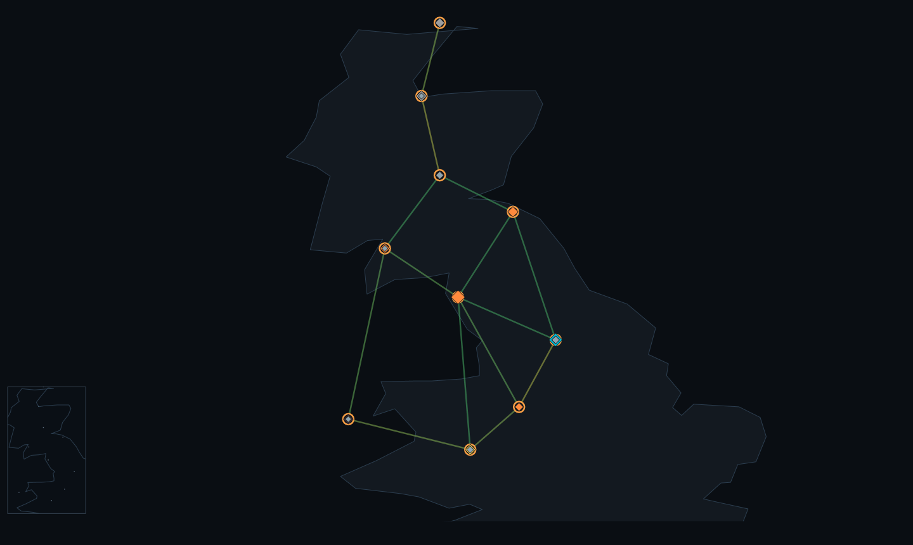
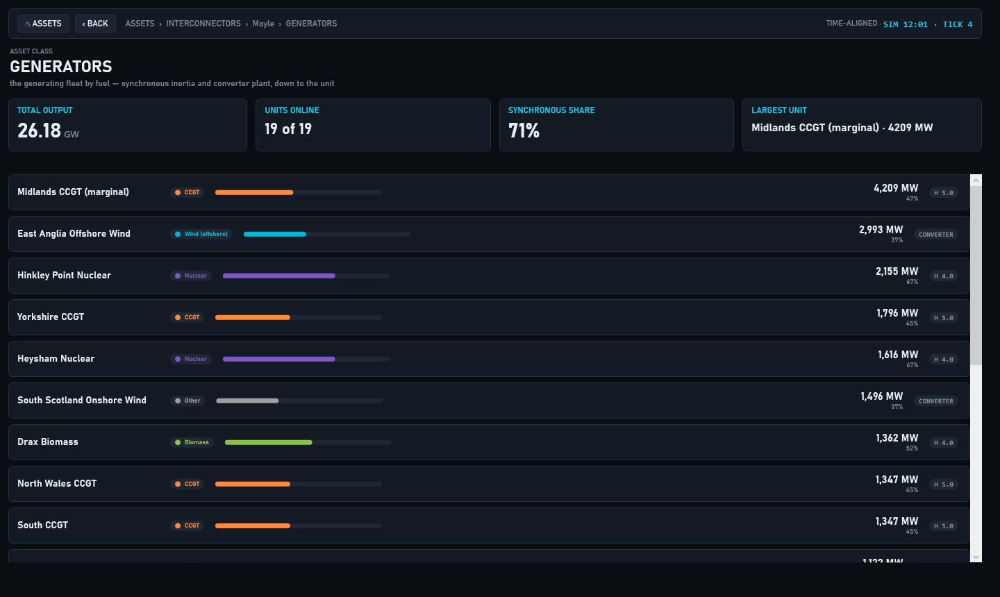
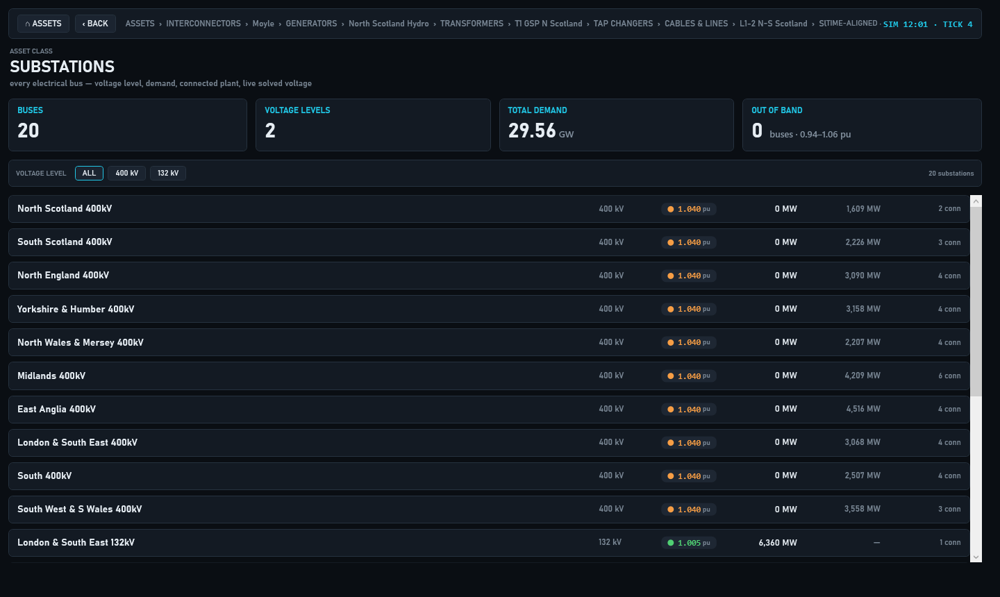
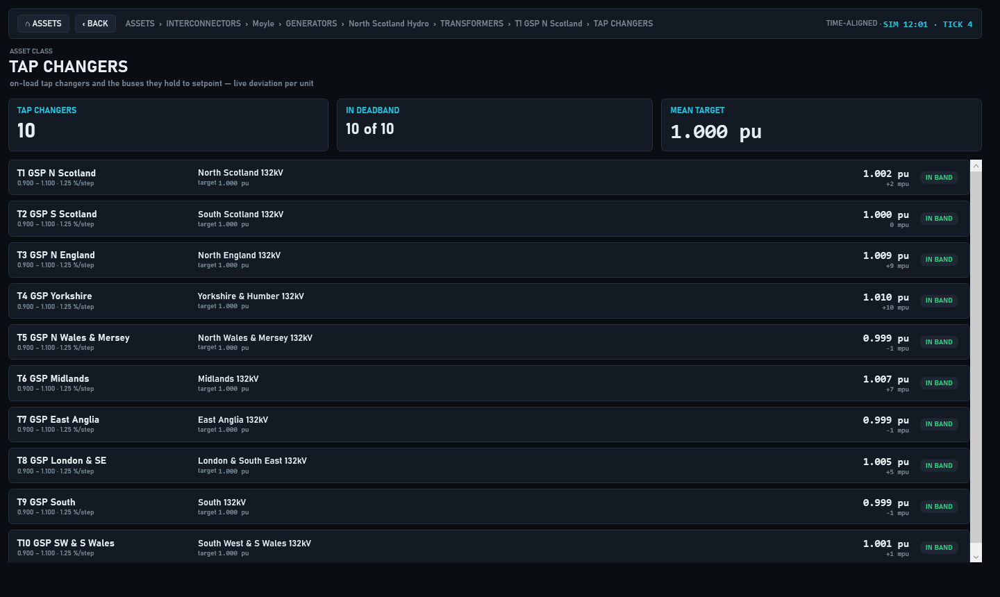

# 8. The desktop app

`GridSim.Wpf` is the Windows control-room dashboard. It solves a network once per tick and shows the result as a live
map, a column of system read-outs, and sixteen tabs that each read the same solved frame. It runs three kinds of feed
through the same screens: a local live solve, a recorded run directory that you step through, and a stream from the GDA
bridge. This chapter covers starting it, the window, the model picker, the map, the live view and its controls, the
tabs, the asset explorer, run replay, bridge mode and `settings.json`. The browser version is summarised at the end.

The app is a WPF program (`net10.0-windows`), so it runs only on Windows. It builds on other systems.

## Starting it

```bash
dotnet run --project src/GridSim.Wpf
```

Close the app before rebuilding: a running copy locks its own binaries (see [ch. 1, Getting started](<0001 Getting started.md>)).
The window opens maximised, titled `GridSim  -  GB Transmission Control  -  v<version>  -  <tier> licence`, and starts
solving at once.

### Launch arguments

All arguments are optional. The app reads the raw command line (`Environment.GetCommandLineArgs()`), checks it
(`GridSim.Core.Presentation.DesktopLaunchArgs`) and applies it.

- **`--zone <text>`** pre-selects the bridge ZONE picker: the first zone whose case name contains the text,
  ignoring case (`--zone ukpn` selects `zone-ukpn`).
- **`--back <days>`** pre-selects the bridge FROM picker. The value must be a whole number equal to one of the
  presets (9, 12, 14, 21, 30 or 60).
- **`--bridge-source <name>`** pre-selects the bridge SRC picker: `presolved`, `estimated` or `live`, ignoring case.
- **`--tab <text>`** opens on the first tab whose header contains the text, ignoring case, scanning left to right
  (`--tab operator`).
- **One other word** is the model text. The app opens on the first model-picker entry whose label contains it,
  ignoring case (`case118`, `GB full`, `Replay`). With no model text, it opens on the model you last used, and on the
  first entry in the picker if that model no longer exists.

Each flag takes its value as the next word, and that word is never the model text: `--back 30` sets the look-back and
leaves the model alone, and `--tab OPERATOR` on its own opens the last-used model on the OPERATOR tab.

The app refuses a command line it cannot honour. It shows a message listing every problem and closes with exit
code 2 (a usage error, as in the CLI) instead of opening on something you did not ask for. It refuses:

- a value that matches nothing: a zone, tab or model text that no entry contains, a `--back` that is not a preset, or a
  source that is not one of the three;
- a `--back` that is not a whole number of days;
- a flag with no value after it, or followed straight by another flag;
- a flag given twice, or two model words (quote a label that contains spaces);
- an unknown option. Flags match exactly and case-sensitively, so `--Zone` is refused with a hint, and only the
  two-token form is read, so `--zone=ukpn` is refused with the right spelling.

The first three only pre-select pickers. They connect to nothing: the pickers act only once the Live bridge entry
is selected (see [Bridge mode](#bridge-mode)). To boot into bridge mode, select Live bridge by model text and add
the picker arguments:

```bash
dotnet run --project src/GridSim.Wpf -- bridge --zone ukpn --back 30 --bridge-source estimated
```

## The window

The window has four horizontal bands.

**Header (top).** From left to right:

- **NETWORK** - the model picker. See [The model picker](#the-model-picker).
- **SOLVER** - the power-flow engine, with a read-out beside it. See [The solver picker](#the-solver-picker).
- A **find** box. Type part of a substation name and press Enter: the map centres on the first bus whose name contains
  the text (ignoring case) and opens its fly-out. With no match the event log records `No substation matching '...'`.
- **LOAD RUN...** - opens a run directory for replay ([Replaying a run directory](#replaying-a-run-directory)).
- **AUDIT LOG...** - opens the audit-log window. Choose a `gridsim-audit/1` log there with its own OPEN LOG...
  button. The optional `anchor count` and `anchor head` boxes (entry count and head hash recorded elsewhere) can be
  filled in first; a bad anchor shows `NOT CHECKED: ...`. The whole hash chain is verified before anything shows, exactly as `gridsim audit show`
  does. A log that verifies lists every entry and the OK line; a log that does not verify shows only the TAMPERED
  verdict and no entries. See [ch. 26, Audit log, deployment and assurance](<0026 Audit log, deployment and assurance.md>).
- On the right, the **status lamp** and the clock: the simulated clock, `tick` and the tick count.

**Tab strip and tab content.** Sixteen tabs ([The tabs](#the-tabs)).

**Transport bar.** One playback bar under the tabs, visible from every tab ([The transport bar](#the-transport-bar)).

**Footer.** A legend: `ROUNDEL = SUBSTATION (ring colour = voltage)` and `LINE = CORRIDOR (dashes = power flow, colour = loading)`.

### The status lamp

The lamp grades every solved frame in a fixed priority order, and shows the first condition that holds:

1. **NOT CONVERGED** - the power flow stopped without converging, so its voltages and flows are not an operating
   point. The lamp is red, and an alarm is raised.
2. **FREQUENCY EVENT** - the frequency is outside the operational band 0.2 Hz either side of the case's nominal
   (below 49.8 Hz or above 50.2 Hz on a 50 Hz case; exactly the edges are in band), or the RoCoF magnitude is above
   1 Hz/s, the GB loss-of-mains relay setting (exactly 1 Hz/s is not an event). The web lamp applies the same rules.
3. **VOLTAGE ALERT** - the lowest bus voltage is below 0.94 pu or the highest is above 1.06 pu. Exactly 0.94 pu and
   1.06 pu are in band.
4. **CORRIDOR ALERT** - a transmission boundary is over its limit.
5. **SYSTEM NORMAL** - none of the above.

A non-converged frame never shows SYSTEM NORMAL. A solver exception, or a frame the app cannot render, shows
**SOLVE FAULT** with an alarm and an event-log line. On a bridge feed, a what-if state on the map prefixes the verdict
with **WHAT-IF**, and a stream that has stopped shows **STREAM LOST** ([Bridge mode](#bridge-mode)).

### The NETWORK tab

The NETWORK tab is the main screen and has three columns.

- **Left: read-outs.** SYSTEM FREQUENCY (a dial from 49.5 to 50.5 Hz, the value in Hz and the deviation from 50 Hz),
  DEMAND (GW), GENERATION (GW, labelled `net bus injection`: the sum of positive net bus injections, so generation at a
  bus with local demand is counted net of that demand), INERTIA (GVAs), LOSSES (MW), GRID SPEED (rpm) and TORQUE (MNm), the VOLTAGE BAND card
  (lowest to highest bus voltage, against the 0.94 - 1.06 band), and VOLTAGE BY LEVEL, one small gauge per nominal
  kV level showing its deviation from nominal.
- **Centre: the map** ([The network map](#the-network-map)).
- **Right: TRANSMISSION BOUNDARIES** (each boundary with a loading bar, its percentage and its flow), **ALARMS** (up
  to 12 rows, newest first, with a CLEAR button), and the **EVENT LOG** (the newest 14 lines, newest first).

GRID SPEED is the frequency expressed as the speed of a two-pole machine: `frequency / 50 Hz x 3000 rpm`. TORQUE is
the total generation divided by the angular frequency, `P / (2 pi f)`, in MNm. Both follow the live frequency.

## The model picker

The NETWORK picker lists every model the app can find, in this order. Labels are exactly as shown, except that when
two entries would share a label (two `gda-out/` or `results/` folders with the same name under different parents) each
gets its parent folder appended in brackets, so every label is unique.

| Picker label | What it is | Where it comes from |
|---|---|---|
| `GB reduced  10-zone` | The reduced GB model. The default first entry. | `data/uk` next to the app |
| `GB synthetic  distribution depth` | The GB model with synthetic distribution depth. | `data/gb-synthetic` |
| `GB full  3539-bus transmission` | The full GB transmission model. | `data/gb-full` |
| `GDA  <folder>` | A model materialised by `gridsim gda --out`, one entry per sub-folder holding a `system.json`. | `gda-out/` |
| `MATPOWER  <case>` | One entry per `.m` file, sorted by path. | `data/matpower` (recursive) |
| `Replay  <run>` | A recorded run directory ([Replaying a run directory](#replaying-a-run-directory)). | `results/` folders, or LOAD RUN... |
| `Live bridge` | A stream from the GDA bridge ([Bridge mode](#bridge-mode)). | Listed only when `BridgeEndpoint` is set |

An entry appears only when its files are present. The three bundled GB entries and the MATPOWER entries come from the
`data/` folder that the build copies beside the executable. The app looks for `gda-out/` and `results/` in the
application folder and in each of its seven parent folders, so they are found whether you run from the repository
root or from `bin/`. A folder that cannot be read (access denied, a dropped network share) is skipped, and the event
log names it. If no model is found at all, the app shows a message box and stays empty.
[Ch. 2, Loading networks](<0002 Loading networks.md>) describes the models themselves.

A model loads in this order: parse the case (MATPOWER cases are normalised for raw ohm and kW distribution files),
give coordinate-less cases a tube-map layout, check the bus count against the licence, build the solver, load the map,
start the first solve and fit the map. The licence gate counts buses only. The bundled GB and MATPOWER models are
exempt. A `GDA` model above the active tier's bus limit is refused, with the reason on the event log (see
[ch. 4, Licensing and activation](<0004 Licensing and activation.md>)). A local model or replay that was running
stays running after a refusal. A bridge feed is disconnected before the gate runs, so a refusal leaves it
disconnected, and the refused entry stays selected in the picker.

Two behaviours depend on the model type:

- **GB and GDA models** run the day demand curve. The simulated clock starts at 08:00.
- **MATPOWER cases** have no demand profile. They hold their loads steady and re-solve the same operating point every
  tick, warm-started from the last converged solve.

A case that ships an authored `asset-classes.json` drives the live frequency through the asset-aware integrator,
which is what makes the INVERTER FLEET tab live.

### The solver picker

| Choice | Engine |
|---|---|
| Auto | Chosen per network |
| Newton (dense) | Dense Newton-Raphson |
| Newton (sparse) | Sparse Newton-Raphson |
| Sweep (radial) | Backward/forward sweep |

Auto picks the sweep for a strictly radial network, sparse Newton above 1,500 buses (`LiveSolveSettings.SparseThresholdBuses`),
and dense Newton otherwise. The read-out beside the picker shows what runs: `auto * Newton-Raphson (dense)` under Auto,
the engine name alone under an explicit choice, `replay` for a run directory and `bridge` for the bridge. Changing the
solver rebuilds the running local model on the new engine and restarts its timeline. On a replay (pre-solved) and on
the bridge (solved by the server) the picker is disabled, because the choice has nothing to rebuild. On the sparse engine the live view
caps the solve at 40 iterations (`LiveSolveSettings.SparseMaxIterations`), does not enforce generator reactive
limits, and skips the on-load tap-changer loop; the sweep also skips that loop. Engine behaviour is described in
[ch. 5, Running power flows](<0005 Running power flows.md>).

## The network map

The map draws substations as roundels and corridors as lines.

- **Ring colour** is the bus voltage, on every model. Blue is low, green is nominal, amber and red are high
  (see below).
- **Line colour** follows the colour mode ([Colour modes](#colour-modes)). **Dashes** march along each line in the
  direction of the real-power flow. The animation takes at most one step per 65 ms (15.4 frames per second).
  Transformer branches are not drawn as animated corridors.
- Roundel size and ring weight follow voltage level. Models of up to 800 buses draw every bus at every zoom. Larger models draw
  the highest-voltage buses first and add lower-voltage ones as you zoom in. Hover and click hit only the buses
  being drawn.
- A **minimap** sits at the bottom left. Clicking inside it recentres the main view. It is not drawn when the
  view is too small: it needs a width and a height of at least 24 pixels and 24 pixels of spare height.
- The map title is `GB TRANSMISSION NETWORK  LIVE POWER FLOW`, and a permanent hint line along the bottom edge lists
  the mouse actions and the map keys for the current feed: on a local model right-click trips, `T` trips the largest
  unit and `.` / `,` change the step; on a replay there are no trips; on a bridge right-click opens the what-if menu.
  `Esc` closes the detail fly-out.
- While a bridge query result is shown, a WHAT-IF banner across the top of the map carries the query title and its
  verdict ([Bridge mode](#bridge-mode)).

### Moving around

- **Scroll** zooms about the cursor, by a factor of 1.15 per notch.
- **Drag** pans. A press that moves 3 pixels or fewer is a click.
- **Fit** (key `F`) fits the whole network to the view with a 36 pixel margin. The app also fits after every model
  load.
- **Dive in** (double-click). Double-clicking a substation centres it and zooms to six times the fit zoom. Double-clicking
  empty space zooms 1.6 times toward the cursor. The find box does the same dive-in for a named bus.
- **Hover** a bus for a tooltip: its name, its nominal kV, its solved voltage in pu and its demand in MW.
- **Click** a bus for a fly-out: the Voltage, Demand and Generation rows, and up to twelve connected branches with
  their loading. A branch fly-out shows its Type (Circuit or Transformer), Rating in MVA, Flow in MW (the larger of
  the two end flows) and Loading. **OPEN IN EXPLORER** selects the ASSETS tab and opens the bus or branch there. The close
  button on the fly-out, or `Esc`, clears the selection.



The screenshots in this chapter were captured on an earlier build. Their glyphs and some labels (a middle dot in the
header clock, dashes in subtitles) differ from the current ASCII text, which the prose gives.

### Colour modes

The colour button on the transport bar cycles LOADING, VOLTAGE, CONDITION and STRESS and back to LOADING. A legend panel
at the bottom left of the map shows the ramp and its end labels for the current mode.

| Mode | What colours the lines | Ramp | Legend ends |
|---|---|---|---|
| LOADING | Branch loading as a fraction of rating; a branch with no rating uses its flow against a 2,000 MW reference | Green at 0, amber at 0.6, red at 1.0 and above | 0% to 100% |
| VOLTAGE | Mean voltage of the branch's two buses | Blue at 0.96 pu and below, green at 1.00, amber at 1.03, red at 1.06 and above | 0.94 to 1.06 |
| CONDITION | Mean condition index of the branch's two end buses (rings use the bus's own index) | Green healthy to red critical, amber at 0.5 | healthy to critical |
| STRESS | Per-branch stress | Blue cool to red hot, amber at 0.5 | cool to hot |

Line colours step in 12 bands. Transformer branches are excluded from the line colour bands. CONDITION and STRESS are
fed only by the bridge stream. On any other feed, or before the first bridge overlay arrives, lines draw the lowest
colour. CONDITION recolours the rings by condition index as well as the lines, but only once an overlay has arrived:
until then the rings stay voltage-coloured, as they do in every other mode.

The FLEET button overlays the generation fleet on the map: one diamond per unit, coloured by fuel and sized by
capacity. The map toggles `M` (minimap), `C` (coastline), `B`
(boundary cuts) and `G` (GSP areas) are listed under [Keyboard shortcuts](#keyboard-shortcuts). The DNO, GSP and
ASSETS buttons overlay real geography: DNO licence-area boundaries, GSP regions, and geocoded REPD/DUKES assets
coloured by technology. They are dimmed and disabled unless that geography has been materialised locally under
`gda-out/geo` (files `dno_areas.geojson`, `gsp_regions.geojson` and `assets.geojson`). The three buttons and the
`D`, `R` and `A` keys are enabled together when any one of the three files loads, not per file; a file that cannot be
read leaves its layer empty and the event log says `Geography layer not loaded: <file>: <reason>`. The app reads
`gda-out/geo` next to the executable, or, when run from a repository clone, in a parent folder up to the repository
root (the folder holding `GridSim.slnx`), never above it. Imported test cases have none.

## The live view

A local model solves once per timer tick on a background thread. The timer interval is 800 ms divided by the
playback speed. A solve never overlaps the previous one: if the previous solve is still running when the timer fires,
that tick is skipped.

### Controls

- **PAUSE / RESUME** stops and restarts the timer. While paused the map animation also stops.
- **STEP** sets the simulated time advanced by each solve: 1 ms, 10 ms, 100 ms, 1 s, 10 s, 1 min, 5 min or 20 min
  (default 20 min). The frequency model integrates the swing equation at the step size. Fine steps let you watch
  RoCoF and the nadir after a trip in slow motion; coarse steps sweep the demand curve.
- **x1** cycles the playback speed x1, x5, x15, x60. It sets how often a solve is attempted: every 800, 160, 53.3
  or 13.3 ms. It does not change the STEP size. The real rate is lower when a solve takes longer than the interval.
- The colour, FLEET, DNO, GSP and ASSETS buttons act on the map.

### Frequency display

The frequency comes from a swing-equation integrator advanced at the STEP size, with a small ambient load imbalance
(0.08 % of base demand) that keeps the dial moving, at the case's own nominal frequency. The dial sweeps 120 degrees
either side of centre at a deviation of 0.5 Hz, and its end labels follow the nominal. The dial's track is drawn over
the same 240 degrees, so each labelled end is full scale, and its green band covers the 0.1 Hz green zone of the
number. The GRID SPEED dial on the GENERATION tab uses the same geometry. The number is green below
0.1 Hz deviation from nominal, amber from there to the edge of the operational band, and red outside it, by the
lamp's own rule, so at exactly 49.8 Hz or 50.2 Hz on a 50 Hz case both the number (amber) and the lamp read in band.
When a case carries no usable inertia data the integrator uses a substitute fleet inertia: a value under
100 MW.s is replaced by 4 s on the fleet's MVA base (`LiveSolveSettings.MinInertiaMwS` and `FallbackInertiaH`).

### Right-click: trip

Right-clicking a bus on a live model trips its largest infeed: the unit generating the most at that bus now, by
live output (power-flow-only devices, the slack balancer and voltage-control units, are never chosen). The loss
enters the frequency integrator and plays out at the current STEP. The event log records the unit, its MW, the RoCoF
and the nadir, an alarm is raised, and the GENERATION & INERTIA tab computes its trip comparison. The header lamp is
left to the next frame's lamp rule, so a small trip that keeps the frequency in band does not light FREQUENCY EVENT.
Pressing `T` trips the largest online unit on the whole system. A bus with no generating unit logs `No generation to
trip at <name>`, and `T` with no generating unit logs `No generation to trip`.

A trip is a frequency what-if: the unit's output enters the integrator as a loss, but the unit stays in the dispatch,
so it is still the largest infeed on the next frame. A second trip of the same unit in the same run is therefore
refused, with the reason in the event log, rather than counted again. Loading a model starts a new run.

On a replay or a bridge feed the app has no local solver. In replay, a right-click on a bus logs `TRIP is not
available on this feed (replay or bridge stream)`. In bridge mode a right-click opens the bridge menu
([Bridge mode](#bridge-mode)).

## The tabs

There are sixteen tabs, in this fixed order. All read the one solved frame; none re-solves the base case. The EXPERIMENTAL tab
does its work only while it is the selected tab; switching to it computes the current frame at once. A tab that is
also a chapter 10 view is marked, and that chapter explains how to read it.

| Tab | What it shows |
|---|---|
| NETWORK | The map, the system read-outs, the boundaries, alarms and event log, described above. |
| GENERATION & INERTIA | Fuel mix split into synchronous and converter-connected plant, live system inertia, and the TSGB device what-if. |
| THE MACHINE | The grid as one rotating mass: FUEL IN, the shaft (power by voltage level), the instruments (speed, commanded and delivered torque, TORQUE GAP), MAINS CLOCK DIVERGENCE, the grid battery and regeneration, POWER OUT, and the electrical instruments (voltage, reactive balance, tap positions). |
| SCADA | A telemetry-style points list with navigation to the asset explorer. See [ch. 10, Analysis views](<0010 Analysis views.md>). |
| OPERATOR | The generation stack, boundary transfers and the dispatch view. See ch. 10. |
| MARKET | Wholesale and balancing prices: imbalance price, market index, BSUoS, constraint cost, carbon, demand and interconnector flows. The price fields fill only from a bridge stream; on other feeds only demand, renewable share and an indicative carbon intensity (computed from the dispatch) are live. See ch. 10. |
| NESO RP1 | The stability panel: purchased time, inertia split, credible-loss and correlated-trip risk. See ch. 10. |
| MECHANICAL | The per-machine plant view: stored kinetic energy per unit, P-Q capability and RoCoF relay margins. See ch. 10. |
| HUMAN SCALE | The same quantities in everyday units. Presentation only. |
| SPEED DOMAINS | The distributed-inertia view: coherent speed domains and dominance. Experimental. |
| INVERTER FLEET | Authored per-asset dynamics: fleet net response, per-class online MW and state of charge, trips and the Loss-of-Mains deficit. It shows OFF unless the case ships `asset-classes.json`. |
| EXPERIMENTAL | The physical-law conformance audit with its hard-gate verdict, and the provenance-tagged experimental models (reciprocity, continuum wave, flow tracing, carbon intensity). Flow tracing and carbon intensity are skipped on models above 1,500 buses (`trace skipped (>1500 buses)`, carbon shows `-`). The continuum-wave model reads "needs per-machine inertia" and is not built when the solve did not converge, when there are no generators, or when any generator has no inertia constant. |
| HARMONICS | A reference panel for `gridsim harmonics`: what the study covers, the command line, and the schema names. It runs no study. See [ch. 17, Harmonic studies](<0017 Harmonic studies.md>). |
| CYCLE | The resident analysis cycle's budget read-out: high-tier jobs met or missed, utilisation and per-job outcomes. See ch. 10. |
| ASSETS | The asset explorer ([The asset explorer](#the-asset-explorer)). See ch. 10. |
| ABOUT | The release number, build, runtime and active licence, and where a crash log is written. |

An unhandled exception on the UI thread or on any other thread writes a crash log, shows a message box naming its
path and ends the app. A failed background task that nobody awaited writes a crash log only, with no message box, and
the app keeps running.

## The transport bar

One bar sits under the tabs and its contents change with the feed.

| Control | Live | Replay | Bridge |
|---|---|---|---|
| PAUSE / RESUME / PLAY | yes | yes (label PLAY when stopped) | opens playing (label PAUSE); PAUSE holds the display |
| restart, previous, next, scrubber, frame read-out | hidden | shown | hidden |
| STEP | shown | hidden | hidden |
| x1 speed | yes | yes | disabled (the server paces the stream) |
| SOLVER | yes | disabled (pre-solved) | disabled (solved by the server) |
| Colour, FLEET, DNO, GSP, ASSETS | yes | yes | yes |
| ZONE, FROM, SRC | hidden | hidden | shown |

## The asset explorer

The ASSETS tab is a navigable stack of pages over every asset class in the running model. The landing page has one card
per class with a live count and a headline metric:

| Card | Opens | Headline metric |
|---|---|---|
| GENERATORS | The generating fleet by fuel | Dispatched output in GW |
| GENERATOR PHASORS | Every generator's voltage-current phasor | Voltage-angle spread across the network, in degrees |
| INTERCONNECTORS | The GB import links, with signed flow | Net flow in GW, labelled NET IMPORT or NET EXPORT, or BALANCED below the shared 0.5 MW idle cut-off (the GENERATION tab's) |
| TRANSFORMERS | GSP and grid transformers by voltage band | Mean loading of rated transformers |
| CABLES & LINES | Transmission corridors, ordered by stress | Peak circuit loading |
| SUBSTATIONS | Every bus | Count of buses outside 0.94 - 1.06 pu |
| TAP CHANGERS | On-load tap changers and the buses they regulate | Count held within their deadband, shown as `n / N` |

Each fleet page lists its items; click an item for its detail page. Detail pages cross-link: a circuit to its two
substations, a substation to its plant and circuits, a generator back to its bus. The BACK button pops one page, ASSETS
returns to the landing page, and the breadcrumb shows the trail. The header strip shows the simulated time and tick of
the displayed frame. The visible page refreshes with every frame while the ASSETS tab is selected, and not while
another tab is showing.







Several routes lead into the explorer: OPEN IN EXPLORER on the map fly-out, a click on a SCADA point, and the cards
on the landing page. The first two select the ASSETS tab by its name. In bridge mode, a substation page opened from the map also asks the bridge for that bus's
per-asset data at the stream's historical instant (generator envelope, battery storage, tap-changer wear and
consumers). The page says when none resolved or why the query failed.

## Replaying a run directory

The app can step through a recorded run instead of solving live. A run directory is the output of `gridsim transient`
or `gridsim gda-replay`; see [ch. 5, Running power flows](<0005 Running power flows.md>) and
[ch. 31, Exports and formats](<0031 Exports and formats.md>).

### What is discovered

A directory is a run when it has an `exports/` folder holding JSON files named `slice-<n>.json` or `state-<n>.json`,
where `<n>` is an integer. The app lists, as `Replay  <folder name>`, every sub-folder of every `results/` folder in
the application folder and its seven parent folders that is a run. **LOAD RUN...** opens a folder browser for a run
anywhere else, adds it to the picker and selects it; a run already listed (the same folder) is selected, not added
again. A folder that is not a run is refused with the event-log line
`Not a run directory (no exports/slice-*.json or state-*.json).`

### Playing a run

A replay opens **paused on frame 0**, with the solver read-out `replay`. Frames play in the numeric order of the
file names. The event log records the frame count, the number of buses, and for a run of more than one frame the
first and last frame labels. The transport bar shows:

- **PLAY / PAUSE** - frames advance at the timer interval (800 ms divided by the speed), and playback stops on the
  last frame. PLAY on the last frame restarts from frame 0.
- **restart** - back to frame 0.
- **previous / next** - step one frame. This is the frame stepping control.
- **the scrubber** - a slider across every frame, snapping to whole frames. Dragging to frame 0 restarts the timeline
  exactly like restart does.
- **the read-out** - `frame 12/480  *  <label>`, with the frame number from 1.

Each frame carries its own solved voltages and flows. A sidecar CSV beside the exports is matched to frames on its
`tick` or `index` column. A `transient` run writes `timeseries.csv`, which supplies frequency, RoCoF, generation,
demand, the clock and the frame label. A `gda-replay` run writes `state-estimate.csv`, which has no frequency, RoCoF,
generation or demand columns, so it supplies only the clock (from `time_utc`) and the frame label. For every value a
sidecar does not supply, including all four scalars on a `gda-replay` run, generation and demand are summed from the
frame, the frequency is the model's nominal frequency and RoCoF is 0. Frames from an exported `transient` run are a
sample of its slices, so the replay steps through snapshots, not every slice. A time-integrated read-out, such as THE
MACHINE's accumulators, restarts on every restart, on every step back and on every backward scrub (including a scrub
to frame 0), so it never double-counts a replay.

## Bridge mode

Selecting **Live bridge** in the picker streams topology and solved states from a GDA bridge server. There is no local
solver and no local model files, and the server paces the stream (2 frames per second). The entry exists only when
`BridgeEndpoint` in `settings.json` is set. A fresh install leaves it blank, so a new install lists no bridge.
Starting and configuring the server is [ch. 24, The GDA bridge](<0024 The GDA bridge.md>). Using the
estimated-state source is [ch. 23, Replaying estimated states](<0023 Replaying estimated states.md>).

Three pickers appear on the transport bar. Changing any of them restarts the stream on the same connection.

- **ZONE** - the network to stream. The choices are `NGED  -  Midlands/SW/S.Wales` (`zone-nged`, the default),
  `UKPN  -  London/South East/East` (`zone-ukpn`), `SSEN  -  N.Scotland/Southern` (`zone-ssen`),
  `SPEN  -  Scotland/Merseyside` (`zone-spen`), `NPg  -  North East/Yorkshire` (`zone-npg`),
  `ENWL  -  North West` (`zone-enwl`), `GB full` (`gb-full`) and `GB spine  -  GSP-level` (`gb-spine`).
- **FROM** - the historical instant the stream starts from: `9 days ago` (the default), `12 days ago`, `2 weeks ago`,
  `3 weeks ago`, `30 days ago` or `60 days ago`. Every preset is behind the 169 hour no-forward-inference horizon, so
  the server never rejects it. With no preset selected the look-back is 9 days.
- **SRC** - the reconstruction that plays. **PRESOLVED** is the demand-scaled re-solve lake. **ESTIMATED** is the
  measurement-fitted lake, where each frame carries a chi-square quality block shown on the status pill; the pill
  turns red when the fit fails its quality test. The pill adds `WARNING: robust re-weighting (IRLS) hit its cap,
  weights not settled` when the server sends `irlsCapReached` and a robust fit's re-weighting stopped on its cap; no
  current server sends that field, so the warning does not appear today. **LIVE** is a static network with
  only the system scalars moving.

The server paces the stream, and the bar opens playing (the button reads PAUSE). **PAUSE** holds the display on the
frame showing: the map, its overlays and dash animation, the HUD and the OPERATOR and MARKET tabs stop changing, and the
pill reads `PAUSED  *  <zone>  *  display held, stream still running`. The stream itself keeps running on the server,
and the app keeps only the newest frame. **PLAY** shows that newest frame and follows the stream again. Changing ZONE,
FROM or SRC, or RETURN TO LIVE, also resumes playing.

**Status pill and HUD.** A pill at the top left of the map shows the connection state: `CONNECTING`, `LIVE  *
streaming <zone>`, `ESTIMATED  *  <zone>  *  <quality>`, `RESTARTING`, `QUERY`, `WHAT-IF`, `HORIZON REJECTION  *
stream stopped`, `BRIDGE FAULT  *  disconnected`, or a connect or restart failure with its reason. `WHAT-IF` shows only
while a what-if state is on the map; after a scalars-only or failed query the pill returns to `LIVE` with the next
frame, and a failed query also raises an alarm. When the stream stops (a fault or a horizon rejection) nothing on
screen is live any more: the header lamp reads `STREAM LOST`, an alarm says the map shows the last frame received, the
HUD is hidden, the OPERATOR, MARKET and NESO RP1 bridge blocks are cleared, and a right-click on the map offers
**Reconnect to the bridge**. Changes of ZONE, FROM or SRC in quick succession restart the stream one at a time, and
a burst of changes ends on the newest selection. A HUD at the
bottom right shows INERTIA in GVA.s, FRAGILITY (a condition index with a trend cue) and RoCoF HEADROOM in Hz/s.
FRAGILITY is coloured on the stream's 0 to 100 fragility scale. The streamed network carries no machine inertia
constants, so the dashboard's INERTIA tile shows the stream's own inertia figure (or ` - ` when the stream sends
none) rather than a model total of 0. The
OPERATOR and MARKET tabs fill from the stream's operator and market blocks, and CONDITION and STRESS colouring
works.

**Right-click.** A right-click opens a menu of queries that the server evaluates at the stream's historical instant:

- on a bus, `Feasibility: +500 MW here  (<bus>)` and `Scenario: trip the largest generator at <bus>` (the largest
  physical unit generating there, by the same rule as a local trip), or, when no unit generates at that bus,
  `Scenario: trip the largest unit in the model (none generating at <bus>)`;
- on a branch, `Scenario: trip this  (<branch>)`;
- while a result is shown, `Return to live stream`.

The server picks the element to trip by name (technical chapter 9), so a trip is not sent for an element with no name
or whose name also matches another element in the model: the branch item is shown disabled with the reason, and a
generator trip logs it.

A result that carries a converged solved state goes through the same path as a live frame: the map, the header lamp
(marked `WHAT-IF`), the read-outs and the tabs all show the what-if state, and live frames are held off. A solved
state that did not converge is never drawn: the WHAT-IF card shows the verdict with a red badge and says the solve did
not converge. The right-hand column shows a WHAT-IF card with the verdict, the binding constraint and the violations,
and a **RETURN TO LIVE** button.

## settings.json

`%LOCALAPPDATA%\GridSim\settings.json` holds the state the app restores. The app writes it when the window closes. A
missing file means the defaults apply. An unreadable or malformed file also leaves the defaults in force, but the event
log says why, and the app does not overwrite that file when it closes, so a hand edit (such as `BridgeEndpoint`) with a
typo is kept for you to fix. A write that fails does not stop the window closing.

| Key | Default | Meaning |
|---|---|---|
| `LastSource` | none | Label of the model selected when you last closed the app. Used only when `LastSourcePath` is absent or matches nothing. |
| `LastSourcePath` | none | Full path (or bridge URL) of the model selected when you last closed the app. Labels can repeat; the path cannot, so this is matched first. |
| `ColorVoltage` | `false` | `true` restores VOLTAGE colouring, `false` LOADING. CONDITION and STRESS are saved as LOADING. |
| `Fleet` | `false` | The FLEET overlay. |
| `Minimap` | `true` | The minimap. |
| `Coast` | `false` | The coastline. |
| `Boundaries` | `false` | The boundary cuts. |
| `GspAreas` | `false` | The GSP areas. |
| `DnoAreas` | `false` | The DNO overlay. |
| `GspRegions` | `false` | The GSP region overlay. |
| `Assets` | `false` | The geocoded assets overlay. |
| `BridgeEndpoint` | empty | WebSocket URL of the GDA bridge. Non-empty adds the Live bridge entry. |

The licence is resolved separately, offline: the `GRIDSIM_LICENCE` environment variable, then
`%LOCALAPPDATA%\GridSim\licence.gridsim`, then the free Personal tier. See
[ch. 3, Configuration](<0003 Configuration.md>) and [ch. 4, Licensing and activation](<0004 Licensing and activation.md>).

## Keyboard shortcuts

The shortcuts are window-wide and act on the map. They are ignored when keyboard focus is in a text box, a password
box or a combo box, and for Ctrl and Alt chords, so typing a substation name never trips a unit. Click the map to
return keyboard focus to it.

| Key | Action |
|---|---|
| `F` | Fit the network to the view. |
| `M` | Toggle the minimap. |
| `C` | Toggle the coastline. |
| `B` | Toggle the boundary cuts. |
| `G` | Toggle the GSP areas. |
| `D` | Toggle the DNO overlay. Needs local geography. |
| `R` | Toggle the GSP regions. Needs local geography. |
| `A` | Toggle the geocoded assets. Needs local geography. |
| `T` | Trip the largest online unit on the system (live feed only). |
| `.` | A finer STEP. |
| `,` | A coarser STEP. |
| `Esc` | Clear the selection. |

## Performance

The fixed numbers are these: the map animation takes at most one step per 65 ms; the timer interval is 800 ms divided by the speed;
solves never overlap; models above 1,500 buses solve on the sparse engine under Auto; and models above 800 buses
draw only their higher-voltage buses until you zoom in. Solve timings by engine are in
[ch. 28, Benchmarking and GPU](<0028 Benchmarking and GPU.md>). The CYCLE tab reports the measured base-solve
time of the model on the machine in front of you.

## The web app

`GridSim.Web` is a browser version of the same control room, built on the same `GridSim.Core` solve. It runs on any
platform. It differs from the desktop app in these ways:

- It has no ZONE, FROM or SRC pickers. A bridge session is chosen by its address.
- It adds the tabs TRIP / DEVICE and CONFORMANCE, and AUDIT LOG is a tab, not a button. It has no ABOUT tab on its
  full strip.
- Its HARMONICS tab runs the study in the page, where the desktop tab is a reference panel.
- A raw public-data replay session shows a reduced tab strip.

## Limits

- CONDITION and STRESS colouring have data only on a bridge feed.
- DNO, GSP and ASSETS geography needs `gda-out/geo` materialised locally; no geography ships with the app.
- The Live bridge entry is absent until `BridgeEndpoint` is set by hand.

## See also

- [ch. 1, Getting started](<0001 Getting started.md>) - building and the rebuild file-lock
- [ch. 2, Loading networks](<0002 Loading networks.md>) - what the model picker finds
- [ch. 5, Running power flows](<0005 Running power flows.md>) - the engines and the run directories the app replays
- [ch. 10, Analysis views](<0010 Analysis views.md>) - the analysis tabs one by one
- [ch. 14, Frequency studies](<0014 Frequency studies.md>) - tripping an infeed and watching the dial
- [ch. 23, Replaying estimated states](<0023 Replaying estimated states.md>) and [ch. 24, The GDA bridge](<0024 The GDA bridge.md>) - the bridge in depth
- [ch. 19, CLI reference](<0019 CLI reference.md>) - the verbs that produce the data the app shows
