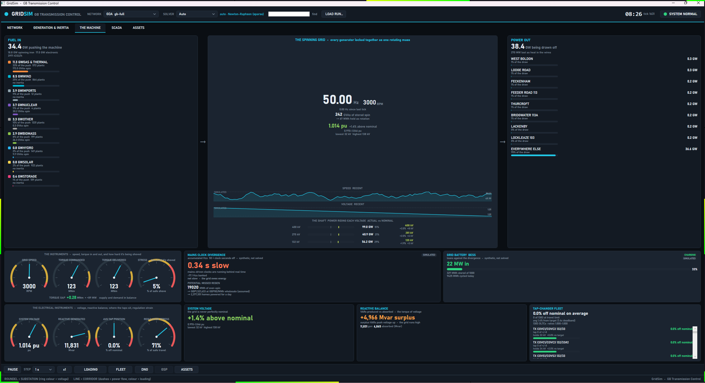

# 10. Analysis views

The desktop app solves one network per tick and every tab after NETWORK reads that one solved frame. This chapter
covers the analysis tabs: what question each answers, what every panel computes and from which Core type, the
thresholds and colours it uses, the provenance of each number, and where the web dashboard differs. The tabs are
SCADA, OPERATOR, MARKET, NESO RP1, MECHANICAL, THE MACHINE, CYCLE, ASSETS, GENERATION & INERTIA, HUMAN SCALE, SPEED
DOMAINS, INVERTER FLEET and EXPERIMENTAL. Starting the app, the transport bar, the model and source pickers, the
NETWORK tab and ABOUT are in [the desktop app](<0008 The desktop app.md>). HARMONICS is in
[harmonic studies](<0017 Harmonic studies.md>).

## How the tabs get their data

Every tab refreshes from each solved frame, in all three feeds: a live solve of the loaded case, a replayed run
directory, and the GDA bridge. The exceptions are EXPERIMENTAL, ASSETS and CYCLE, described under their own headings. A frame carries voltages, flows, generator output, frequency, RoCoF and the model, and
nothing in these tabs changes the grid.

The bridge adds **lake side channels** that a frame does not carry: the operator block (balancing acceptances,
constraints, warnings, response, reserve, derated margin, net interconnector flow, the measured inertia split) and the
market block (prices, net imbalance volume, constraint cost, carbon intensity, demand forecast, interconnector flows).
Each tab below separates its **frame-derived** panels, which fill in every feed, from its **bridge-only** panels. A
bridge-only panel reads `-` (or stays empty) until a bridge tick supplies the value.

Each tab keeps its own provenance rule. Three tags recur:

| Tag | Meaning |
|---|---|
| real | A solved or streamed quantity, or a formula over one. |
| proxy | A real quantity turned into a stand-in for something the feed does not carry, flagged in the view. |
| synthetic, demo, simulated, assumed | A fixed or invented value shown so a layout reads sensibly. It is never measured. |

To examine one instant, pause the transport bar first. Every drill-down reads the frame on screen when you click.

## Colour rules shared by the tabs

These ramps live in `src/GridSim.Wpf/Visuals/Palette.cs`. Hex values are the palette constants.

| Ramp | Rule |
|---|---|
| Loading (`Palette.Loading`, input as a fraction) | Green `#2FD27F` at 0, amber `#F3C13A` at 0.6, red `#FF5B5B` at 1.0 and above, linear between. |
| Voltage (`Palette.Voltage`, pu) | Blue `#3FA9F5` at 0.96 and below, green at 1.00, amber at 1.03, red at 1.06 and above, linear between. |
| Condition (`Palette.Condition`, 0 to 1) | Green at 0, amber at 0.5, red at 1. |
| Muted | `#8492A0` for neutral or inactive items. |

Fuel names, fuel colours and the synchronous or converter split come from one Core taxonomy, `FuelTaxonomy`
(`src/GridSim.Core/Presentation/FuelTaxonomy.cs`), through `Fuels.Classify`. Synchronous plant carries inertia.
Wind, solar, storage, tidal, hydrogen, grid infeed, other and interconnectors are converter-connected and carry none. A generator whose type reads
hydrogen, fuel cell or electrolyser is Hydrogen (converter), and one typed recip, diesel or engine is a
reciprocating engine (fossil, synchronous).

## SCADA

**Question: what would a control-room point list and alarm log show for this frame?** The tab is a simulated EMS
console. A telemetry register of tag-named points and an event log are both driven off the solved frames
(`ScadaVm`, with the thresholds in `ScadaThresholds`, `src/GridSim.Core/Presentation/ScadaThresholds.cs`, shared with
the web). The header reads `SCADA  SUPERVISORY CONTROL AND DATA ACQUISITION  -  SIMULATED` and
`RTU LINK  SIMULATED`.

### The register

The register is built once per network, and again only when the model name, bus count or branch count changes. It
holds, in this order:

| Points | Tag form | Value | Source |
|---|---|---|---|
| Every bus with `BaseKv` of 275 or more (`ScadaThresholds.EhvCutoffKv`) | `SITE.400.V_PU` | `Vm` in pu, 4 decimals | `PowerFlowResult.Vm` |
| The 30 non-transformer branches with the highest solved loading at build time (`ScadaThresholds.TopCorridors`) | `FROM-TO.400.P_MW` and `FROM-TO.400.Q_MVAR` | `PFromMw`, `QFromMvar`, 1 decimal | `PowerFlowResult.LineFlows` |
| One point per on-load tap changer whose transformer is found in the model | `SITE-SGT.TAP_POS` | `TapRatio` of the transformer branch, 4 decimals | `Branch.TapRatio` |
| System frequency | `SYS.F_HZ` | Hz, 3 decimals | `SimFrame.FrequencyHz` |

A site code is the leading word of the bus name with non-alphanumerics removed, upper-cased and cut to 8 characters,
or `BUS<id>` when the name is empty. The kV field is the rounded base kV of the higher end of a branch, or `EHV` below
1 kV. A tag that collides with an earlier one gets `-2`, `-3` and so on, so every tag is unique. Tags come from the
model's substation and circuit names. They are not read from an EMS point database.

The columns are TAG, DESCRIPTION, VALUE, UNITS, LOAD, QUAL and STAMP. LOAD is filled for the P and Q points only: it is
`LineFlow.LoadingPercent`, coloured by the loading ramp. The filter box is a case-insensitive substring match over tag
and description. The header shows `visible / total points` and the count of points reading GOOD.

### Quality

A point reads GOOD (green) with the clock of the frame as its stamp. In each window of three ticks one point,
`Hash(tick / 3) % pointCount`, is held at its last value with quality STALE (amber `#F3C13A`) and an unchanged stamp (its load and brush also stay unchanged),
to mimic an RTU dropout. The choice is a deterministic function of the tick, so a replay shows the same dropouts.
STALE is simulated and means nothing about the model.

### The event log

Events are raised once on the onset of a condition, so a sustained excursion logs once. The log holds the newest 200
entries, newest first.

| Priority | Raised by | Message |
|---|---|---|
| P1 (red `#FF5B5B`) | The lowest bus voltage below 0.94 pu or the highest above 1.06 pu (`VoltageLimits.OperationalLowPu` and `OperationalHighPu`). One event for the whole network, with the lowest bus as source. | `VOLTAGE OUT OF BAND lo-hi pu` |
| P2 (amber) | A registered corridor with loading above 90 % (`CorridorAlarmPct`). | `CORRIDOR LOADING n% OF RATING` |
| P2 (amber) | Frequency below 49.9 Hz or above 50.1 Hz (`FreqOperationalLowHz`, `FreqOperationalHighHz`). | `FREQUENCY f Hz OUTSIDE 49.9-50.1` |
| P3 (muted `#8492A0`) | A registered corridor above 70 % (`CorridorWatchPct`) and not above 90 %. | `corridor loading n%  -  watch` |
| P3 | An OLTC tap ratio that moves by more than `1e-6`. | `TAP MOVED a -> b pu` |
| P3 | Voltage or frequency returning to band. | `Voltages returned to band`, `Frequency recovered f Hz` |

Only the registered corridors are watched, so a corridor outside the 30 heaviest at build time raises nothing. Each
row has an ACK button and the header has ACK ALL. An acknowledged row dims to 45 % opacity, and the header counts the
unacknowledged rows.

### Clicking

Every register row except `SYS.F_HZ` is a link. A voltage point opens that substation page, and a flow or tap point
opens the circuit or transformer page, in the explorer of the [ASSETS](#assets) tab, and the tab switch selects ASSETS
by its name. The system-frequency point opens nothing.

### On the web

The web register (`ScadaService`) has the same sources and thresholds, with these differences:

- Voltage points are in kV (`SITE.V`, `Vm x BaseKv`) and the frequency tag is `SYS.FREQ`, which is the first point of
  the register where the desktop puts `SYS.F_HZ` last. Tags are the cleaned names with spaces as underscores.
- There is no STALE state and no acknowledge. Quality is GOOD or ALARM, and an `In alarm` count replaces the
  acknowledge count. Every stamp is the frame clock.
- The priorities are the same on both consoles, from one set of constants (`ScadaThresholds.Priority*`): a bus voltage
  out of band is P1, frequency outside 49.9 to 50.1 Hz is P2, and a corridor above 90 % is P2. The web log keeps the
  newest 60 entries.
- The web logs one event per point entering alarm, so a voltage excursion logs once for each EHV bus as P1, with the
  text `<description> entered alarm (v unit)`, where the desktop logs one network event. A point leaving alarm logs
  `<description> cleared` as P3. The corridor watch text is `corridor loading n% - watch`, raised for the P points only.
  The web has no `TAP MOVED` event and no `Voltages returned to band` event.
- An unrated corridor takes its loading as `|P|` against 2,000 MW (`PresentationLimits.UnratedBranchNominalMw`).
- A row with an asset page opens it in ASSETS and the tab switch lands on ASSETS.

## OPERATOR

**Question: what is the system doing right now, as a control room sees it?** The tab (`OperatorVm`) is a read-only
board of three columns.

### Frame-derived panels

| Panel | Formula or source |
|---|---|
| FREQUENCY | `SimFrame.FrequencyHz`, 3 decimals. Red when the deviation from the model's nominal frequency exceeds 0.2 Hz, amber above 0.1 Hz, green otherwise. |
| RoCoF | `SimFrame.RocofHzPerS`, signed, 3 decimals. |
| INERTIA | `GridModel.SystemInertiaGvaS`, in GVA.s. |
| DEMAND, GENERATION | `SimFrame.DemandMw` and `GenerationMw`, in GW to 2 decimals. |
| LOSSES | `PowerFlowResult.TotalLossMw`, in MW. |
| LARGEST LOSS `* live N-1` | `FrequencyRiskPresenter.LargestSecuredUnit`: the largest positive output of any single unit in this frame, synchronous, converter-connected or an interconnector import (a grid infeed at a model boundary is not a unit and is skipped). Shows `-` when nothing generates. |
| TRANSMISSION BOUNDARIES | One row per boundary the case defines, from `BoundaryAnalysis.Evaluate`: signed flow `sum(direction x PFromMw)` over the boundary's branches, the limit, and loading `|flow| / limit x 100`. A limit of 0 means no limit authored, so loading is 0 and the boundary is never overloaded. The bar runs to 120 % and takes the loading colour. Cases without boundaries show an empty panel. |
| GENERATION STACK | Dispatched MW by fuel (`max(0, Pg)` summed per fuel), biggest first, with the share of the total. Above it, SYNCHRONOUS and CONVERTER output in GW. |

The LARGEST LOSS tile carries one sub-line: `3,600 MW * Dogger Bank cluster (not secured)`. The 3,600 MW figure is
`CredibleLossBasis.DesignBasisLossMw`. It is the Dogger Bank A, B and C cluster lost together, a simultaneous event
that NESO's Frequency Risk and Control Report 2025 does not secure. The report (source S052, sections 4.1 and 7.1)
secures all single-unit (BMU-only) events and names 1,800 MW as the future largest loss
(`CredibleLossBasis.FictionLossMw`). The tile shows the live
single-unit loss, and the lake's own 1,800 MW figure is not shown here.

### Bridge-only panels

| Panel | Content |
|---|---|
| Warning banner | The operator block's warning text, newlines collapsed, cut to 160 characters, white on red. Hidden when the block has no warning. |
| DERATED MARGIN, RESERVE | `DeratedMarginMw` and `ReserveMw`, in GW to 1 decimal. |
| BALANCING MECHANISM | Up to 40 acceptances: unit, kind badge, level MW and price. A kind starting `BID` is amber and any other kind is green. |
| ACTIVE CONSTRAINTS | Up to 30 constraints: name, a dot (red when binding, muted otherwise) and the cost in GBP thousands. |

The operator block also carries a response figure, a net interconnector figure and a warnings list. The model holds
them, and this view does not display them. The voltage band the model computes is not displayed either.

OPERATOR, MARKET and NESO RP1 clear their bridge state on every model or source switch and on every replay restart (entering
replay, a restart, a scrub to frame 0 and a replay loop), so a GB-scale acceptance list cannot sit over
an unrelated case. Nothing on this tab is clickable.

### On the web

The web OPERATOR tab (`TabProjections.Operator`) shows frequency, inertia, largest loss with the unit's name,
synchronous share, RoCoF, demand, generation and losses as tiles, the boundary table with headroom, and the fuel stack.
The lake panel, titled `GDA LAKE - SYSTEM OPERATOR`, adds the response, reserve, derated margin, net interconnector,
outturn inertia and market inertia figures, the warning, the acceptance table with price and fuel, and the constraint
table with flow, limit, cost and a binding flag. A model without boundaries says so in a note.

## MARKET

**Question: what are wholesale and balancing prices doing, and how carbon-heavy is the mix?** The tab (`MarketVm`) has
six headline tiles, a price trace and an interconnector table.

### Frame-derived

| Tile | Formula or source |
|---|---|
| DEMAND | `SimFrame.DemandMw` in GW, with `fcast <GW>` beneath it from the market block when present. |
| CARBON | `sum(Pg x intensity) / sum(Pg)` over generators with positive output, in gCO2/kWh, with `CarbonFactors.IntensityKgPerMwh`. Beneath it, `renewable n%`, the share of dispatched MW in renewable fuels. |

The factors, in kg CO2 per MWh, are the one carbon table `CarbonIntensityTable`
(`src/GridSim.Core/Presentation/CarbonFactors.cs`), from NESO's Carbon Intensity Regional Forecast Methodology (May
2024, Table 1):

| Fuel | kg CO2 per MWh |
|---|---|
| Coal | 937 |
| CCGT, Gas | 394 |
| OCGT | 651 |
| CHP | 394 |
| Oil, reciprocating engine | 935 |
| Biomass | 120 |
| Other, and an unlisted fossil fuel | 300 |
| Every other fuel (nuclear, wind, solar, hydro, storage, interconnector) | 0 |

Every figure is direct combustion except biomass, which NESO publishes on a consumption basis (supply-chain
emissions; its stack CO2 is biogenic). Interconnectors and grid infeeds are 0 because their combustion happens outside
the network, so a distribution model supplied mostly through its grid infeeds reads close to zero. NESO's methodology
(docs/reference S325, Table 1) prints approximate import figures for consumption-based accounting (French about 53,
Dutch about 474, Belgian about 179, Irish about 458 gCO2/kWh); GridSim does not apply them.

The figure is an estimate from fixed direct-combustion factors. The tile is labelled `CARBON`, and the word
indicative is this chapter's description and does not appear in the view. A lake carbon intensity replaces it on any bridge tick that carries one. Carbon is green
below 100 gCO2/kWh, amber below 250 and red from 250.

### Bridge-only

| Tile or panel | Content |
|---|---|
| IMBALANCE PRICE | The streamed imbalance price, with a unit line in pounds per MWh. Green when below 0, red above 150, amber above 80, light grey otherwise. |
| MARKET INDEX | The streamed market index price, with the unit line `APX / N2EX`. |
| BSUoS | The balancing services use of system charge, with a unit line in pounds per MWh. |
| CONSTRAINT COST | With the unit line `thermal, today`. GBP, written `GBP 1.2m` from 1,000,000, `GBP 340k` from 1,000 and `GBP 12` below. |
| IMBALANCE PRICE trace | A sparkline of the last 96 samples, captioned `STREAMED FROM LAKE`. |
| INTERCONNECTORS | Name, an IMPORT (green) or EXPORT (amber) badge, and the signed flow in GW. Import is positive. |

The trace takes one sample per GB settlement period (`ImbalancePriceTrace`, `src/GridSim.Core/Presentation/ImbalancePriceTrace.cs`).
A period is a 30-minute half-hour of the UTC clock. A later period appends a sample, a tick in the same period
replaces the period's sample, an earlier period (a seek back, or a looping replay) clears the trace first, and a
missing or non-finite price adds nothing. Ninety-six samples cover two days. Every bridge value, the interconnector
rows and the trace are cleared on a model or source switch, a replay restart and a bridge stream restart
(`MarketVm.Reset`), so no bridge price stays on screen over a local case.

The market block also carries a system sell price, a day-ahead price, a net imbalance volume and a price per
interconnector. The model holds them, and the six tiles and the interconnector table do not display them.

### On the web

The web MARKET tab (`TabProjections.Market`) shows four frame tiles (renewable share, carbon in kg/kWh, demand,
interconnector count) and, in bridge mode, a lake panel with eight tiles: imbalance price, system sell price,
day-ahead price, BSUoS, net imbalance volume, market index, carbon and demand forecast. Constraint cost and the
price sparkline sit below it. It adds a BALANCING panel (BM cost estimated as Elexon accepted volume times the marginal
bid or offer price, BSAD cost, volume and units instructed) and a BALANCING ACTIONS log of individual acceptances. Its
interconnector table keeps only named GB links and falls back to the model's interconnector units.

## NESO RP1

**Question: how long do I have?** The tab (`NesoRp1Vm`) is a situational-awareness page built on one quantity, the
purchased time, in seconds of frequency ride-through on the system's real stored energy. The physics is
`StabilityMetrics` (`src/GridSim.Core/Dynamics/StabilityMetrics.cs`). The credible loss and the grade ladder come from
one presenter, `FrequencyRiskPresenter`, which the web calls too.

RP1 is a GB 50 Hz product: its purchased time is graded to the absolute 49.2 Hz limit and its RoCoF and MIF use the
GB nominal. On a case whose nominal is not exactly 50 Hz (`case9`, 60 Hz) both shells hide the page and show one line
in its place: `NESO RP1 is a GB 50 Hz product page (purchased time to 49.2 Hz, GB RoCoF and MIF); this case runs at
60.0 Hz, so the page is not shown.`

### The quantities

```
E          = intrinsic inertia in MW.s  = 1000 x GVA.s(i)
RoCoF      = f0 x dP / (2 x max(1, E))            f0 = 50 Hz, dP = credible loss in MW
t_purchase = (f_now - 49.2) / RoCoF               0 when f_now <= 49.2; infinite when RoCoF < 1e-9
dyn MIF    = f0 x dP / (2 x 0.125) / 1000         GVA.s that holds 0.125 Hz/s for loss dP
```

The 49.2 Hz threshold is `StabilityMetrics.LfddWorkingSetpointHz`. The 0.125 Hz/s limit is
`FrequencyLimits.RocofLimitLegacyHzPerS`. This is the initial-RoCoF, governor-free approximation.

### Panels

| Panel | Content |
|---|---|
| PURCHASED TIME (hero gauge) | `t_purchase` against the live credible loss, to 1 decimal in seconds. The gauge runs 0 to 10 s, red below 2 s (0.2 of range), amber below 5 s (0.5) and green above, and an infinite time reads `>10 s`. The figure is coloured by the ladder level without the trend rule: green at 5 s or more, amber at 2 s or more, red below. Beneath it, `correlated cluster (not secured)` with the same quantity at 3,600 MW. |
| GENERATION & INERTIA (three gauges) | `GVA.s TOTAL`, `GVA.s(i)` intrinsic and `GVA.s(p)` market. All three run 0 to 400 GVA.s, and `GVA.s(i)` alone has a red band to 0.255 of the range (102 GVA.s) and an amber band to 0.39 (156 GVA.s). Total is (i) plus (p). (i) is the lake's measured synchronous inertia in bridge mode, and otherwise the sum of `H x MBase` over synchronous units. (p) is the lake's market inertia and is 0 without a bridge. |
| DISPATCH STACK (left) | Per fuel: output, headroom (`capacity - output`, written `+n` above 1 MW), inertia in GVA.s for synchronous fuels, and a SYNC or CONV tag. SYNCHRONOUS and CONVERTER totals sit at the foot. |
| LIVE CREDIBLE LOSS | The largest single infeed online, named. Below it the largest correlated interconnector group, labelled `(not secured)`. Then `correlated cluster (not secured)` at 3,600 MW with source `Dogger Bank A+B+C`, and `future largest loss (FRCR 2025)` at 1,800 MW. |
| INERTIA BY SOURCE | Each synchronous fuel's share of intrinsic stored energy times the purchased time, in seconds to 1 decimal. |
| STABILITY TREND | A sparkline of the purchased time over the last 60 frames (`FrequencyRiskPresenter.TraceCapacity`), one point per solved frame, headed `STABILITY TREND  *  last 60 frames`. Its span in time is 60 times the step: 60 minutes at a 1-minute step, 30 hours on a half-hourly replay. `dyn MIF` and `RoCoF` read-outs sit beneath. |
| LFDD RISK | The grade, in a coloured badge, in the header and again below the trend. |
| Handover sentence | `<clock> - System carrying n GVA.s (n intrinsic), purchased time t s against a n MW credible loss.` plus the top boundary's loading when the case has boundaries, then the 3,600 MW and 1,800 MW figures. |
| NETWORK CONSTRAINT & COST (right) | Boundary bars sorted by loading, with a trend arrow, and below them the constraint costs. |
| IMBALANCE PRICE, BM STABILITY DELTA, INTERCONNECTORS (bottom) | See below. |

**Credible loss.** The credible loss is the largest single infeed online, whatever its technology: NETS SQSS v2.10
paragraph 5.1.2 secures the loss of a single generating unit, power park module or DC converter, and NESO's Frequency
Risk and Control Report 2025 secures all single-unit (BMU-only) events, interconnectors included, and does not secure
simultaneous ones. A unit at zero or negative output (a pump, a charging battery, an exporting link) is not an infeed. The correlated group, which is a
simultaneous event, is context. `CorrelatedGroupExceedsSecured` is true when it is the larger figure, and the view then
draws the group figure bright. The unit figure is drawn bright whenever a unit is generating and muted only when none
is, so both figures can be bright together. A group is
the summed positive imports of its members: Sellindge (IFA and ElecLink) and North Sea (NSL and Viking), matched by
canonical link id in `InterconnectorCorridors`, so `NS Link interconnector` counts as NSL and `IFA2` does not count as
IFA. Group flows come from the bridge market block, so the group reads `-` outside bridge mode.

**LFDD ladder** (`FrequencyRiskPresenter.GradePurchasedTime`), on purchased time:

| Grade | Condition | Colour |
|---|---|---|
| NORMAL | 5 s or more (`GradeNormalS`) | green |
| WATCH | 3 s or more (`GradeWatchS`) | amber |
| ADVISORY | 2 s or more (`GradeAdvisoryS`) | amber |
| WARNING | below 2 s | red |

Below NORMAL, a falling trend turns the badge red and appends ` down`. The trend is true when the newest trace point is
more than 0.05 s (`TighteningDeltaS`) below the point three frames earlier, so it needs four points. The ladder has no
source document. It is a presentation judgement anchored to the 49.2 Hz limit.

**Boundary bars.** The trend glyph compares each boundary's loading with the previous frame: an up triangle in red
when it rose by more than 0.5 percentage points (`BoundaryTrendBandPct`), a down triangle in green when it fell by
more, and a flat bar in muted colour otherwise. With no boundary model the panel says `no boundary model for this case - constraint cost from the lake below`.

### Bridge-only panels

| Panel | Content |
|---|---|
| Constraint costs | Up to 12 constraints. The lake carries a daily cost, shown as an hourly rate `daily / 24 / 1000` in `GBP k/h`. A dot is red when binding. |
| IMBALANCE PRICE | The latest price and a sparkline of the last 48 settlement periods (one day). It takes one sample per settlement period by the same rule as the MARKET trace (`ImbalancePriceTrace`), and keeps half as many. |
| BM STABILITY DELTA | Up to 30 acceptances graded by inertia effect. A synchronous unit with an OFFER kind reads an up triangle followed by `inertia` (green), and a synchronous unit with any other kind reads a down triangle followed by `inertia` (red). A non-synchronous unit reads `neutral` (muted). A row with no synchronous tag reads `watch` (amber). The header summarises `n improving * n reducing * n neutral`. |
| INTERCONNECTORS | Links ordered by absolute flow with signed MW. A link with `|flow|` below 0.5 MW (`StatusLampRules.IdleInterconnectorMw`) is left out. Importing links are amber. A red dot marks members of a correlated corridor. |

### Clickable

Rows in the dispatch stack, inertia by source, BM stability delta and interconnectors open the Inspector, the overlay
described under [The Inspector](#the-inspector).

### On the web

The web NESO RP1 tab (`TabProjections.Rp1`) has the hero with the grade, the purchased-time gauge, the three
inertia gauges, the credible-loss card, inertia by source, the interconnector fleet with corridor flags, the narrative,
and an **N-1 RoCoF screen** that the desktop tab lacks: each online generator as a single loss, worst RoCoF first, top
10, flagged against 0.125 Hz/s and 1.0 Hz/s. Differences:

- The web has no boundary bars, constraint costs, BM stability delta, imbalance trace or stability-trend sparkline. It
  has no DISPATCH STACK card, because the projection carries the rows and no page shows them, and no separate LFDD badge
  below the trend. Its three inertia gauges scale to `max(50, ceil(total / 100) x 100)` GVA.s. Its INERTIA BY SOURCE
  card lists GVA.s and the share of intrinsic, where the desktop lists seconds of purchased time.
- An infinite purchased time reads as an infinity sign, where the desktop reads `>10 s`.
- Total inertia is the sum of `H x MBase` over every generator, intrinsic is the synchronous part, and market is the
  difference. On the desktop, market is the lake's figure or 0.
- In the raw public-data replay the largest unit is set to 1,800 MW named `SQSS secured-event standard`, because an
  aggregate mix has no units.
- The web does not show the 3,600 MW cluster figure. The web grade ladder, thresholds and trend rule are the same Core
  code.

## MECHANICAL

**Question: what are the machines doing?** The tab (`MachineEngineerVm`) is the plant engineer's view of every
synchronous unit, as against OPERATOR's view of the system. It lists **synchronous units with output of 10 MW or more**
(`MechanicalThresholds.MinSyncMachineMw`), since converter plant carries no rotating mass and small embedded plant is
noise at this level.

### Per-machine state

Rows sort most-stressed first. The columns are a risk dot, MACHINE, FUEL, MW, MVAr, POWER FACTOR, `EXC%*`, `AVR*` and
`GOV*`. Each row is a button that opens the Inspector.

```
loading   = Pg / Pmax                     0 when Pmax is infinite or not positive
stress    = max(loading, Qg+ / Qmax, Qg- / |Qmin|)     reactive terms only when Qg is not 0
risk      = LIMIT at or above 0.95, NEAR at or above 0.85, otherwise OK    (red, amber, green)
KE        = H x MBase / 1000              GVA.s
ramp      = (Pg - Pg_previous) / period   MW per minute
```

The limits are `PresentationConstants.StressLimitFraction` and `StressNearFraction`. The previous output is held per
generator index (`UnitRampHistory`, which checks bus and name), because names repeat on gb-full. A unit with no
history has no ramp. The period is the interval between the last two frame clocks, and 30 minutes
(`DefaultPeriodMin`) before two frames have been seen. A ramp counts as holding inside plus or minus 0.5 MW per
minute (`RampDeadbandMwPerMin`).

### Provenance

| Field | Status |
|---|---|
| MW, loading against Pmax, risk grade | real |
| Stored kinetic energy `H x MBase`, and H | real |
| MW ramp, fleet trend, projected inertia | real, frame to frame |
| RoCoF relay margin | real (frame RoCoF against both settings) |
| P-Q envelope (`Qmin`, `Qmax`, `Pmax`) | real limits |
| MVAr, power factor, excitation | `-`, because the feed carries no per-generator reactive dispatch (`Generator.Qg` is 0) |
| Torsional pulse count | proxy: one pulse per frame-to-frame output step above 40 MW (`TorsionalPulseStepMw`) |
| AVR, governor mode | synthetic labels: `AUTO+PSS` for Nuclear, CCGT and Biomass, otherwise `AUTO`; governor `AUTO` |
| Stator and rotor temperature | synthetic: stator `40 + 60 x loading` degC, rotor `50 + 45 x loading` degC |
| Peak stress | synthetic: `min(15 + 3 x pulses, 85)` per cent once a unit has a pulse |
| Certified J, type-test date, committed starts | `-` or a placeholder note, because no asset register or commitment feed exists |

The view shows `-` for MVAr, not a number rebuilt from the bus net reactive injection. That injection includes line
charging and shunt compensation, so an 11 MW unit would read hundreds of MVAr. If a case carries a non-zero `Qg`,
MVAr, power factor and excitation (`90 + 30 x Qg / Qmax`, clamped to 40 to 130 %) fill from it.

### The five sections

| Section | Content |
|---|---|
| PER-MACHINE STATE | The table above. |
| SHAFT / TORSIONAL & THERMAL | Per machine: pulse count, peak stress, stator and rotor temperature, and an up arrow when loading is above 0.9. |
| PROTECTION ENVELOPE | The P-Q diagram of the most-stressed machine inside its capability polygon. An infinite `Qmin` or `Qmax` is drawn as `-Pg` or `+Pg`, and an infinite `Pmax` as `Pg`. Without reactive telemetry the point sits on the P axis. Beside it, the **RoCoF relay margin**. |
| INERTIA PER UNIT | H, test date and KE per machine; `sum ASSET KE`, `REPORTED (i)` and `SYNTHETIC GAP`. |
| FLEET TRAJECTORY | Ramp arrow and MW per minute per machine; `PROJECTED (i) +15 min`; a count of units ramping up and de-loading. |

**RoCoF relay margin.** `|f.RocofHzPerS|` as a percentage of 0.125 Hz/s (the original setting) and of 1.0 Hz/s (the
relaxed setting, `FrequencyLimits.RocofLimitModernHzPerS`), each with a bar capped at 100 %. A bar is green up to 80 %,
amber above 80 % and red above 100 %.

**Inertia roll-up.** `sum ASSET KE` is the sum of the listed units' KE. `REPORTED (i)` is the lake's synchronous
inertia in bridge mode and the same sum otherwise, so outside a bridge the synthetic gap `reported - sum` is 0.

**Projection.** `PROJECTED (i) +15 min` is `max(0, sum KE + R x 15 / 1000)`, where R sums `ramp / Pmax x H x MBase` over
units de-loading by more than the deadband. Only de-loading units contribute, so the projection can fall and cannot
rise. It is red when more than 1 GVA.s below the sum, green when more than 1 above and muted otherwise.

### Clickable

A machine row opens the Inspector with a per-machine card: output, stored KE, risk, ramp, and the fields listed
above. Only some rows carry a status tag in their label: `Excitation (proxy)`, `Torsional pulses (proxy)` and
`Stator / rotor temp (synthetic)`, `AVR mode (synthetic)` and `Governor mode (synthetic)` (both assumed by fuel class,
with no AVR or governor telemetry), plus the type-test note. Real fields carry no `real` tag, and certified J and committed starts are absent.

### On the web

The web tab (`MechanicalService`) lists the same units with the same threshold, sorts by stress, and shows the two
RoCoF margins as `(limit - |RoCoF|) / limit` per cent with a BREACH flag, the P-Q diagram for the top machine, and a
machine table. It omits the torsional, thermal, excitation, AVR and governor fields, `REPORTED (i)` and `SYNTHETIC GAP`, the
projection and the committed-starts note. The modern-margin card shows `Sum inertia`, the GVA.s of the listed units,
and a machine row opens an inspector. Its ramp divisor is the session step in minutes, which follows the STEP
picker. An infinite `Pmax` is replaced by `max(Pg, MBase)`.

## THE MACHINE

**Question: what does the whole grid look like as one rotating machine?** The tab (`MachineVm`) reduces the system to
a single machine. Fuel pushes torque in on the left, regions draw it off on the right, the transmission network is the
shaft between them layered by voltage, and the frequency story is told as torque. Its centre carries the title
`THE SPINNING GRID - every generator locked together as one rotating mass`.



The screenshot was captured on an earlier build and shows five tabs, so its glyph spacing differs from the current view.

### Left and right columns

**FUEL IN** buckets the dispatched output (positive `Pg`) into coarse layman groups, each with GW, its share of the
push, a plant count and the inertia it carries:

| Bucket | Fuels |
|---|---|
| GAS & THERMAL | CCGT, OCGT, Gas, CHP, Coal |
| NUCLEAR | Nuclear |
| WIND | Wind (offshore), Wind (onshore) |
| SOLAR | Solar |
| HYDRO | Hydro, Pumped storage, Tidal |
| BIOMASS | Biomass |
| IMPORTS | Interconnector, Grid infeed |
| STORAGE | Storage |
| OTHER | Everything else |

The header shows total generation in GW, the synchronous and electronic split, and `tCO2/h`, which is
`sum(Pg x CarbonFactors.CombustionTonnesPerMwh)`, the same table as the MARKET tab in tonnes per MWh: gas, CCGT and
CHP 0.394, OCGT 0.651, coal 0.937, oil and reciprocating engines 0.935, biomass 0.12, other 0.3, and 0 for every other
fuel.

**POWER OUT** shows total demand in GW, the solved losses (`TotalLossMw`, so it agrees with NETWORK), and the eight
buses with the highest demand, then `EVERYWHERE ELSE`.

### The shaft and the centre

The centre shows frequency, RPM (`f / 50 x 3000`), stored spin (`SystemInertiaGvaS`, with
`sum(H x MBase) / 3600` MWh held as rotation), the demand-weighted average voltage, and two 120-sample traces for
speed and voltage. **THE SHAFT** has one row per transmission voltage level: the sum, over non-transformer branches
whose higher-kV end is that level, of `max(|PFromMw|, |PToMw|)`, in GW and as a share; the mean solved voltage of the
buses on that level in kV; and its deviation from nominal in per cent and kV. The deviation bar spans plus or minus
6 %.

### The instruments

```
commanded torque  T_cmd = (demand + losses) x 1e6 / (2 pi x 50)             MNm at 50 Hz
surplus           S     = (f - 50) / 50 / 0.04 x demand                     MW, governor droop 4 %
delivered torque  T_act = (demand + losses + S) x 1e6 / (2 pi f)            MNm at the live speed
torque gap              = S x 1e6 / (2 pi f)
stress                  = |gap| / (0.05 x T_cmd) x 100                      clamped to 0 to 100 %
```

The droop (`GovernorDroopFraction`) and stress band (`StressBand`) are in `EnergyEconomicsConstants`. The dials are
GRID SPEED (2,970 to 3,030 rpm), TORQUE COMMANDED and TORQUE DELIVERED (0 to 200 MNm) and STRESS. The note beside the
gap reads `supply and demand in balance` inside plus or minus 200 MW (`TorqueNarrativeBandMw`), `too much push - the
machine speeds up` above it and `not enough push - the machine slows down` below it.

### Simulated cards

Two cards, MAINS CLOCK DIVERGENCE (which also carries the POTENTIAL MISSED REGEN read-out) and GRID BATTERY BESS, are tagged `SIMULATED` in the view. They integrate over the simulated time between frames, and they restart
on a model switch, a replay restart and a scrub to frame 0 (`MachineVm.Reset`). A backward step in tick is a
discontinuity and integrates nothing.

| Card | Formula |
|---|---|
| MAINS CLOCK DIVERGENCE | Banked `Hzs = sum((f - 50) x dt)` with dt in seconds. Clock error in seconds is `|banked| / 50`, shown `fast` or `slow`. The note reads `net fast  -  regeneration window open` above +0.5, `net slow  -  the grid owes energy` below -0.5 and `running true to 50 Hz` otherwise. |
| POTENTIAL MISSED REGEN | `sum(max(0, S) x dt)` in MWh, valued at GBP 80 per MWh (`RegenPricePerMwh`) and as homes powered for a day at 8 kWh per home-day (`HomeKwhPerDay`). The price carries the tag `(assumed)` and the homes line carries none. |
| GRID BATTERY BESS | A narrative 500 MW, 1,000 MWh battery (`BessCapMw`, `BessCapMwh`) that takes `0.25 x S` (`BessResponseFraction`) clamped to its power, stops charging at 95 % state of charge and discharging at 5 %, starts at 50 %, and reads CHARGING above +10 MW, DISCHARGING below -10 MW and STANDBY inside that band (`BessModeDeadbandMw`), where the power text reads `holding`. |

### The electrical instruments

| Panel | Content |
|---|---|
| SYSTEM VOLTAGE | Average pu weighted by `max(Pd, 0) + 1e-6` MW per bus, its deviation from 1.0 in per cent, the spread `lo-hi pu`, and the kV at the lowest and highest bus. The dial runs 0.94 to 1.06 pu. |
| REACTIVE BALANCE | The line term is the `QLossMvar` summed over all lines. Produced = positive generator `Qg` plus the network total when it is negative (charging). Absorbed = the sum of positive bus `Qd` only, negative generator `Qg` and the network total when it is positive. The net reads `surplus` or `deficit`. The note says VARs push voltage up above +300 Mvar, voltage sags below -300, and balanced between. The dial scale is `max(2000, ceil(1.2 x produced / 500) x 500)`. |
| TAP-CHANGER FLEET | One row per OLTC record, on the transformer branch the solver drives (`SteadyStateSolver.MapOltcRecordsToBranches`: by name and controlled-bus end), so parallel transformers sharing a name are not confused. Per OLTC: percent off nominal `(ratio - 1) x 100`, the step `tap +n of +/-m`, and the held bus's kV and error against target. A tap within half a step of its travel limit reads AT LIMIT. The header shows the average offset, `n of N at travel limit`, the average error as a multiple of the deadband (the first tap changer's deadband, or 0.01 pu when the model has none), and the ratio range. It appends `NOT SETTLED` when the solve's tap loop did not finish. |
| REGULATION STRESS | `max(limit fraction, min(1, average error / deadband / 2)) x 100`, clamped to 0 to 100 %. |

Reactive quantities depend on the `Qg` the frame carries, which is 0 in a presolved feed. A case with no tap changers
shows `no tap changers in this model`.

### On the web

The web tab (`MachineService`) uses the same constants and formulas. It adds a battery label `GRID BATTERY (500 MW / 1
GWh)`. In the raw public-data replay it shows only the mechanical instruments, the speed trace and fuel in, because
there is no solve: voltage, reactive, taps, shaft layers and the integrated cards are hidden.

## CYCLE

**Question: what did the parallel analysis engine do with the last cycle?** The base Newton-Raphson solve is
single-core. Everything run after it converges (N-1 sweeps, harmonics, RoCoF screening, physics conformance and the
watch list) reads the same solved frame and fans out across a worker pool under a compute budget. This tab is that
budget's read-out. Both the desktop (`CycleVm`) and the web wrap one shared `ResidentCycleService`
(`src/GridSim.Core/Scheduling/ResidentCycleService.cs`). The desktop refreshes when each cycle completes, not once per
frame.

The service builds its jobs from `AnalysisJobLibrary`:

| Job id | Name | Tier |
|---|---|---|
| `watch` | Watch list | High |
| `n-1:hot` | N-1 (hot branches): branches at 80 % loading or more (`HotBranchLoadingPercent`) | High |
| `harmonics` | Harmonic penetration: a six-pulse source at the largest-demand bus; skipped above 1,500 buses | High |
| `n-1:lp:0` to `n-1:lp:7` | All branches, in up to 8 rotating shards named `N-1 shard s [a..b)` (`NMinus1Shards`); the hot-branch job overlaps them. A small case has fewer shards | Low |
| `rocof` | RoCoF N-1 screen | Low |
| `physics` | Physics conformance | Low |

The desktop rebuilds the service on every model switch, replay load and bridge (re)start (`CycleVm.ForgetModel`), and
between those only when the bus count or branch count changes. The web builds one
`SessionCycleService` when a live session starts and never rebuilds it. Frames offered while a cycle runs coalesce to the newest.

### Panels

| Panel | Meaning |
|---|---|
| Hero | `HIGH TIER MET` when every High job completed, else `HIGH TIER MISSED`, with utilisation `spent / total` core-ms as a percentage. A missed tier is the one hard failure the tab watches for. High jobs are never cancelled. |
| `CYCLE n - budget accounting` | The ledger below. |
| Base solve (single core) | The measured wall time of the solve that produced the frame, in ms. A replayed or bridge frame was not solved here and reads `-`. |
| Fan-out wall time | Wall clock of the parallel drain. |
| Compute spent (core-s) | `spent / total` core-seconds, where total is `workers x window`. |
| High tier | `done / total complete`, green when met. |
| Low tier (done / admitted / deferred) | Low jobs are admitted in rotation order while the running cost estimate fits the budget, and the first is always admitted. A Low job that is not served keeps its place at the front. |
| Low cancelled at deadline | Low jobs aborted when the window closed. Cancellation reaches into the Newton inner loop. |
| Backlog depth | Low jobs waiting for a later cycle. |
| N-1 shards covered since load | `covered / total shards`, the number of distinct `n-1:lp` shards that have completed at least once since the service was built (on loading the case). It is cumulative, not a rolling window: it never falls, and a shard completed many frames ago still counts. Green at full coverage and amber below. `n/a` when the case has no shards. |
| Worst contingency seen | The first non-converged outage, as `<outage> - islands` when that outage splits the network or `<outage> - did not converge` when it does not (voltage collapse or an iteration cap), otherwise the outage with the most violations as `<outage> - n violations`, red in both cases, or `none - all secure` in green. |
| Job table | Every job, High first then heaviest first by core-ms, with the outcome: a green tick and its ms for completed, an amber `cancelled`, a muted `deferred`, and a red `faulted`. A job that throws is isolated and does not stop the cycle. |

The pool is `min(4, logical cores - 1)` workers, at least 1, and the window is 1,000 ms (`CycleOptions.WindowMs`), so
the budget is 4,000 core-ms on a machine with five or more logical cores. The window is the wall-clock deadline for
Low jobs, and the budget scales with the worker count. Nothing on this tab is clickable.

### On the web

The web tab (`CycleTab`) shows the same ledger with these differences. It adds a `Utilization` row coloured red above
100 %, amber above 85 % and green otherwise. It shows `Low cancelled at deadline` only when the count is above 0.
It is driven only for live sessions, and bridge and replay feeds do not drive it. The pool is `min(4, logical cores - 1)`
and the configuration keys `Cycle:Enabled`, `Cycle:WindowMs`, `Cycle:Workers` and `Cycle:Shards` override the
enabled flag, window, worker count and shard count (see [configuration](<0003 Configuration.md>)).

## ASSETS

**Question: what is this asset, and what is it connected to?** The tab is a navigable stack of pages over every asset
class in the running model (`AssetExplorerVm`). The landing page has one card per class, each with a live count and a
headline metric. Click a card for the fleet list, and click an item for its detail page.

Navigation is a stack: BACK pops one page, ASSETS returns to the landing page, and the breadcrumb shows the trail. A
detail page links onward: a circuit to its two substations, a substation to its plant and circuits, a generator to its
bus, a transformer to its HV, LV and regulated buses, an interconnector to its landing substation. The header shows the
simulated time and tick of the frame on screen. Only the visible page refreshes, and navigation refreshes the page it
reveals. The explorer refreshes per frame only while its gate is set, which the desktop chapter's Limits describes.

| Card | Count | Headline metric |
|---|---|---|
| GENERATORS | Non-interconnector generators | Dispatched output in GW, with a bar of `sum Pg / sum Pmax` |
| GENERATOR PHASORS | Same count | `ANGLE SPREAD`: max minus min `VaDeg` over all buses, in degrees. Colour: red-amber above 30 degrees, amber above 15, green otherwise. Bar scaled to 60 degrees. |
| INTERCONNECTORS | Interconnector generators | Net `Pg` in GW, signed: `NET IMPORT` or `NET EXPORT`, or `BALANCED` when `|net|` is below the shared 0.5 MW idle cut-off (`StatusLampRules.IdleInterconnectorMw`) |
| TRANSFORMERS | Transformer branches | `MEAN LOADING`: mean `LoadingPercent` over rated transformers |
| CABLES & LINES | Non-transformer branches | `PEAK CIRCUIT LOADING`: the highest `LoadingPercent` among rated circuits |
| SUBSTATIONS | Buses | Count of buses outside 0.94 to 1.06 pu, or `ALL IN VOLTAGE BAND` |
| TAP CHANGERS | OLTCs | `n / N` OLTCs whose controlled bus is within `DeadbandPu` of `TargetVpu` |

The generator, circuit, transformer and substation pages cap the register at 200 rows, and the phasor page at 64 tiles. The capped pages say `showing n of N` (circuits and transformers add `heaviest loaded first`). The interconnector and tap-changer pages have no cap. Rows are keyed by model
index, because names repeat on gb-full.

### GENERATORS

The fleet page shows tiles for total output (GW), `n of N` online (positive `Pg`), synchronous share
(`sum sync Pg / sum Pg`) and the largest unit. Rows are ordered by output and show fuel, output, utilisation
`Pg / Pmax` and `H n` or `CONVERTER`.

The detail page shows:

- OUTPUT, CAPACITY, UTILISATION and FUEL CLASS, and an OUTPUT dial against nameplate.
- `INERTIA CONTRIBUTION`: H, stored energy `H x MBase` in MW.s and GVA.s, the share of system `sum(H x MBase)`, and the
  system total. A converter reads `converter - no inertia`.
- `PHASOR  POWER FACTOR` and `OPERATING POINT`: `S = sqrt(P^2 + Q^2)`, `PF = |P| / S`, and LAGGING for `Q > 0`, LEADING
  for `Q < 0`. The view labels Q as estimated: it is the bus net reactive injection plus `Qd`, shared to the unit by its
  share of the bus's `Pg`. It is exact with one machine on the bus.
- An estimated fuel-burn card. The fuel volume comes from textbook heat rates (CCGT, CHP and Gas 6.5 GJ/MWh with gas at
  38.7 MJ/m^3; OCGT 10 GJ/MWh; coal 0.34 t/MWh; biomass 0.55 t/MWh; nuclear 3.9 g U-235 per MWh). The CO2 line reads the
  one carbon table, `CarbonIntensityTable` (CCGT, CHP and Gas 0.394 t/MWh, OCGT 0.651, coal 0.937, biomass 0.120 on
  NESO's supply-chain basis), so it matches THE MACHINE and MARKET for the same unit. Plants that burn nothing show the
  CO2 avoided against a CCGT at the table's 0.394 t/MWh. Every line is labelled estimated.
- NAMEPLATE & CONNECTION: voltage setpoint, reactive output, limits and the connected bus.
- An output history of up to 96 samples, holding only the frames seen since the page opened.
- SUBSYSTEMS and EVENT LOG, both tagged `STATIC DEMO`: fixed rows chosen by fuel class, not telemetry.

### GENERATOR PHASORS

The page (`GeneratorPhasorFleetVm`, title PHASOR MAP) shows a grid of phasor discs, one per generator, up to 64 by
output. Tiles show output, the voltage angle of the unit's bus in degrees, the bus voltage in pu, `PF`, and LEAD, LAG or
UNITY, with the same estimated Q as the detail page. The header shows total output, units online and the angle spread
across the generators' buses. Click a tile for the generator page. The angle is the solved voltage angle of the bus
the unit connects to, not an internal rotor angle.

### INTERCONNECTORS

Tiles: total capacity, net flow, links importing `n of N`, and the largest flow. Each row shows the route
(`Interconnectors.RouteOf`), signed flow, a badge (`IMPORTING` or `EXPORTING`, or `IDLE` when `|Pg|` is below the shared 0.5 MW cut-off),
and utilisation `|Pg| / Pmax`. The detail page shows flow, capacity, direction, the landing substation, its voltage
and co-located generation, and a history of up to 96 samples, holding only the frames seen since the page opened.

### TRANSFORMERS

Tiles: count, voltage bands, mean loading and `n of N` OLTC fitted. Rows are ordered by loading and show the band
(`400->132 kV`), rating, loading, flow, tap ratio and an OLTC tag. The OLTC tag and the detail page's OLTC card follow
the solver's own OLTC-to-branch mapping (by name and controlled-bus end), so of two parallel transformers sharing a
name only the regulated one carries them. The detail page has a schematic, whose bushing badges show the
phase-to-neutral voltage `V_LL / sqrt(3)`, the same on all three phases (the power flow is balanced), flow HV to LV,
rating, tap ratio, loading history, voltage and reactive flow at both ends (in kV and pu), and the OLTC card: regulated
bus, target, live voltage, tap range, step in per cent, deadband, and state IN BAND, HIGH or LOW. The THERMAL, DISSOLVED
GAS ANALYSIS, PROTECTION and EVENT LOG sections hold fixed values (top oil 58 degC, hot spot 71 degC, DGA ppm,
all relays healthy) that are not telemetry. Each of those headers carries an amber `STATIC DEMO` tag, the TOP-OIL and
HOT-SPOT dials read `TOP-OIL  DEMO` and `HOT-SPOT  DEMO`, and the schematic header is tagged
`TEMPERATURES: STATIC DEMO` because the temperatures it draws are the same fixed values.

### CABLES & LINES

A chip row filters by voltage band, snapped to 400, 275, 132, 66, 33 or 11 kV. The register is re-ranked on every
frame, so it stays ordered by the live loading and a circuit that becomes heavily loaded enters the capped list. Tiles: circuit count, live transfer
(`sum |PFromMw|`), the highest loaded circuit and the count above 80 %. The detail page shows loading, signed flow,
rating, real loss, a loading history, in and out voltages oriented by the direction of real power, `deltaV`, angle
spread, the reactive balance (a net MVAr SINK when `QLossMvar >= 0`, a SOURCE otherwise), the current at each end
`S / (sqrt(3) x V)`, series R, X and B and X/R. ROUTE INTEGRITY, THERMAL ENVELOPE, ACCESS & CIVIL and EVENT LOG hold
fixed values (conductor 62 degC, 90 degC limit, survey dates), each header tagged `STATIC DEMO`, and the conductor
dial reads `CONDUCTOR  DEMO`. A circuit page is keyed by the branch's index, confirmed by its ends and name
(`AssetLookup.FindBranch`), so on a model that repeats a circuit name (a materialised GDA zone or a user case; the
bundled gb-full names are unique) each namesake opens its own page, and a circuit with no name opens too. When the model changes under an open page and the branch cannot be found, or two branches
share its ends and name, the page says the circuit is not in the current model.

### SUBSTATIONS

A chip row filters by voltage level. Tiles: bus count, levels, total demand and buses out of band. Rows are ordered by
voltage then demand and show kV, solved voltage (voltage ramp), demand, generation and connection count. The detail
page shows voltage, angle, demand and reactive demand, generation, bus type (SLACK, PV or PQ) and base kV, a single-line
diagram, a voltage history, CONNECTIONS (every touching branch with the absolute flow at this end, an `OUT ->` or `<- IN` marker, and loading, `unrated` when
it has no rating), CONNECTED PLANT, and SUPPLY CONTEXT (net injection, net source above +5 MW or net sink below -5 MW,
transformer and line counts). Everything on the substation pages is read from the model and the solve. Connection rows are one per branch (keyed by the
branch's model index, N258), so parallel branches that share a name each have their own row and open their own page.
The interconnector fleet rows and pages are likewise one per link, opened by the unit's index, so two links that share a
name (gb-full's two Auchencrosh links) each show and open their own.

In bridge mode, a substation page opened from the map also queries the bridge for that bus's per-asset data
(generator envelope, battery storage, tap-changer wear, consumers). The rows are formatted by
`AssetInsightFormatter` and the page says when none resolved or why the query failed.

### TAP CHANGERS

Tiles: count, `n of N` in deadband, and mean target. Each row shows the transformer, the regulated bus, target, tap
range and step, the live voltage, the deviation in milli-pu and an IN BAND, HIGH or LOW badge. Click a row for the
transformer page.

### On the web

The web explorer has the same pages for six classes and has no GENERATOR PHASORS card. Its circuit page labels the
route integrity, thermal, access and event-log panels `STATIC DEMO`. Its SCADA click-through lands on ASSETS.

## GENERATION & INERTIA

**Question: how much of the dispatch spins?** The tab reads the generators of the frame. Its tiles are TOTAL
GENERATION, SYSTEM INERTIA (`SystemInertiaGvaS`), SYNCHRONOUS SHARE and EST. CO2 in tCO2/h from the same stack rate as
THE MACHINE. Panels:

- GENERATION MIX BY FUEL, biggest first, with GW, share and the inertia each fuel carries.
- INERTIA BY CLASS.
- IMPORT LINKS: each interconnector with `|Pg|` of 0.5 MW or more, a signed flow, a badge and a centred bar of
  `Pg / Pmax`, and the net flow as `GW net import` or `export`.
- THE GRID AS ONE MACHINE: speed dial (2,970 to 3,030 rpm), torque `P / (2 pi f)` in MNm, and SYNCHRONOUS vs CONVERTER,
  FOSSIL and RENEWABLE totals.
- STABILITY REGIME: `GAS FOR STABILITY n GW spinning` when renewable output exceeds fossil and some gas is online,
  `LOW INERTIA REGIME` when the synchronous share is below 0.40 (`PresentationConstants.SyncShareModerateFraction`),
  otherwise `synchronous-backed`.
- The TSGB DEVICE what-if: sliders for synthetic inertia (0 to 150 GVA.s, default 30) and fast response (0 to 10 GW,
  default 2), and SIMULATE LARGEST-UNIT TRIP. The trip removes the largest unit and its inertia, runs
  `FrequencyDynamics.Simulate` with and without the device, and shows RoCoF and nadir for both, the baseline scored
  against the GB limits (`FrequencyLimits.Assess`), and the device size that holds 0.125 Hz/s and 49.5 Hz
  (`TsgbSizer.SizeForTargets`). A right-click trip on the NETWORK map drives the same panel. The method is in
  [frequency studies](<0014 Frequency studies.md>).

The web GENERATION & INERTIA tab shows the mix, the inertia and carbon block, the stability note keyed to the
synchronous share (healthy at `SyncShareHealthyFraction` or more, moderate at 0.40 or more, otherwise converter
dominated), and a behind-the-meter note.

## HUMAN SCALE

**Question: what do these numbers mean in everyday units?** The tab (`HumanScaleVm`) restates real streamed quantities
(generation, system inertia, RoCoF, demand, losses) as cars, homes, kettles and showers. The view is headed
`JUST FOR FUN`. It is presentation only, and no decision reads it. Each figure is a faithful conversion with a stated
anchor. Counts of cars, homes and kettles are whole numbers with grouping. The physical read-outs keep their own
precision: torque 2 decimals in MN.m, Mach number 1 decimal, rpm and GJ whole numbers, rpm per second 1 decimal and
losses whole MW.

| Panel | Formula |
|---|---|
| Shaft torque | `T = Pgen x 1e6 / (2 pi f)`, in MN.m and ft.lb (1 Nm = 0.7376 ft.lb), and in family cars at 200 Nm each. |
| Shaft horsepower | `Pgen / 745.7 W`, in family cars at 130 hp and Formula 1 cars at 1,000 hp. |
| Grid speed | `f / 50 x 3000` rpm, and blade-tip speed `2 pi f x 0.9 m` (`LpBladeTipRadiusM`) against 343 m/s. |
| Stored spin | `SystemInertiaGvaS` GVA.s taken as GJ, times 277.78 kWh per GJ, in EVs at 60 kWh, homes at 8 kWh per day and kettle boils at 0.1 kWh. |
| Live braking power | `2 x E x |RoCoF| / f` in MW (E in MW.s) and hp. DELIVERING when RoCoF is below -1e-4 Hz/s, SOAKING UP above +1e-4, COASTING otherwise. Also RoCoF in rpm per second, `|RoCoF| x 60`. |
| The load | Demand as kettles at 3 kW, homes at 0.5 kW mean draw and showers at 8.5 kW. Losses as homes and kettles. |

**THE TWIST** is the one panel the view tags as real (`THIS ONE IS REAL`). It takes the solved bus voltage angles
`VaDeg`, buckets buses into four latitude bands by bus name on GB models (SCOTLAND, NORTHERN ENGLAND, THE MIDLANDS,
LONDON & THE SOUTH) and into three bands by map Y elsewhere, and references every angle to the mean of the southern
band. It shows the mean lead per band, the end-to-end spread, the widest angle across a single in-service branch (from
end, less any phase shift, minus to end) as a share of the 90 degree `sin(delta)` peak, naming that branch, and every
synchronous unit of 10 MW or more ranked by the lead of its bus. The `sin(delta)` peak applies to the angle across one
series reactance, which is why the share is taken per branch and not from a bus's angle against the south; it is a
steady-state bus-angle margin, not a rotor-angle or small-signal one. Units are listed one row each, by model index.
For a two-pole set electrical degrees equal mechanical degrees, which is why the view calls the lead a rotor twist. The
number is the angle of the unit's bus, not a measured rotor angle.

The web tab has the same panels. In the raw public-data replay THE TWIST is replaced by a note, because it needs solved
angles.

## SPEED DOMAINS

**Question: does one speed domain carry enough inertia to anchor recovery?** The tab (`DomainsVm`) is experimental. It
groups the generators of the frame into speed domains with `DomainAssignment.Assign`
(`src/GridSim.Core/Dynamics/Distributed/DomainAssignment.cs`):

```
domain         = machines sharing (poles, kind), from PoleMap.ForType(type)
E_d (MW.s)     = sum(H x MBase)
S_d (MVA)      = sum(MBase)
GVad           = sum(MBase x availability)        availability = clamp(|Pg| / MBase, 0, 1)
rpm            = 6000 / poles                     at 50 Hz
deltaGVa       = (GVad_1 - GVad_2) / GVad_2       top two domains by GVad
dominant       = deltaGVa >= 0.10                 (DistributedConfig.DominanceThreshold)
```

A sole domain, or a runner-up with zero GVad, reads `sole domain` and is dominant. Pole assignment is `PoleMap`: coal,
nuclear, biomass, CCGT, OCGT, CHP and gas are 2-pole at 3,000 rpm, recip is 4-pole at 1,500, hydro and pumped storage
are 8-pole at 750, storage is a virtual synthetic-inertia domain, and everything else inverter-based is a virtual PLL
domain. Any machine whose type maps to a virtual domain (so with no pole count) but has `H > 0` becomes a 2-pole synchronous machine, whatever its fuel. `PoleMap.ForType` matches the lower-cased raw type string, so `pumped-storage`, `pumped`, `battery` and `bess` are also accepted, and it does not use `FuelTaxonomy`.

The tab shows the domain count, `deltaGVa`, the dominant domain with the line `Domain n carries waveform authority` or
`none - inertia too evenly spread`, a GVad bar per domain and a spinning-inertia bar per domain, and the gap sentence.
Bars are green for the dominant domain, blue for other synchronous domains and purple for virtual ones. The provenance
line reads that domain structure and GVad are grounded in the model while per-bus spatial spread and propagation delay
are unvalidated at scale. The type-to-pole map is a modelling assumption, since the data holds no pole or speed field. A
fixed footnote in the view states that real rotational inertia sits almost entirely in the synchronous thermal domain.
The web tab shows the same panels from `TabProjections.Domains`.

## INVERTER FLEET

**Question: what does the authored inverter fleet do that the synchronous fleet cannot?** The tab (`InverterFleetVm`)
shows OFF, with the text `Inverter-fleet dynamics are OFF for this session`, until the case ships an
`asset-classes.json` that binds assets, because the asset-aware frequency integrator
(`AssetAwareFrequencyIntegrator`) is then driving the frequency. When active it shows:

| Item | Source |
|---|---|
| NET FLEET RESPONSE | `SimFrame.AssetFleetNetMw`, signed MW. |
| CLASSES, BOUND UNITS, TRIPPED (LoM) | Class count, the sum of unit counts, and the sum of tripped counts, red when above 0. |
| PER-CLASS RESPONSE | Class, mode (green for `grid-forming`, blue otherwise), units, online MW, tripped, and state of charge when above 0. |
| Loss-of-Mains warning | Shown when `AssetTrippedMw` is above 0: that much embedded generation tripped on RoCoF or vector-shift protection and was added to the deficit, the feedback loop of 9 August 2019. |

Grid-forming units inject synthetic inertia in proportion to df/dt and ride through. Grid-following units droop on
measured local frequency and trip on RoCoF or vector shift. Provenance: every control parameter (gains, timings, relay
settings) is vendor-proprietary and approximated from the literature, tagged `[VERIFY]` in the view. The fleet response
is unvalidated at scale. Capacity and location are grounded, and the curve shape is assumption-driven. The web tab
shows the same table and an OFF message otherwise.

## EXPERIMENTAL

**Question: is this state physically admissible, and what do the opt-in models say about it?** The tab
(`ExperimentalVm`) computes its models only while it is the selected tab. Selecting it computes the newest frame at once.
The work runs on a worker thread, one computation at a time, and a frame that arrives meanwhile is parked, with only the
newest parked frame computed next.

### Physics conformance

`PhysicsLaws.Audit(model, result)` recomputes ten laws per branch and bus independently of the solver, with a pass
threshold of `1e-6` MVA on the MVA-scale residuals. The table shows number, law, status, residual with its unit, and
the gate. Names come from `PhysicsCheckRegistry.Names`:

| Law | Name | Gate |
|---|---|---|
| 1 | Conservation of energy | HARD |
| 2 | Ohm's law | HARD |
| 3 | Joule heating | HARD |
| 4 | Faraday induction | |
| 5 | Ampere's law (passivity) | |
| 6 | Kirchhoff's current law | HARD |
| 7 | Kirchhoff's voltage law | |
| 8 | Complex power S = V I* | HARD |
| 9 | AC phase & frequency synchronism | |
| 10 | Gauss's law / Coulomb | |

The hard-gate set is `PhysicsCheckRegistry.HardGateLaws`. The status is Holds (green), Violated (red), or Constitutive,
NotModeled or NotApplicable (muted). The verdict reads `ADMISSIBLE - all hard laws hold` in green or `REJECTED - a hard
law is violated` in red, and a violated non-hard law does not reject. The same audit is the `physics-check` verb in
[validation tools](<0027 Validation tools.md>), and the laws are specified in
[physics conformance](<../technical/0016 Physics conformance and the constrained estimator.md>).

### Experimental models

All are opt-in, provenance-tagged and off the validated solver path. The panel is headed
`EXPERIMENTAL MODELS  *  opt-in, off the validated path`.

| Model | Shows | Skipped when |
|---|---|---|
| RECIPROCITY (`Y = Y^T`) | `ReciprocityCheck.Evaluate`: status and the asymmetry residual. | Never. |
| CONTINUUM WAVE | `ContinuumWaveModel.FromSolvedCase`: the dominant inter-area mode in Hz, and the machines swinging against each other (buses with a signed mode-shape amplitude beyond plus or minus 0.05). | Reads `needs per-machine inertia` when the solve did not converge, there are no generators, or any generator has no inertia constant. The model is then not built. |
| POWER-FLOW TRACE | `PowerFlowTracing.Trace`: Bialek proportional sharing, the six largest generator-to-load allocations in MW. | `trace skipped (>1500 buses)`, and `flow graph has a cycle - proportional trace not defined` when the flow graph is cyclic. |
| CARBON INTENSITY | `CarbonTracing.Trace`: a flow-traced system intensity in gCO2/kWh from the same carbon table (coal 0.937, OCGT 0.651, CCGT, CHP and generic gas 0.394, oil 0.935, biomass 0.12, imports and grid infeeds 0, unknown 0.3 t CO2 per MWh). On a distribution model fed mostly by grid infeeds the figure is near zero at infeed-fed loads. | `-` above 1,500 buses (`HeavyModelBusLimit`). |

The three carbon figures in the app, the MACHINE stack rate, the MARKET grid intensity and this tracing figure, read
one figure per fuel from `CarbonIntensityTable`, so the same dispatch gives the same carbon on each.

### On the web

The web EXPERIMENTAL tab has the continuum wave, reciprocity, carbon and the power-flow trace, with a hero colour that
follows reciprocity. It has no law table. The law audit is its own CONFORMANCE tab (an ADMISSIBLE or IMPOSSIBLE hero and
one row per law with a gate mark). The web also has TRIP / DEVICE and AUDIT LOG tabs, which
[the desktop app](<0008 The desktop app.md>) summarises. The CHARTS and LIVE tabs exist only in the strip shown for
a raw public-data replay.

## The Inspector

NESO RP1 and MECHANICAL share a drill-down overlay (`InspectorVm`). Click an aggregate and the Inspector shows how it is
made up for the displayed frame. It has a title and subtitle, a row of stat tiles, and constituent rows. A row that can
drill further shows a chevron. Every hop pushes the previous page on a back stack, BACK retraces it and the close button
clears it.

| Start | Page |
|---|---|
| RP1 fuel row | The fuel's units, ordered by output. Tiles: UNITS, TOTAL OUTPUT, MEAN, AVG LOADING (mean of `Pg / capacity`) and INERTIA. Each row shows output, KE in GVA.s, H and loading, or `converter (0 inertia)`. |
| A unit | OUTPUT, HEADROOM, LOADING, INERTIA, and rows for fuel (drills back up), real power, headroom to capacity, H, stored KE and whether the unit is intrinsic. |
| RP1 BM row | LEVEL, ACTION and STABILITY, and `Why`: a synchronous unit turning up or down changes real intrinsic inertia, and a non-synchronous action changes MW and not intrinsic inertia. |
| RP1 interconnector row | FLOW, DIRECTION and CORRELATED, with the corridor name and each other member's flow as a row that drills to that member. `importing - a trip is a loss of infeed` or `exporting - not an infeed loss`. |
| MECHANICAL machine row | The per-machine card described under MECHANICAL. |

The Inspector reads the frame on screen only. If you leave the transport running, the numbers you drilled into belong to
the frame you clicked.

## Limits

- N-1 shard coverage on CYCLE is cumulative since the case was loaded, so it shows that the rotation has reached every
  shard, not that every shard's result is recent.
- The OPERATOR view does not display the response, net interconnector, voltage-band or warnings-list values its model
  computes, and the MARKET view does not display the system sell price, day-ahead price, net imbalance volume or the
  per-interconnector price.

## See also

- [The desktop app](<0008 The desktop app.md>) - starting the app, tabs tour, transport bar, source pickers, the map
- [Frequency studies](<0014 Frequency studies.md>) - tripping an infeed and watching these tabs react
- [Replaying estimated states](<0023 Replaying estimated states.md>) - bridge sources and the SRC picker
- [The GDA bridge](<0024 The GDA bridge.md>) - the server that feeds the lake-only panels
- [Harmonic studies](<0017 Harmonic studies.md>) - the HARMONICS tab
- [Validation tools](<0027 Validation tools.md>) - `physics-check`, the CLI form of the conformance audit
- [Physics conformance](<../technical/0016 Physics conformance and the constrained estimator.md>) - the laws, residuals and the gate
- [Frequency dynamics](<../technical/0005 Frequency dynamics.md>) - the swing equation behind the dial and the trip what-if
- [CLI reference](<0019 CLI reference.md>) - every verb
